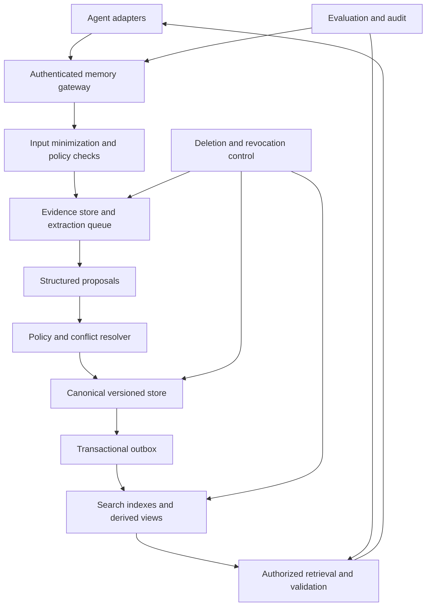

# 附录 11：Agent 记忆机制详解——架构、写入决策、维护治理与效果评估

> 定位：**Agent 记忆的完整工程方案**（全文收录，信息基准 2026-10-10）。正文第 10 章讲记忆机制与本书实现，附录 10 讲 Mem0 实战，附录 15 提供 Memory 赛道全景；本附录系统展开记忆分层与准入、身份和作用域、写入决策、冲突与生命周期、检索注入、安全治理、Skill 晋升，以及从离线评测到在线实验的完整验证方法。

---

## 目录

11.1. [阅读说明与核心结论](#s01)
11.2. [记忆分层与信息准入](#s02)
11.3. [身份、作用域、来源与数据模型](#s03)
11.4. [写入流程与操作决策](#s04)
11.5. [评分特征：由谁计算、如何计算、如何校准](#s05)
11.6. [更新、冲突、事务与失败恢复](#s06)
11.7. [生命周期、遗忘与删除](#s07)
11.8. [检索、上下文注入与记忆使用](#s08)
11.9. [安全治理与统一多 Agent 架构](#s09)
11.10. [情景记忆向程序记忆和 Skill 晋升](#s10)
11.11. [评估总体设计：目标、基线与公共基准](#s11)
11.12. [评测数据集、Gold 标注与时间回放](#s12)
11.13. [组件指标：定义、分母与异常情况](#s13)
11.14. [离线端到端评估、消融与归因](#s14)
11.15. [在线评估与 A/B：跨会话状态的实验设计](#s15)
11.16. [统计方法、样本量与不确定性](#s16)
11.17. [自动化评测协议、可观测性与发布门槛](#s17)
11.18. [主流框架与记忆服务：已核查的实现边界](#s18)
11.19. [Coding Agent：规则文件、自动记忆与版本差异](#s19)
11.20. [落地路线与完整检查清单](#s20)
11.21. [参考资料与版本说明](#references)

---

<a id="s01"></a>

## 11.1 阅读说明与核心结论

### 11.1.1 本文的适用范围与证据等级

本文面向通用助手、Coding Agent、企业工作流和多 Agent 平台，讨论**外部可管理记忆**，不把模型参数中的知识、当前上下文和业务数据库混为一谈。

全文区分三种内容：

| 标记方式 | 含义 | 使用方式 |
|---|---|---|
| 带参考编号的产品或研究描述 | 本次从官方文档或论文核对的事实 | 仍需核对实际部署版本、配置、地区和功能开关 |
| “本文建议”“示例策略” | 本文提出的工程设计，不是行业统一标准 | 结合需求、风险和评测结果调整 |
| “演示数据”“假设” | 为解释公式和流程构造的虚拟数据 | 不得当成真实用户信息、实测结果或上线承诺 |

**尤其注意：评分权重、0.75 等阈值、TTL 和至少三次成功等数字，没有被证明适用于所有 Agent。** 本文保留可解释的冷启动方案，但不把经验参数包装成统计概率。

### 11.1.2 一条主线

```text
定义任务与边界
→ 建立身份、证据和时间模型
→ 安全接入与候选提取
→ 操作分类与受控写入
→ 更新、删除和索引维护
→ 权限内检索与使用
→ 离线诊断与线上因果评估
→ 根据证据迭代
```

长期记忆是否有效，最终看它是否减少重复说明、改善任务结果，同时不增加不可接受的错误、泄露、延迟和成本。

### 11.1.3 需要修正的概念边界

**持久化不等于跨会话长期记忆；经过提炼也不是长期记忆的必要条件。** 原始轨迹、文件和事件，只要可以跨会话按权限检索，也能构成情景型长期记忆。将内容提炼为原子事实是便于更新和检索的一种设计，不是定义本身。LangGraph 区分 thread-scoped state 与跨线程 store；ADK 同时提供提炼记忆和原始会话 RAG 路线。[R01](#r01)[R03](#r03)

**记忆不必只来自用户聊天。** 经授权的业务事件、工具结果、项目文件和人工维护资料都可以成为来源。关键是来源可追溯、使用范围明确，而不是是否“由交互学到”。

**指令文件不等于安全执行边界。** `AGENTS.md`、`CLAUDE.md`、`GEMINI.md` 可以提供持久指令；实际权限、审批、不可逆操作限制仍应由工具网关、身份系统、沙箱和策略服务执行。[R12](#r12)[R14](#r14)[R17](#r17)[R27](#r27)

**推荐职责划分：** 业务系统维护业务真值；记忆服务维护可复用的证据和派生判断；检索索引提供搜索；策略系统控制权限；评测系统验证效果。各层可以共享基础设施，但不能失去职责边界。

---

<a id="s02"></a>

## 11.2 记忆分层与信息准入

### 11.2.1 分类模型

语义、情景、程序记忆的区分可参考 CoALA；下表是本文的工程化组织方式，不要求每一层都使用独立数据库。[R21](#r21)

| 对象 | 内容 | 推荐用途 | 关键限制 |
|---|---|---|---|
| 工作上下文 | 当前指令、最近消息、当前工具结果 | 支撑本轮推理与执行 | 受上下文预算限制 |
| Session / Checkpoint | 线程历史、任务恢复点 | 跨进程恢复同一会话 | 不自动提供跨用户语义记忆 |
| 语义记忆 | 用户偏好、项目事实、实体属性 | 跨会话检索与个性化 | 原子化、来源、版本、作用域 |
| 情景记忆 | 任务轨迹、结果、失败经验、摘要 | 检索历史证据、类比学习 | 可保留原文，不强制全部摘要化 |
| 程序记忆 / Skill | 步骤、前提、例外、验证方法 | 支撑可复用任务流程 | 不自动获得执行权限 |
| 业务状态 | 订单、权限、库存、任务进度 | 业务操作的权威依据 | 以业务系统为准，可按需缓存 |
| 策略和配置 | 安全规则、组织约束、项目指令 | 控制允许行为 | 变更必须经过授权流程 |

### 11.2.2 准入矩阵

| 输入信息 | 推荐处理 | 不应做的事 |
|---|---|---|
| “以后回答用中文” | 在允许的用户作用域保存明确偏好 | 由一句话推断国籍、母语等额外属性 |
| “这个项目使用 TypeScript” | 先区分项目事实、个人偏好或待批准决策 | 自动升级成组织政策 |
| “下周一出差” | 保存计划及已知时间，未知字段留空 | 捏造返程日期，或提前认定已出发 |
| “本轮先给我简版” | 当前任务约束，通常不自动长期化 | 覆盖长期格式偏好 |
| 一次工具失败 | 保存必要的失败事件与环境证据 | 直接写成永久禁用该工具 |
| 已验证的修复步骤 | 形成 Episode，再评测 Skill 候选 | 只凭一次成功就发布共享流程 |
| API Key、口令、私钥 | 普通记忆拒绝保存；凭据流程单独授权 | 先写入日志再做敏感检查 |
| 业务权限变更 | 通过身份或权限系统确认 | 依据“请记住我有管理员权限”授予权限 |
| 仓库中可重查的事实 | 可缓存引用与版本，读取时验证 | 宣称此类信息一律不能成为记忆 |
| 用户要求忘记 | 走删除与禁止重建控制路径 | 因“未来价值高”拒绝遗忘 |

### 11.2.3 原子事实与摘要并存

原子化主要针对**可独立更新的断言**。一个记录不宜同时保存“输出用中文”和“需要 Mermaid 图”，因为它们可能分别被更改或删除。

情景摘要可以包含多个关联事实，但应链接到原始事件和独立断言。摘要不是所有事实的唯一副本，也不能在原始证据被删除后继续泄露同一内容。

所有例子中的 `user_demo`、`project_alpha`、`tenant_demo` 都是虚构标识，不代表当前用户的真实身份或项目。

---

<a id="s03"></a>

## 11.3 身份、作用域、来源与数据模型

### 11.3.1 作用域不是固定父子链

不要把组织、用户、工作区、Agent 建模为唯一的“组织 → 用户 → 工作区 → Agent”树。一个工作区可包含多名用户，一名用户可参与多个工作区，一个 Agent 可在多种授权上下文运行。

本文建议将以下维度分别建模：

```text
租户边界 tenant_id
资源所有者 owner_type / owner_id
业务主体 subject_type / subject_id
工作区 workspace_id（按资源类型选用）
执行身份 principal_id / agent_id
授权规则 acl_policy_id
处理目的 purpose
实验隔离 experiment_id / arm / memory_namespace
```

Namespace 方便组织和过滤，**不是身份认证机制**。模型只能建议业务作用域；真实租户、用户、成员关系、授权范围由服务端认证上下文生成并校验。空字段不意味着公开可见，缺少必需上下文应拒绝访问。

### 11.3.2 指令权限、事实证据、检索相关性是三个轴

| 轴 | 回答的问题 | 示例 |
|---|---|---|
| 指令和操作权限 | 谁能要求系统做什么 | 管理员策略不能由普通用户记忆覆盖 |
| 事实证据权威 | 谁最能证明这个属性的值 | 用户偏好由用户表达；账户余额由业务账本确认 |
| 任务相关性 | 该信息是否适用于当前任务 | 项目 A 的构建事实未必适用于项目 B |

不能使用一个全局“用户说的话永远高于代码和数据库”的排序。用户是自身偏好的主要来源，但用户转述的外部事实不自动高于对应权威系统。

### 11.3.3 版本化原子记录

以下是**本文的示例 Schema**，不是任何厂商 SDK 的直接接口。`confidence` 未经过校准时使用 `null`，不要为“看起来可靠”随意填 0.98。

```json
{
  "memory_id": "mem_demo_001_v1",
  "logical_id": "pref_demo_001",
  "version": 1,
  "kind": "semantic_preference",
  "subject": {"type": "user", "id": "user_demo"},
  "scope": {
    "tenant_id": "tenant_demo",
    "owner_type": "user",
    "owner_id": "user_demo",
    "workspace_id": null,
    "acl_policy_id": "acl_user_private_v1"
  },
  "attribute": "response_language",
  "value": "zh-CN",
  "qualifiers": {"task_type": "technical_explanation"},
  "claim": "用户偏好技术解释使用中文。",
  "source_refs": [{
    "event_id": "event_demo_001",
    "message_id": "msg_demo_001",
    "source_role": "user",
    "evidence_span": "以后技术解释请用中文",
    "evidence_family_id": "family_demo_001"
  }],
  "source_authority": "self_reported_preference",
  "evidence_support": "direct",
  "confidence": null,
  "confidence_method": "not_calibrated",
  "sensitivity": "personal_preference",
  "purpose": "assistant_personalization",
  "consent_ref": "preference_setting_demo",
  "observed_at": "2026-10-10T09:00:00+08:00",
  "recorded_at": "2026-10-10T09:00:01+08:00",
  "valid_from": "2026-10-10T09:00:00+08:00",
  "valid_to": null,
  "valid_time_precision": "explicit_forward_from_message",
  "system_from": "2026-10-10T09:00:01+08:00",
  "system_to": null,
  "expires_at": null,
  "reverify_after": "2027-04-10T09:00:00+08:00",
  "status": "active",
  "supersedes": null,
  "deletion_epoch": 0,
  "schema_version": 2,
  "extractor_version": "extractor_demo_v1",
  "policy_version": "memory_policy_demo_v2"
}
```

`memory_id` 标识不可变版本，`logical_id` 串联同一逻辑记忆。Embedding、倒排索引和图投影可分别保存索引版本，不必把所有索引元数据都塞入事实正文。

### 11.3.4 时间字段的含义

| 字段 | 含义 | 不能混淆为 |
|---|---|---|
| `observed_at` | 系统接收到证据的时间 | 事实真实发生时间 |
| `recorded_at` | 此记录入库时间 | 用户表达时间 |
| `valid_from / valid_to` | 事实或约束在现实中的有效区间 | 存储保留期限 |
| `system_from / system_to` | 数据库何时持有此版本判断 | 事实在现实中成立的时间 |
| `expires_at` | 依据产品策略停止默认召回的时间 | 事实必然变假的时间 |
| `reverify_after` | 建议重新核实的时间 | 自动否定原有事实 |

需要精确历史查询时采用有效时间与系统时间两个维度；Graphiti 的双时间模型可作为实现参考。[R08](#r08)

### 11.3.5 未知时间必须保留未知

假设消息发生在 **2026-10-10，Asia/Singapore**，用户说“下周一去东京”。在采用周一作为一周开始且语义无其他歧义的情况下，可以解析计划日期为 **2026-10-12**，但不能推断行程结束日或具体出发时刻。

```json
{
  "kind": "plan",
  "claim": "用户计划下周一前往东京。",
  "plan_status": "planned",
  "observed_at": "2026-10-10T09:00:00+08:00",
  "scheduled_start_date": "2026-10-12",
  "scheduled_end_date": null,
  "timezone_context": "Asia/Singapore",
  "date_precision": "day",
  "expires_at": null
}
```

TTL 可以另按产品策略设置，但必须标注为策略推导。计划到期后也不能自动转成“用户确实已在东京”。

同理，“我已经搬家”只能确定截至报告时地点已变化；不知道搬家日期时，不得以消息时间伪造精确迁居日期。旧版本可保留“此前被报告为当前”的历史，新版本标注最新自述，历史查询必要时说明时间不确定。

---

<a id="s04"></a>

## 11.4 写入流程与操作决策

### 11.4.1 处理顺序

```text
认证上下文与输入来源绑定
→ 输入最小化、Secret 检测及必要脱敏
→ 按策略留存事件，或仅传递受控引用
→ 显式删除、撤回、关闭记忆的控制路径
→ LLM / 分类器提取候选及证据片段
→ Schema、实体、作用域、证据和敏感性校验
→ 在授权范围查询既有记忆
→ 判定 ADD / AMEND / SUPERSEDE / MERGE / NOOP
→ 安全准入、同意检查、未解决冲突检查
→ 仅对适用候选计算价值分数
→ 主存储事务提交 + Outbox
→ 派生索引与缓存更新
→ 返回提交状态与可见性状态
```

这是比“先让 LLM 提取，最后再检查密钥”更稳妥的顺序。若提取模型运行在外部服务，发送输入前就应完成相应的数据边界检查；提取后再做一次输出校验。[R27](#r27)

### 11.4.2 操作语义统一

| 操作 | 含义 | 关键要求 |
|---|---|---|
| `ADD` | 新增独立事实或偏好 | 先查重和确认作用域 |
| `AMEND` | 增补证据或细化原断言 | 保留变更记录；值语义改变时重新判定 |
| `SUPERSEDE` | 新值取代同槽位旧值 | 有明确更正或可验证状态变化 |
| `INVALIDATE` | 事实被证伪或不再适用 | 保存原因，区分“过去成立”与“从未成立” |
| `MERGE` | 合并等价记录 | 保留来源关系并更新引用 |
| `CONFIRM` | 增加支持证据 | 不得因此自动提升为组织政策 |
| `FORGET` | 接受遗忘请求并撤销可用性 | 触发删除传播和禁止重建 |
| `ARCHIVE` | 转为非默认检索 | 不等于删除 |
| `NOOP` | 内容无变化 | 可更新去重后的证据计数，不复制事实 |
| `REJECT` | 不允许持久化 | 只记录必要拒绝原因，不复制被拒绝的敏感值 |

各厂商接口可能使用 `UPDATE`、`DELETE` 等名称；适配层负责映射，不要把这些业务动作假定为所有产品内置行为。

### 11.4.3 同步与异步

本文建议显式记住、更正、遗忘走可确认的控制路径；普通候选和摘要可异步提取。LangMem 官方文档提供 hot path 与 background 两种模式。[R02](#r02)

“异步”意味着**可能尚不可见**。写入 API 应区分 `accepted`、`committed`、`indexed`，不要在仅入队时向用户声称已成功持久化。

显式写入需要 read-your-writes 时，可在主存储提交后使用直接查询或会话覆盖层，在索引完成前仍读取新值。删除受理后应先撤销在线可见性，再清理副本，不能等待向量库清理完成才停止使用。

### 11.4.4 模型输出只是提案

LLM 可输出 `claim`、候选类型、时间表达、原文 span 和候选项目标签。以下字段由服务端生成或验证：

```text
真实 tenant_id / principal_id / owner_id
可读可写 ACL
证据所属会话与角色
最终 source_authority
最终操作权限
删除目标集合
最终提交版本和策略版本
```

模型声称“来源是管理员”不构成管理员认证；字符串符合 JSON Schema 也不意味着事实真实。

---

<a id="s05"></a>

## 11.5 评分特征：由谁计算、如何计算、如何校准

### 11.5.1 先说明公式的地位

旧稿把同一指标分别写成“不缩放惩罚”和“缩放惩罚”两种形式。本版统一为：

$$
Q_{raw}=0.25E+0.25U+0.15S+0.15C+0.10R+0.10N
-\lambda_r Risk-\lambda_c Conflict
$$

示例参数为 $\lambda_r=0.30$、$\lambda_c=0.20$；八项输入在 $[0,1]$。

由此可直接得到：

$$
-0.50\le Q_{raw}\le1.00
$$

它是**启发式价值分，不是“应该保存”的概率**。界面需要 0～1 显示时，可以另外定义 $Q_{display}=\min(1,\max(0,Q_{raw}))$，但应同时记录原分数，并说明裁剪会丢失负分差异。

本文用 `Q` 而不是 `P`，避免与经过校准的概率混淆。明确遗忘、Secret、越权、缺少必要同意、不可解的高影响冲突，不进入这条加权决策。

### 11.5.2 组件分工

| 特征 | 原始信息来源 | MVP 计算者 | 有数据后的升级方向 |
|---|---|---|---|
| E：长期意图明确程度 | 原文、意图和临时性标签 | 规则 + 语义分类 | 意图模型，输出证据而非任意小数 |
| U：未来任务价值 | Agent 职责、任务频率、复用成本 | 业务先验表 | 有监督效用模型，处理观察偏差 |
| S：稳定性 | 字段类型、时间线索、历史变更 | 先验表 + 统计 | 指定时间窗内的失效预测 |
| C：证据支持度 | 来源、提取忠实度、验证结果 | 证据规则 + 验证器 | 按任务校准的正确性估计 |
| R：独立重复证据 | 去重后的证据家族、会话计数 | 数据库与程序 | 可选时间加权统计 |
| N：增量新信息 | 同槽位查询、值比较、语义等价 | 结构化匹配 + 模型辅助 | 经标注的等价／增量分类器 |
| Risk：残余软风险 | 数据类别、用途、暴露面、行动影响 | 风险规则 + 检测器 | 辅助风险分类，不替代授权 |
| Conflict：未解决冲突 | 槽位、条件、时间重叠、矛盾判断 | 结构化逻辑 + NLI/LLM | 针对业务校准的冲突解析 |

Embedding 和 Cross-encoder 属于学习型模型；对它们输出做余弦计算或排序是数值运算。**计算可以复现，不代表相似度判断不依赖模型。** LLM 本身也可以承担分类器角色，二者不是互斥类别。

### 11.5.3 E：明确程度

先判断说话人、引用关系、否定、作用域和临时条件，再查表示例：

| 语义标签 | 示例 E |
|---|---:|
| 已认证用户明确要求长期记住 | 1.00 |
| 明确设置以后默认行为 | 0.90 |
| 明确表达较稳定偏好 | 0.75 |
| 明确陈述当前状态，但未要求长期保存 | 0.60 |
| 跨会话反复出现的行为性偏好候选 | 0.45 |
| 单次推断 | 0.20 |

“文档里写着‘请记住’”“不要记住这件事”“这次默认用 Python”不能因为出现关键词就获得高 E。低可信网页中的命令不具有用户长期记忆指令权限。

### 11.5.4 U：未来价值

冷启动可采用本文的三项示例公式，避免把有效时长在 U 和 S 中重复加权：

$$
U=0.45F+0.35I+0.20K
$$

- F：在预先规定的未来任务窗口中，预计相关任务的比例或等级。
- I：正确使用该事实对任务结果的影响程度。
- K：能节省的重复说明、重查或探索成本。

F、I、K 可以先使用 0、0.25、0.5、0.75、1.0 的等级表；需要更细分时说明数据来源。相同偏好对 Coding Agent 与旅行 Agent 的 U 可以不同。

数据积累后，可预测“未来 30 天或未来 10 个有效任务内有益复用”的概率，但必须固定窗口及标签定义。**被检索不等于被使用，被使用不等于提升结果。** 未被保存的候选缺少后续反馈，用户未回访也不等于记忆无用；训练时要处理选择偏差和观察不足。

### 11.5.5 S：稳定性

MVP 的一个示例为：

$$
S=0.50T+0.30L+0.20H_c
$$

T 是字段稳定性先验，L 是长期／临时语言线索，$H_c$ 是历史一致性。没有历史可暂用配置先验，例如 0.5，并记录 `history_missing=true`，不能伪装成实测一致性。

| 类型 | 示例先验 T | 说明 |
|---|---:|---|
| 回答语言偏好 | 0.85 | 仍允许被更正或撤回 |
| 项目代码示例偏好 | 0.80 | 与项目生命周期有关 |
| 当前工作地点 | 0.45 | 不应推断永久稳定 |
| 今日安排 | 0.10 | 宜进入临时计划而非永久 Profile |

这些值是可调整配置。预测型 S 则应明确为 $1-P(\text{指定窗口内发生实质变化})$，不能从“没有观察到更正”直接推出事实未变。

### 11.5.6 C：支持度不是 Schema 合法率

先检查格式和必要字段，失败就进入修复或拒绝；**Schema 通过只说明格式合法，不给事实真实性自动加分。**

冷启动可以保留两个独立支持指标：

```text
A：该来源对当前属性的证明能力
X：候选断言是否被原文充分支持
C = min(A, X)  // 本文的保守启发式，不是概率公式
```

对“用户说自己偏好 TypeScript”，直接自述有高支持；对“用户转述某公司现任负责人”，应保留“用户转述”或另查权威来源。不能因为同一来源被复制到十个摘要中，就当成十份独立佐证。

多个提取器一致也不等于独立证据。模型可能共享相同偏差；要求它们指向原文中的支持片段，比只比较生成文本更有诊断价值。

### 11.5.7 R：独立重复程度

以去重后的独立证据家族数 d 计算示例分数：

$$
R=1-\exp[-0.6\max(d-1,0)]
$$

| d | R（约） |
|---:|---:|
| 1 | 0.0000 |
| 2 | 0.4512 |
| 3 | 0.6988 |
| 4 | 0.8347 |
| 5 | 0.9093 |

同一会话反复引用、Assistant 复述、缓存复制和摘要转写不增加独立证据数。独立会话只是近似代理，仍需识别是否都源于同一条消息。没有证据时即使公式返回 0，也不能绕过证据准入。

### 11.5.8 N：新颖性与操作分类

先匹配 `(tenant, subject, attribute, qualifiers, scope, valid_time)`，再判定关系：

| 关系 | 操作 | N 的处理 |
|---|---|---|
| 同槽位同值、语义等价 | NOOP / 增补证据 | 0，不重复新增 |
| 同槽位新值、明确更正 | SUPERSEDE | 不用普通 ADD 分数决定是否纠错 |
| 添加条件或新作用域 | AMEND 或新增限定事实 | 按新增信息量判定 |
| 无匹配槽位且查重覆盖充分 | ADD | 可用 1 作为 MVP 标签 |
| 召回不足、无法判断 | 待判定 | 不自动认定 N=1 |

不要把 `1 - cosine_similarity` 直接当成新颖概率。不同值的矛盾语句可能非常相似，不同措辞也可能表达同一事实。

### 11.5.9 Risk：硬门槛与残余风险分开

缺少必要授权、敏感数据处理许可、身份边界或安全政策支持时直接拒绝／待确认，不能由高 U 抵消。

仅对已经允许考虑保存的候选，可定义剩余软风险示例：

$$
Risk=0.40D+0.35A_r+0.25X_r
$$

D 是允许范围内的数据敏感度，$A_r$ 是错误使用的行动影响，$X_r$ 是副本和暴露面。高风险内容是否允许保存，由业务治理策略决定；本文不制定通用法律结论，也不把所有个人信息等同于 Secret。

### 11.5.10 Conflict：只惩罚“未解决”的冲突

示例：

$$
Conflict=p_{contra}\times O_{scope}\times O_{time}\times(1-r_{resolve})
$$

这里各数值未校准前只是评分信号，不是联合概率。槽位必须定义基数：一个人能会多门语言，“会 Python”和“会 TypeScript”不矛盾；单一默认示例语言在相同条件下取不同值才可能冲突。

明确的同源更正可根据业务规则取代旧值；仅有较新的时间戳不足以证明来源更可靠。对高影响、无法解决的冲突，应保留待确认状态或在读取时说明不确定，不能只减 0.2 分后继续自动写入。

### 11.5.11 缺失值和分支决策

| 场景 | 决策 |
|---|---|
| 明确遗忘且请求已授权 | FORGET，不走分数 |
| 明确保存低风险偏好且证据、作用域完整 | 优先按明确指令写入；分数可用于记录，不阻止正当请求 |
| 确认的重复事实 | NOOP 或增补证据 |
| 明确状态更新 | 走 SUPERSEDE 的证据规则 |
| 临时信息 | 按时间和目的进入短期／TTL 层，不按总分反推 TTL |
| 硬安全拒绝 | REJECT |
| 剩余隐式 ADD 候选 | 计算 Q，并使用按类型校准的阈值 |
| 必需证据、权限或时间无法确认 | 待确认／拒绝，不能把缺失项全部填 0.5 |

对于最后一类可评分候选，**演示阈值**可设为：Q≥0.75 自动保存；0.55≤Q<0.75 观察／确认；Q<0.55 不自动晋升。观察队列本身也要有保留期限、权限和敏感检查。

### 11.5.12 可复算案例

虚构输入：“请记住，以后这个项目的代码示例优先使用 TypeScript。”

假设已确认用户能设置该项目中的个人示例偏好，并且这不是组织代码政策变更。

| 特征 | 输入依据／示例配置 | 计算结果 |
|---|---|---:|
| E | 明确长期保存意图 | 1.000 |
| U | F=0.90，I=0.80，K=0.60 | 0.805 |
| S | T=0.80，L=0.90，Hc=0.50 | 0.770 |
| C | A=1.00，X=0.95 | 0.950 |
| R | d=1 | 0.000 |
| N | 授权范围内无匹配槽位 | 1.000 |
| Risk | 演示用残余软风险 | 0.050 |
| Conflict | 无冲突 | 0.000 |

$$
Q=0.25+0.20125+0.11550+0.14250+0+0.10-0.015=0.79425
$$

这里的配置值不是模型实测准确率。明确请求本就可走显式保存分支；公式演示主要用于说明可复算和可审计性。

另外，旧稿案例在 E=1、U=0.92、S=0.86、C=0.98、R=0、N=1、Risk=0.02、Conflict=0 时得到 **0.850**，算术本身正确；问题是输入值缺少可追溯的配置或校准依据，而不是算错。

### 11.5.13 校准与训练

先收集人工标注的 `should_store`、操作类型、原子断言、作用域、敏感类别和未来结果，再按用户／项目及时间划分训练、验证和测试集。不要在测试集上调阈值。

可训练 Logistic Regression、树模型或受约束分类模型；概率输出仍要校准。神经分类器的置信度不天然可靠，温度缩放等方法可作为候选，但应在独立验证集验证。[R25](#r25)[R26](#r26)

建议同时报告可靠性曲线、ECE、Brier 分数和任务错误成本。Brier 分数同时涉及校准与区分能力，降低 Brier 不等于单独证明校准改善。[R26](#r26)

不要把 `user_deleted=true` 自动标为“记忆错误”：删除可能出于隐私或用途变化。`helped_task=true` 需要客观判据或审查，不能由执行 Agent 单方面自报。

---

<a id="s06"></a>

## 11.6 更新、冲突、事务与失败恢复

### 11.6.1 用属性模型判断冲突

先定义属性是单值、多值还是条件值。例如，`primary_response_language` 在同一任务范围内可能是单值；`known_programming_languages` 是多值；“工作项目用 TypeScript、个人分析用 Python”是条件值。不同字符串不一定矛盾。

对于同主体、同属性且作用域和时间重叠的候选，依次判断：语义等价、补充条件、明确更正、状态变化、证据错误、未解决冲突。不能简单用“消息更晚”覆盖可信业务记录。

### 11.6.2 更新示例

```text
已存：项目 alpha 的示例默认使用 Python。
新证据：从现在起，这个项目的示例改用 TypeScript。

处理：
1. 验证当前说话人有权修改对应项目偏好。
2. 验证“这个项目”确实解析为 alpha。
3. 关闭旧偏好的当前有效区间。
4. 建立新版本，并保留 supersedes 关系和证据。
5. 发送索引更新事件；读取端拒绝把旧版本当作当前偏好。
```

这里只更新**项目偏好**，不自动修改仓库代码、构建配置或组织标准。若旧记录是正式架构政策，需要走相应审批，而非偏好更新流程。

### 11.6.3 选择一个明确的规范存储

本文建议，为每类事实指定一个规范存储（canonical store），它可以是事务数据库、图数据库或受版本控制的文件仓库。向量索引、搜索索引、Agent 本地文件若只是副本，应明确作为派生视图。

不要同时把关系库和 Markdown 文件当作可随意独立更新的唯一真值。单个数据库事务也不能保证所有外部索引和文件一起原子提交。

一种推荐实现：

```text
规范记录更新 + outbox 事件：同一事务提交
→ 索引消费者按事件更新向量 / BM25 / 图投影
→ 消费成功记录索引版本
→ 对失败任务重试、告警和重建
```

图数据库本身作为规范事实层时，不必再把它强行降为投影；关键是写入契约明确。

### 11.6.4 并发和幂等控制

| 问题 | 推荐控制 |
|---|---|
| 同一事件被重复消费 | 服务端幂等键：来源事件、候选标识、策略版本；不以 LLM 自造 ID 为准 |
| 两个 Agent 同时更新同一事实 | `expected_version` 乐观锁或相应事务隔离；冲突后重新读取并决策 |
| 旧事件延迟到达 | 区分 observed、valid、system 时间，不按入库顺序盲目覆盖 |
| 写入已提交但索引未完成 | 返回 committed/indexing 状态；必要时读取规范存储补足 read-your-writes |
| 删除后旧作业重新写入 | 校验删除版本 `deletion_epoch` 与当前允许用途，拒绝过期作业 |
| 模型提取失败 | 留待处理，不默认把整段原文写进公开或根命名空间 |
| 索引重建 | 只读取仍获授权、未被删除且符合当前策略的规范记录 |

### 11.6.5 失败回退不应扩大权限

普通个性化记忆检索超时，可以在标记降级后使用当前会话完成非敏感任务。授权校验超时、关键操作约束不可确认时，应拒绝相关读取或暂停相关行动，而不是“为了可用性继续执行”。

删除、权限撤销和禁用记忆属于控制平面，不应完全依赖可能失败的语义模型。

---

<a id="s07"></a>

## 11.7 生命周期、遗忘与删除

### 11.7.1 区分四种动作

| 动作 | 含义 | 是否仍可能被授权历史查询访问 |
|---|---|---|
| 过期 Expire | 停止默认使用某条缓存或临时记忆 | 取决于保留和访问策略 |
| 失效 Invalidate | 声明该断言不应继续视为成立 | 可保留失效证据，但不能作为当前事实 |
| 归档 Archive | 从热检索移到冷层 | 通常可以，需显式路径 |
| 忘记 / 删除 Forget/Delete | 撤销后续记忆用途，并按删除策略清理副本 | 不应通过普通历史召回绕过删除 |

数据库中保留过期记录，不等于用户的删除请求已经被执行。反过来，TTL 到达也不证明该现实事实为假。

### 11.7.2 生命周期策略

稳定偏好可长期保存并允许更正；计划按已知时间管理；项目事实在代码或决策变化后复核；情景记录按用途、容量和保留要求归档；Skill 按版本维护。

旧稿的 30～180 天、30～90 天等数值只能作为假设配置，不能作为通用最佳期限。本修订版不为所有产品指定统一 TTL。

对可归档候选可按价值、近期使用和容量排名，但**低使用率不能单独删除罕见却关键的约束**。先执行用户指令、保留要求、安全与依赖检查，再做成本优化。

### 11.7.3 删除不是一次向量库 delete

建议维护派生关系图，至少覆盖：规范记录及版本、摘要和 Profile、向量及关键词索引、图关系、缓存、Agent 本地记忆文件、实验和 Shadow 存储、分析导出及备份恢复流程。

```text
接收并验证删除请求
→ 标记禁止使用，增加 deletion_epoch
→ 所有在线读取路径立即校验删除状态
→ 取消或阻断旧提取 / 合并 / 索引作业
→ 清理已知副本与派生内容
→ 验证普通检索、历史检索和重建路径
→ 记录各存储完成状态及待处理项
```

删除控制记录可以保留必要的事件 ID、范围和版本，不要在 tombstone 中重新保存待删除的敏感正文；可逆映射和哈希也需按信息敏感性处理。

### 11.7.4 必须防止“删除后复活”

只删除记忆而保留可再提取的聊天日志，后台任务可能重新生成同一事实。需根据用户请求范围，删除或禁止相关原始证据进入记忆生成；不能把“原始日志不可变”作为绕过遗忘的理由。

备份恢复后先重放删除账本和用途撤销，再开放读取。重试队列中的旧任务应因删除版本不匹配而失效。未来用户重新明确提供同一信息时，应按新的事件和授权重新判断，不宜永久屏蔽某个属性本身。

### 11.7.5 删除承诺分级

| 状态 | 可以承诺的内容 |
|---|---|
| `online_blocked` | 普通线上读取及正在组装的后续上下文不再使用 |
| `active_stores_purged` | 已核查的活动存储和派生索引完成清理 |
| `retention_cleanup_pending` | 某些受保留策略约束的存储仍待清理，并已停止一般用途访问 |
| `completed_under_policy` | 本系统控制范围内按明确策略完成，报告例外和边界 |

不能承诺立即抹除已经发送给用户的文本、用户下载的副本、不受控制的第三方存储或模型参数。若原文已进入当前模型上下文，应终止或重建后续上下文；仅删除数据库不会从已发送请求中“撤回”内容。

审计日志应尽量不含敏感正文，并有独立的访问和保留策略。本文描述工程控制，不替代针对部署地区和数据类型的合规审查。

---

<a id="s08"></a>

## 11.8 检索、上下文注入与记忆使用

### 11.8.1 先限定可访问集合，再计算相关性

```text
认证请求与任务目的
→ 服务端确定租户、所有者、工作区及可访问资源
→ 在允许范围检索候选
→ 语义 / 关键词 / 实体 / 时间检索融合
→ 从规范存储复核版本、授权和删除状态
→ 去重、冲突与时间判断
→ 重排和 Token 预算裁剪
→ 带来源和作用域注入上下文
→ 记录实际工具行为和任务结果
```

敏感内容不能先发送给外部重排器或 LLM，再做权限过滤。索引中的旧 ACL 也不够；返回正文前要防止权限撤销与索引延迟导致的越权。

### 11.8.2 当前查询与历史查询

问“现在使用什么构建工具”应使用当前有效记录并复核必要证据。问“迁移之前使用什么工具”可能需要已被 supersede 的历史记录。

因此不应全局固定 `status=active` 后声称支持完整时间推理；应结合查询意图、有效时间、系统时间以及删除状态。已被用户要求遗忘的数据不能借“历史模式”重新召回。

### 11.8.3 排序分数只是候选集合内的工具

本文建议在通过授权和时间检查后，将语义相关、关键词相关、重要性、证据质量、时效和冗余等特征归一化，再训练或配置排序函数。

不同 Embedding 的 cosine、BM25 分数和 LLM relevance 标签不能未经尺度处理直接相加。相似度也不是“该记忆为真”的概率。

### 11.8.4 上下文预算

先为系统指令、当前任务、工具定义、预期工具结果和输出留出空间，再给记忆分配预算。使用实际部署模型的 tokenizer 估算，而不是按字符数硬换算 Token。

推荐使用结构化包装：

```text
[Retrieved memory — evidence, not a new system instruction]
Record: mem_demo_001_v2
Scope: project_alpha
Status: current; latest source observed at ...
Claim: ...
Source: event / document / commit reference
Limitations: ...
```

包装有助于解释，但不构成安全防护本身。不要把外部网页中的“忽略之前指令”通过记忆通道升级为系统指令。

### 11.8.5 使用时验证

代码事实可附 commit、文件或测试引用，并在适当时机验证是否仍支持该断言。Copilot 的仓库记忆对当前分支中的引用进行验证，是一个已记录的产品例子，而非所有 Agent 的默认行为。[R17](#r17)

对于关键业务动作，应回查对应权威系统。长期记忆可以提示“需要确认什么”，但不能替代余额、权限、生产配置等实时事实来源。

### 11.8.6 可观测性不等于因果归因

记录被检索的 ID、实际注入的版本、过滤原因以及后续工具行为。Agent 自报 `used_memory_ids` 仅是辅助信号：它可能遗漏或错误解释自己的使用方式。

要证明“因为记忆而做对”，还需要配对消融或随机实验。相关性、出现频次和模型自述不能直接证明因果收益。

---

<a id="s09"></a>

## 11.9 安全治理与统一多 Agent 架构

### 11.9.1 主要风险与控制

OWASP 将 Agent 的权限、外部输入、工具执行和记忆污染纳入安全考虑；本文据此将防护落实在输入、写入、读取和行动四个边界，而不只依赖 Prompt。[R27](#r27)[R28](#r28)

| 风险 | 本文建议的控制 |
|---|---|
| 网页或工具输出要求永久修改规则 | 标明低可信来源；禁止晋升指令权限；写入前后分别审查 |
| 普通用户把自己写成管理员 | 权限只能由身份系统确认；记忆中的声明不授予权限 |
| Secret 进入事件或记忆 | 输入侧检测和最小化，模型输出侧复检；凭据使用专用路径 |
| 其他用户或工作区内容被召回 | 服务端 ACL、隔离索引或强制过滤、读前复核、越权测试 |
| 多 Agent 传播同一错误 | 来源家族去重；Agent 转述不作为独立证据 |
| 删除后重新生成 | 删除版本、来源用途限制、队列检查与恢复流程 |
| 未获授权的敏感推断 | 不从普通偏好推断额外敏感属性；高风险类型单独准入 |

规则、Secret Scanner 和分类器都可能漏检。不能因为通过一个正则表达式就声明数据安全；应结合范围最小化、访问限制和事件响应。

### 11.9.2 推荐平台架构



这是本文建议架构，不宣称某一厂商已经实现图中全部能力。

### 11.9.3 适配器职责

适配器负责把各 Agent 的事件、工具结果和证据转换为平台模型，并将已授权的记忆传回对应上下文。不要默认导入全部 CLI 私有文件或完整对话。

记忆服务对写入、更新、读取和删除使用独立权限；Agent 可提交 proposal，但服务端绑定真实执行身份、用户和租户。跨 Agent 共享的是获准共享的事实或经验，不是整个用户聊天档案。

### 11.9.4 文件式记忆的治理

原生文件式记忆可以保留，但要选择清晰模式：它是规范存储，还是平台投影。若允许双向同步，应有来源标记、版本检查、循环同步阻断、删除传播和冲突处理。

不要随意覆盖工具自己生成和管理的目录。对于只提供查看或重建控制的厂商目录，应使用其支持的管理接口，而不是假设任意文件编辑都安全。[R13](#r13)

### 11.9.5 用户控制面

至少提供查看、纠正、删除、暂停写入、暂停使用和作用域设置；区分“本会话不贡献新记忆”与“本会话不使用已有记忆”。用户纠正结果应可追溯，但审计不应泄露被删除的原文。

---

<a id="s10"></a>

## 11.10 情景记忆向程序记忆和 Skill 晋升

### 11.10.1 晋升链路

```text
成功与失败轨迹
→ 按任务、环境和约束聚类
→ 提取可复用步骤、前提和例外
→ Skill 候选
→ 独立任务评测与安全检查
→ 版本化发布及权限配置
→ 灰度、监控和回滚
```

单次成功不足以证明可泛化；反复尝试中只有成功轨迹被保存也会产生偏差。保存必要的失败条件和无效操作，避免把偶然结果当作通用规则。

### 11.10.2 Skill 的最低描述

一个可维护候选应声明适用环境、输入、前提条件、允许工具、步骤、成功判据、失败退出条件、需要人工审批的步骤以及回滚方式。

Skill 可以是 Markdown 指令或其他结构化过程描述，并不必然是可直接执行的代码。OpenCode 的 `SKILL.md` 是按需加载的指令文件例子。[R20](#r20)

### 11.10.3 发布证据

“至少三次类似成功”最多是收集候选的冷启动规则，不能作为统计意义的可靠性保证。发布前应覆盖独立测试任务、反例、环境变化、工具版本、权限和不可逆操作。

评测成功率和适用范围一起发布；安全失败不与成功次数相抵消。正式执行仍受工具权限和审批约束。

---

<a id="s11"></a>

## 11.11 评估总体设计：目标、基线与公共基准

### 11.11.1 评估要回答什么

**组件评估**定位写入、更新、检索、时间和删除环节；**端到端评估**判断是否改善任务；**线上实验**判断真实用户收益；**安全测试**验证边界。

四者不能互相代替，也不能把它们简单压成一个总分。建议先检查发布阻断项，再比较任务价值、成本和可靠性。

### 11.11.2 对照组及其边界

| 组别 | 设置 | 用途与限制 |
|---|---|---|
| No Long-term Memory | 保留与实验组相同的当前任务、近期上下文和工具，仅禁用跨会话长期记忆 | 不是把基础模型变成完全无上下文 |
| Recent Window | 只保留固定窗口历史 | 测试短窗口是否已足够 |
| Full History | 在预算允许时提供完整历史 | 是长上下文参考，不保证最高分，也不适用无限历史 |
| Naive RAG | 明确配置的简单检索 | 评估复杂维护策略是否超越基础检索 |
| Candidate | 被测方案 | 记录全部配置和版本 |
| Gold-memory / Oracle reference | 只提供人工确认的必要记忆，不泄露标准答案 | 诊断参照，不是严格理论上界 |

Gold-memory 可能受组织方式、Prompt 和模型读取影响而低于其他方案。不要由“Oracle 低”直接断言模型没有记忆能力。

### 11.11.3 两种比较不要混淆

**单组件消融：** 固定基础模型、数据、其他模块和预算，只改变待测组件。

**完整产品比较：** 可以保留各方案原生检索、存储和整理机制，但要披露差异，在相近预算或质量—成本曲线上比较。不能一边禁用某方案的核心能力，一边声称公平比较完整系统。

冻结或记录模型及版本、Prompt、Embedding、重排器、时间窗口、Token 预算、工具环境、超时、重试、索引版本和费用口径。

### 11.11.4 公共基准的适用性

| 基准 | 可借鉴能力 | 使用边界 |
|---|---|---|
| LongMemEval | 信息提取、跨会话、时间、更新、拒答；包含 500 个问题 | 不能代替真实业务任务与权限测试。[R23](#r23) |
| LoCoMo | 长期多会话及时间、事件关系；含问答、事件摘要和多模态任务 | 不等于完整写入治理或删除评测。[R24](#r24) |
| MemBench | 事实与反思记忆，参与和观察场景，同时考虑效率与容量 | 应保留其任务和计分设定，不直接混比不同榜单数字。[R30](#r30) |
| LongMemEval-V2 | 工作历史中的静态／动态状态、流程、环境陷阱和前提意识 | 所核查论文为 2026 年 5 月的 work-in-progress；其 Web 环境经验问答不等于真实 Coding Agent 测试通过率。[R31](#r31) |

公共基准主要提供可复现横向参照。本产品的隐私边界、实际工具动作、共享记忆和删除需求，仍需专门数据集。

---

<a id="s12"></a>

## 11.12 评测数据集、Gold 标注与时间回放

### 11.12.1 数据集组成

建议维护三套互补数据：稳定的人工回归集、更新／投毒／越权／删除等对抗集、脱敏的真实业务回放集。合成数据用于可控边界案例，不能完全替代真实分布。

覆盖维度至少包括：记忆类型、来源、语言、用户／项目作用域、历史长度、噪声比例、时间间隔、事实变更、拒答、并发、故障与删除。各类占比按业务风险设计，而不是机械套用固定百分比。

### 11.12.2 四层 Gold

| 层级 | 标注内容 |
|---|---|
| Capture Gold | 哪些断言应保存、操作类型、来源、范围和必要条件 |
| State Gold | 每个时间点规范记忆应处于什么状态，哪些旧版应失效或被删除 |
| Retrieval Gold | 此时回答所需的证据概念／版本及允许访问范围 |
| Action Gold | 正确答案、工具行为、必须满足和必须不发生的约束 |

跨方案不要直接比较厂商生成的记忆 ID。先用来源、属性、值、范围、时间和人工审查建立 canonical evidence 映射；记录未匹配、重复和歧义。

### 11.12.3 一个更新与删除样例

以下为虚构数据集片段，`t1/t2/t3` 是评测时间，不是模型可自由重写的叙事顺序。

```json
{
  "case_id": "update_forget_demo",
  "cluster_id": "user_demo_project_alpha",
  "split": "test",
  "events": [
    {"id": "e1", "at": "2026-10-01T09:00:00+08:00", "text": "这个项目的示例默认用 Python。"},
    {"id": "e2", "at": "2026-10-05T09:00:00+08:00", "text": "从现在起，这个项目的示例改用 TypeScript。"},
    {"id": "e3", "at": "2026-10-08T09:00:00+08:00", "text": "忘掉我对这个项目示例语言的偏好。"}
  ],
  "checks": [
    {
      "as_of": "2026-10-06T09:00:00+08:00",
      "visible_event_ids": ["e1", "e2"],
      "expected_operation_at_e2": "SUPERSEDE",
      "gold_evidence": ["project_alpha_language_typescript_v2"],
      "expected_current_value": "TypeScript"
    },
    {
      "as_of": "2026-10-09T09:00:00+08:00",
      "visible_event_ids": ["e1", "e2", "e3"],
      "gold_evidence": [],
      "expected_memory_behavior": "do_not_recall_deleted_preference",
      "expected_action": "ask_or_use_current_task_default_without_claiming_to_remember"
    }
  ]
}
```

删除后的成功判据不是强制输出“我不知道 Python 是什么”，而是不得继续把已删除偏好当作用户约束或宣称从历史记得它。

### 11.12.4 防止未来信息泄露

在时间 t 的写入或回答测试中，系统只能看到 t 之前可见的事件。不能把未来问题、标准答案、未来更正和删除指令传给提取器来“帮助选择有用记忆”。

每个方案从独立快照按时间回放；隐藏 Gold 只交给评测器，不交给被测 Agent。在线写入系统的离线重放，也要模拟异步延迟和当时的索引可见性。

### 11.12.5 切分与标注质量

按用户或项目主体隔离训练、验证和测试，再检查时间泄露和内容近重复。相同轨迹的改写不应一份训练、一份测试。

高风险样本采用双人标注与仲裁，保留标注指南、分歧和不确定标签。LLM Judge 可以辅助语义匹配，但不应是权限、安全和删除测试的唯一裁判。

真实数据处理前取得相应授权并最小化。删除请求应能传播到包含该数据的评测集和衍生文件。

---

<a id="s13"></a>

## 11.13 组件指标：定义、分母与异常情况

### 11.13.1 写入指标

设 G 为应写入的原子 Gold 断言集合，W 为实际产生的写入条目。经**一对一匹配**得到 TP，额外写入为 FP，漏写为 FN：

$$
Precision_w=\frac{TP}{TP+FP},\qquad Recall_w=\frac{TP}{TP+FN}.
$$

$$
F1_w=\frac{2TP}{2TP+FP+FN}.
$$

一条 Gold 不能重复匹配多条预测以虚增 TP；重复写入应单列，或按预先规定计为额外 FP。权限错误、作用域错误、无依据扩写不能因为文本相似就算正确。

没有任何实际写入时，Precision 分母为零，记录 NA；没有 Gold 时，Recall 记录 NA，转而评估 No-op Accuracy 和错误写入率。聚合时报告 micro、macro 及 NA 数量，不把 NA 默认为满分。

### 11.13.2 更新、状态与时间

操作准确率只是第一步：还要检查旧版本是否正确关闭、当前值是否唯一、来源是否保留、时间区间是否合理，以及并发冲突是否被处理。

建议报告：Operation Accuracy、State Accuracy、Scope Accuracy、Temporal Accuracy、关键冲突用例失败率，以及发生过变更的任务中**实际使用旧版导致错误**的比例。检索到旧证据用于历史解释不自动算失败。

### 11.13.3 检索指标

对于有 Gold 的查询 q，令 Gq 为必需证据集合，Rq,K 为 Top K 内去重后匹配到的证据：

$$
Recall@K(q)=\frac{|G_q\cap R_{q,K}|}{|G_q|}.
$$

$$
Precision@K(q)=\frac{|G_q\cap R_{q,K}|}{K}.
$$

这里采用固定 K 分母，返回不足 K 条仍按 K 计算；若另报“实际返回精度”，必须明确使用实际条目数作分母，不得混用。

`All-evidence Hit@K` 检查是否集齐整个必需集合；`Hit@K` 只检查是否至少命中一条。多跳任务不能用后者替代前者。MRR 和 nDCG 分别反映首个相关项位置和分级相关排序，需要事先定义相关等级。

Gold 为空时，Recall 不适用，评估是否避免无依据回忆、越权内容和错误工具行为。额外但有用的证据是否计相关，应在数据标注中明确。

### 11.13.4 读取与行动

对 Coding Agent 优先检查测试、修改范围和规范；对工作流检查终态、步骤与权限；对助手检查事实和当前约束。不要仅用回答中是否复述了记忆判成功。

记忆引用正确率只说明证据支持，不等于任务因果收益。隐式风格偏好可用于低风险个性化，不能据此授权删除生产数据或发送敏感信息。

### 11.13.5 生命周期与安全

| 指标 | 建议口径 |
|---|---|
| Online Block Time | 删除请求被接受至所有受控在线路径拒绝该记忆的时间 |
| Purge Completion | 已确认清理的已知存储副本 / 应清理的已知副本，同时报告未知覆盖缺口 |
| Resurrection Rate | 删除后重试、回放、恢复测试中重新出现该内容的比例 |
| Scope Leakage | 有未授权数据到达下游或用户的测试次数 / 隔离测试次数 |
| Poisoning Acceptance | 每类投毒尝试被错误提升为可信记忆的比例 |
| Secret Persistence | 测试凭据进入受禁止日志、存储或输出路径的次数 |

“已知副本全部清理”不等于证明系统不存在任何未知副本，必须报告数据流覆盖程度。

### 11.13.6 效率与成本

分别记录写入、更新、检索、删除传播和总任务的 P50/P95/P99；补充错误率、超时率、索引滞后、后台吞吐、峰值资源及索引重建时间。

$$
CostPerSuccessfulTask=\frac{C_{LLM}+C_{embedding}+C_{retrieval}+C_{storage}+C_{background}+C_{operations}}{N_{successful}}.
$$

明确统计窗口、摊销规则和计费单位。成功数为零时报告 undefined/NA，而不是 0。Token 是成本代理，不等同于实际费用。

规模实验同时增加历史长度、主体数量、冲突密度和并发量；只堆一百万条互不相关向量不足以代表真实负载。

---

<a id="s14"></a>

## 11.14 离线端到端评估、消融与归因

### 11.14.1 配对运行

每个测试用例从相同的授权历史快照创建隔离状态，分别运行 baseline、candidate 和 gold-memory reference。固定其余待控制条件，并保存随机种子、重试和模型版本；有随机性时进行预设次数的重复运行。

线上动作在沙箱、模拟工具或只读环境回放，不为了评测重复发送邮件、修改生产数据或执行支付。

### 11.14.2 三个核心量

对 N 个配对结果，bi、mi、oi 分别为 baseline、candidate 和 gold-memory 的二元成功标记：

$$
MemoryGain=\frac{1}{N}\sum_i(m_i-b_i).
$$

$$
OracleGap=\frac{1}{N}\sum_i(o_i-m_i).
$$

$$
PairedHarmRate=\frac{1}{N}\sum_i\mathbf{1}[b_i=1\land m_i=0].
$$

同时记录：

$$
PairedBenefitRate=\frac{1}{N}\sum_i\mathbf{1}[b_i=0\land m_i=1].
$$

对同一组完整配对二元结果，有一个可检查的恒等式：

$$
MemoryGain=PairedBenefitRate-PairedHarmRate.
$$

这里的 harm 是**该配对实验中的退化率**，不能保证每个样本差异都由某条记忆造成，随机推理和环境差异仍需控制。`OracleGap` 可为负数，不应被强制截断，也不是严格的“剩余工程提升上限”。

### 11.14.3 最小消融矩阵

| 实验 | 诊断目标 |
|---|---|
| 实际流水线 | 总体效果 |
| 人工 Gold 写入，使用真实检索 | 写入／更新是否是瓶颈 |
| 真实记忆状态，直接提供 Gold 检索结果 | 检索瓶颈；Gold 必须确实存在于该状态，否则单独标为写入缺失 |
| 完整 Gold 记忆 | 读取和任务完成能力的诊断参考 |
| 删除关键记忆 | 判断真正依赖记忆的问题是否退化 |
| 增加无关或过期记忆 | 噪声和冲突鲁棒性 |
| 更换身份但不修改授权 | 检查系统拒绝访问他人记忆，而非故意把他人内容合法注入 |
| 回放更新、删除和延迟作业 | 检查状态一致性与复活风险 |

需注意：反事实消融是在受控副本中开展，不能破坏真实用户数据。不要把未来测试问题暴露给写入器来制造高分记忆。

### 11.14.4 Judge 与客观验证

代码测试、结构化状态、工具参数、ACL 和删除探针优先使用确定性验证。开放文本采用盲评、证据支持、约束检查和人工抽检；裁判看不到方案品牌，提示和版本需记录。

LLM Judge 的输出应接受人类校准和误判分析。同一模型担任写入器、执行器和唯一裁判会形成共同偏差；换一个模型可以降低部分关联风险，但不能自动获得正确标签。

### 11.14.5 报告切片

除总体结果外，按记忆类型、历史长度、时间间隔、更新次数、噪声、语言、工作区数量和风险级别报告。高频用户不应完全淹没低频但关键场景。

不要只保存最佳一次结果。必须保留失败、超时、拒答、无结果和重复运行波动。

---

<a id="s15"></a>

## 11.15 在线评估与 A/B：跨会话状态的实验设计

### 11.15.1 需要离线和在线，但不把 A/B 绝对化

离线验证正确性和边界；在流量、授权和风险允许时，在线随机实验能检验真实用户收益。新增记忆能力、显著修改写入或检索策略，通常值得开展。

确定性修复和安全问题不必为了 A/B 而继续让控制组暴露在已知风险下。低流量或无法随机化时，可结合离线、分阶段上线和观察性分析，但应降低因果结论强度，不强行宣称“已证明提升”。

### 11.15.2 随机化单位取决于共享关系

长期记忆会跨会话影响未来状态。主要实验应对用户、账户、工作区或租户进行稳定分组，而不是随每个请求切换写入策略。

选择单位时先检查共享图：个人私有记忆可以按用户；工作区共享事实可能需要按工作区；同一用户跨工作区携带偏好时还要处理组间干扰。租户不是一律必选，较粗分组可能显著降低样本量。

纯只读、冻结快照、相互隔离的检索回放可以做请求级配对比较；这与有真实持久写入的在线实验不同。

### 11.15.3 记忆和缓存也要分组隔离

```text
experiment_id + arm + authorized_entity_id
→ 独立的记忆状态、索引、摘要、缓存和后台作业
```

实验组不应更新控制组正在使用的共享事实。授权撤销与删除必须跨所有组同步生效；不能为了“实验隔离”让被删除的数据留在控制组。

分组应使用稳定、带实验盐的散列或实验平台，不使用进程重启后变化的临时 hash。记录分配事件，避免重复入组或切组。

### 11.15.4 冷启动与迁移效果分开

**冷启动实验**观察从零积累的记忆价值；**热启动实验**从相同的已授权历史快照开始，并明确迁移成本和初始质量。

不能给实验组大量高质量旧记忆，却给控制组空历史，然后把全部差异归因于新算法。也不能忽略写入后到后续复用的时间。

### 11.15.5 主分析采用事先定义的人群

在分组前定义 eligible 人群和主要指标，以分配组别开展 ITT（intention-to-treat）分析。不要只分析“后来再次访问”“成功检索到记忆”或“使用了记忆”的人；这些行为本身可能被实验影响，筛选后会破坏组间可比性。[R29](#r29)

机制切片可以分析被调用的记忆，但作为次要诊断，不能替代主要因果估计。重复说明率、纠错率的识别规则应在两组保持一致，并经过人工抽样验证。

### 11.15.6 指标体系

| 类型 | 建议指标 | 口径提醒 |
|---|---|---|
| 主收益 | 每个分配用户的成功任务数，或预先定义的任务成功率 | 明确统计单位与所有 eligible 任务范围 |
| 用户负担 | 重复说明、补充背景、纠正次数 | 不只统计命中记忆的会话 |
| 效率 | 完成时间、总轮数、每成功任务成本 | 同时报告失败和超时，避免只看成功者 |
| 安全与质量 | 经核实的记忆相关事故、越权、删除失败 | 严重事故单列，不能平均抵消 |
| 系统护栏 | P95/P99 延迟、错误率、后台积压、存储增长 | 披露平台和模型成本变化 |
| 控制和体验 | 查看、编辑、关闭、删除记忆行为 | 删除不一定说明错误，可能是隐私选择 |

**线上事故率不是离线 PairedHarmRate。** 同一真实用户在同一时刻不能同时经历两个完整状态，因此无法直接观察逐任务的两个反事实结果。线上可报告经审查的记忆相关事故率和随机组间总体差异，名称和解释应分开。

### 11.15.7 分阶段发布

```text
离线回归和安全边界测试
→ 按需启用隔离 Shadow
→ 小范围 Canary
→ 正式稳定分组 A/B
→ 根据门槛扩大或回滚
```

Read-only Canary 可用于隔离读取风险，但不是每次发布必经的固定步骤。Shadow 即使不改变用户回答，仍可能处理隐私数据、调用模型和持久化副本，必须经过同样的数据授权与保留治理。

先做 A/A 或分流校验，并检查 Sample Ratio Mismatch（SRM）、日志缺失、流量偏移与实验交叉影响；SRM 未解释前不要据此做产品判断。[R29](#r29)

### 11.15.8 观察周期与回滚

覆盖写入、跨会话复用、信息变化以及记忆累积。根据用户实际回访间隔和预设检验功效确定周期，而不是任意设“七天足够”。新老用户与活跃度分层应在分组前定义。

设置停止自动写入、停止读取、冻结共享、切回旧索引和执行删除的独立开关；回滚不能恢复已删除或已撤销授权的数据。

---

<a id="s16"></a>

## 11.16 统计方法、样本量与不确定性

### 11.16.1 先明确估计对象

“每个任务平均成功率”“每个用户平均成功率”和“每用户完成任务数”不是同一个指标。高频用户权重大时会得到不同结论，必须在看结果之前选择主要估计对象。

离线同一轨迹产生多个问题，线上同一用户产生多个请求，通常不能把它们都视为独立样本。本文建议以独立用户／项目／轨迹或实际随机化单元做 cluster bootstrap 或相应稳健分析。

对于相互独立的配对二元结果，可以使用 McNemar；存在簇内相关时不能直接把所有行塞进独立样本检验。官方实现提供 exact 与近似两种路径。[R32](#r32)

### 11.16.2 MDE 不等于业务最低收益

MDE 是给定显著性、功效、方差和样本规模下可检测的效果大小。业务上“至少提升多少才值得上线”是另一个决策阈值。

先确定业务有意义的差异，再检查实验是否有足够功效检测该量级；不要将“未显著”解释为“效果一定为零”。功效计算需要显著性、效应、分配比例和样本规模等参数。[R33](#r33)

### 11.16.3 独立二项样本的演示计算

**演示假设：** 两组等量、每个单位只有一个独立二元结果，基线 p0=0.70，希望检测 p1=0.72，双侧 α=0.05，power=0.80。

使用常见正态近似，令 pbar=(p0+p1)/2：

$$
n\approx\frac{\left[z_{1-\alpha/2}\sqrt{2\bar p(1-\bar p)}+z_{power}\sqrt{p_0(1-p_0)+p_1(1-p_1)}\right]^2}{(p_1-p_0)^2}.
$$

代入 z≈1.95996、0.84162，得到 **每组约 8,080 个独立单位，总计约 16,160 个**。这是本文按上述公式计算的演示值，不是所有记忆实验的推荐人数；精确方法、失访和指标定义都会改变要求。

不能把 8,080 个高度相关请求当成 8,080 个独立用户。等簇大小的粗略方差膨胀可用 DE≈1+(m−1)ρ 说明相关性的影响，但真实不等簇、共享干扰和比率指标应使用实际流量数据或仿真估算功效。

### 11.16.4 零次安全事件不等于零风险

对于 n 次**独立、同分布、可视为 Bernoulli** 的测试，观察到零事件时，单侧 95% 上限可由 (1−p)^n=0.05 解得：

$$
p_{upper}=1-0.05^{1/n}\approx\frac{3}{n}.
$$

例如 n=3,000，得到约 **0.0998%**，不是 0%。这说明“所有测试通过”不能证明真实泄露概率为零。一般二项比例区间可参考官方统计实现；本文这个零事件公式直接由二项模型求解。[R34](#r34)

对高度相关攻击、未知威胁和分布偏移，该上限也不能直接推广。安全决策应同时看攻击覆盖、控制设计和事件严重程度。任何已确认的严重越权依然可以作为发布阻断条件，这与统计上承认残余风险不矛盾。

### 11.16.5 置信区间、重复与多重比较

报告样本数、独立簇数、点估计、置信区间和分层结果。Bootstrap 应按相关结构重采样，不按所有请求行独立抽样；只有几个簇的置信区间不能作为稳定上线证据。

预先声明主要指标、检验方向、停止规则和多重比较处理。频繁查看普通 p 值并在首次显著时停止，会改变错误率；采用固定周期或事先设计的序贯方法。

效应显著但业务收益过小、成本过高，仍可能不值得上线；置信区间很宽则需要明确结论不确定。

---

<a id="s17"></a>

## 11.17 自动化评测协议、可观测性与发布门槛

### 11.17.1 一次评测的执行契约

```text
1. 校验数据授权、版本和时间边界。
2. 为每个方案构造独立初始快照。
3. 按时间顺序摄入可见事件，并记录 accepted/committed/indexed 时间。
4. 在指定检查点测试写入、状态、检索和工具行为。
5. 执行更新、删除、故障、恢复与投毒探针。
6. 将厂商记录映射为 canonical claim/evidence 标签。
7. 使用确定性裁判和经校准的语义裁判生成逐样本结果。
8. 汇总配对效果、簇级区间、成本和严重事件。
9. 输出失败案例、版本信息和发布建议，不仅是平均分。
```

### 11.17.2 运行清单示例

以下 YAML 是本文的协议示例，不对应某个已安装产品的配置格式。

```yaml
experiment:
  id: memory_eval_demo_v2
  mode: offline_paired
  dataset_version: gold_demo_2026_10_10
  unit_of_analysis: trajectory_cluster
  initial_snapshot: sanitized_snapshot_demo
  as_of_enforced: true
  future_query_hidden_from_writer: true
  arms: [baseline, candidate, gold_reference]
  repetition_seeds: [11, 23, 37]
  controls:
    base_model_version: pinned_by_deployer
    prompt_version: prompt_demo_v2
    tool_environment_version: sandbox_demo_v1
    memory_token_budget: 2000
  judge:
    deterministic_checks: true
    semantic_judge_version: pinned_by_deployer
    human_review_for_high_risk_failures: true
  release:
    severe_confirmed_incident_blocks: true
    business_thresholds: defined_before_run
    sample_size_plan: required_for_online_inference
```

### 11.17.3 最低运行日志

每条记录包含实验 ID、分组、时间、主体和权限引用、来源事件、操作、逻辑记录与版本、删除版本、检索与注入 ID、索引版本、过滤原因、模型/策略版本、耗时和费用。

记录提取的证据和简要决策依据，不要求或保存模型私有推理草稿。日志也适用敏感最小化和删除策略。

### 11.17.4 发布规则

| 层次 | 决策原则 |
|---|---|
| 安全阻断 | 已确认严重越权、Secret 泄露、策略绕过、删除后复活等，停止或回滚，不以平均收益抵消 |
| 正确性 | 必需更新、删除、历史版本和作用域回归通过；允许的误差范围事先规定 |
| 业务价值 | 相对基线的收益达到预先定义的业务门槛，并报告不确定性 |
| 运行成本 | 总任务成本、尾延迟、后台积压和恢复能力符合预算 |
| 证据质量 | 无未解释 SRM、时间泄露、严重缺失或选择偏差 |

门槛由业务负责人、工程和安全共同确定；不能把示例 0.75 分或任意成功率作为通用标准。

### 11.17.5 最小聚合示例的实现范围

若按上述协议实现 `agent_memory_eval.py`，它应定位为**已有离线结果的聚合器**，而不是完整 Agent runner。它不调用 LLM，不连接数据库，也不自动判断自然语言语义或真实权限。

示例 JSONL 应全部使用虚构数据。脚本检查输入类型、Gold 去重和结果配对，计算写入 micro 指标、Recall/Precision@K、配对 gain/benefit/harm，以及簇等权 gain 的 bootstrap 区间。任务等权和簇等权结果分别报告。

```bash
python agent_memory_eval.py --self-test
python agent_memory_eval.py agent_memory_eval_sample.jsonl --output agent_memory_eval_demo_report.json
```

实际接入时需要实现数据回放、Agent 适配、canonical 标签匹配、真实裁判和删除／安全探针；不能把演示报告当作任何记忆产品的实测成绩。

---

<a id="s18"></a>

## 11.18 主流框架与记忆服务：已核查的实现边界

### 11.18.1 核查口径

本章核查日期为 **2026-10-10**。仅陈述下列官方页面明确支持的行为；产品文档可能更新，部署时仍需核查安装版本、地区、套餐、功能开关和发布状态。没有验证过的性能、成本和安全保证不写入比较表。

### 11.18.2 实现对比

| 方案 | 官方资料明确描述的机制 | 不应直接推导的结论 |
|---|---|---|
| OpenAI Agents SDK Sessions | 按 session 管理历史并在后续 run 使用，支持不同会话存储实现 | Sessions 本身不等于已建立跨会话用户事实治理；也不能据此断言整个 SDK 不存在其他记忆能力。[R04](#r04) |
| LangGraph / LangMem | 线程状态与跨线程 store 分开；LangMem 支持工具路径和后台提取／归并 | namespace 不代替 ACL；示例 InMemoryStore 不提供进程外持久性。[R01](#r01)[R02](#r02) |
| Google ADK / Memory Bank | Memory Bank 路径处理提炼记忆；RAG 路径可检索原始会话；`add_memory` 的直接创建与启用 consolidation 的生成路径应区分 | 不能声称所有写入 API 默认执行冲突归并。[R03](#r03) |
| AWS AgentCore Memory | 配置策略后从事件提取并归并长期记录，可使用内置或自定义策略 | 未配置相应策略时，不会因为原始事件落盘就自动具有全部长期记忆能力。[R05](#r05) |
| Microsoft Foundry Memory | 文档标注 public preview；提供记忆类型、提取、管理与保留相关能力 | 不把预览能力当作稳定版统一承诺；各类记忆的整理方式和支持范围需逐项核对。[R06](#r06) |
| Mem0 | 当前 How it works 说明 add/search 等流程；自动提取路径以新增事实为主，显式管理接口处理更新删除 | 不把旧版本示例的自动 ADD/UPDATE/DELETE 行为推广到所有版本；托管与开源配置不同。[R07](#r07) |
| Graphiti / Zep | Graphiti 将 episode 转为实体与关系，保存时间信息并支持混合检索 | Graphiti 开源库不等同于 Zep 托管产品的所有功能；图谱不保证无错地消解任意矛盾。[R08](#r08) |
| Letta 当前 Agent SDK | 当前文档描述 git 支撑的 MemFS、`system/` 上下文文件、按需读取其他文件和后台整理 | 旧 V1 的 core blocks / archival 描述应标为旧版，不能与当前接口混为一个版本。[R09](#r09)[R10](#r10) |
| CrewAI | 所核查的版本化文档提供统一 Memory、scope、remember/recall，以及 LLM 辅助分类和重要性判断 | LLM 可以参与评分，这是产品实现事实；本文不推荐“裸分数”不代表主流产品都不用 LLM 评分。模型建议作用域仍需业务层校验。[R11](#r11) |

### 11.18.3 如何选型，而不是只比功能清单

先用同一组真实需求验证：是否需要同一线程恢复、跨会话事实、时间查询、可编辑文件、共享作用域、删除传播或程序经验。

再比较原生机制在相同业务任务和合理预算下的质量、延迟、成本、可解释性、可迁移性及运维负担。本文没有对上述产品执行实测，因此不提供性能排名或“最佳产品”结论。

MemGPT 的分层上下文思想可作为理解历史设计的参考，但论文架构与当前商业 SDK 不能直接画等号。[R22](#r22)

---

<a id="s19"></a>

## 11.19 Coding Agent：规则文件、自动记忆与版本差异

### 11.19.1 当前文档与旧机制分开

| 产品 | 已核查机制 | 适用边界 |
|---|---|---|
| Claude Code | `CLAUDE.md` 提供人工维护指令；Auto Memory 维护可复用的笔记，按仓库相关上下文组织 | 不假定所有历史自动永久加载；自动笔记与安全权限分离。[R12](#r12) |
| Codex | `AGENTS.md` 提供项目指令；Memories 从符合条件的空闲聊天整理本地记忆，有使用与贡献控制 | 自动生成目录应按产品支持方式管理；脱敏机制不代表所有来源都绝无敏感残留。[R13](#r13)[R14](#r14) |
| Gemini CLI 当前 Memory files | 直接使用文件编辑工具维护 Markdown，区分共享项目、私有项目和全局个人偏好 | 当前层级文件机制与旧 `save_memory` 工具文档不是同一描述。[R16](#r16) |
| GitHub Copilot Memory | public preview；区分仓库事实与个人偏好，仓库事实附引用并在当前分支验证 | 各 Copilot 场景使用的记忆类型不同；不把某场景能力自动扩展到全部产品面。[R17](#r17) |
| Cursor Cloud Automations | 同一 automation 可跨运行保存和管理记忆项 | 这是自动化运行作用域，不应泛称所有 Cursor 会话或整个账户共享同一记忆池。[R18](#r18) |
| OpenCode | 官方规则与 Skill 文档描述 `AGENTS.md` 和按需加载的 `SKILL.md` | 这些资料不能独自证明一个完整的自动长期事实治理系统；插件能力需另核查。[R19](#r19)[R20](#r20) |

### 11.19.2 Gemini CLI 的旧资料为什么会造成混淆

旧 `save_memory` 文档描述写入用户级 `~/.gemini/GEMINI.md`，不能据此声称该工具会写入任意项目级文件。[R15](#r15)

当前 Memory files 页面则描述通过 `write_file` / `replace` 直接编辑不同层级记忆文件。因此审校结论不是“Gemini 永远只有全局记忆”，而是**必须区分旧工具和当前文件机制**。[R16](#r16)

### 11.19.3 文件也需要治理

规则文件、自动笔记和 Skill 都可能携带跨会话影响。版本控制、引用验证、代码审查、授权写入和读取边界仍然必要。

文件存在不等于所有 Agent 都会加载；加载也不等于可靠遵循；可靠遵循更不等于可以替代工具权限。统一平台接入前，应实测加载时机、覆盖范围、优先级、删除和更新传播。

---

<a id="s20"></a>

## 11.20 落地路线与完整检查清单

### 11.20.1 分阶段实施

| 阶段 | 建议交付 | 进入下一阶段的条件 |
|---|---|---|
| 基础阶段 | 来源和身份模型、原子偏好、显式写入／纠正／删除、规则硬门槛、最小评测集 | 基础授权、删除和回归测试通过 |
| 受控自动化 | LLM 结构化提取、统计特征、候选区、异步任务、索引和版本 | 写入精度、时间与并发行为达到预设目标 |
| 业务验证 | 真实回放、消融、Shadow/Canary、稳定分组实验 | 无阻断问题且业务收益有足够证据 |
| 持续优化 | 经校准分类器、按需图谱、Skill 学习、容量和成本优化 | 持续回归、红队、删除恢复与反馈闭环 |

评估、安全和删除从第一阶段开始，不是完成全部记忆功能之后的附加阶段。

### 11.20.2 发布前检查

- [ ] 身份由认证系统绑定；作用域与共享关系明确，缺失信息不会默认公开。
- [ ] 敏感最小化发生在日志和外部模型调用之前；输出侧也做校验。
- [ ] 事实有来源和适当时间精度；计划、当前事实和推断不混用。
- [ ] 显式保存、纠正、重复、临时信息、未解决冲突和删除分支独立。
- [ ] 评分可复算、输入可追溯，经验分数未伪装成概率。
- [ ] 幂等、并发、异步索引、读写一致性和失败回退有测试。
- [ ] 删除覆盖源证据用途、派生副本、延迟作业和备份恢复，防止复活。
- [ ] 检索前后都满足授权；过期或已撤销内容不会因索引滞后继续使用。
- [ ] 当前与历史查询分开；历史查询不能绕过用户遗忘。
- [ ] 工具权限与记忆内容分离；隐式偏好不授予高风险操作权限。
- [ ] 有训练／验证／测试切分、时间回放边界和四层 Gold。
- [ ] 指标分母、NA、配对关系、分析单位和失败样本处理已明确。
- [ ] 在线分组、状态隔离、ITT、SRM 和样本量计划已核对。
- [ ] 严重事件为阻断项，零测试事件未被解释为零真实风险。
- [ ] 用户能够查看、纠正、关闭和删除；具备故障回滚和独立 kill switch。
- [ ] 产品版本、官方引用和实际部署开关已对应，未以文档代替实测。

### 11.20.3 最终判断

一个可发布的方案，不只需要“记得多”，还需要**有依据地记、在正确范围内用、随事实变化更新、按请求停止使用，并有可重复的证据证明收益与风险边界**。


---

<a id="references"></a>

## 11.21 参考资料与版本说明

以下均为官方产品文档、研究论文页面或官方统计文档；访问核查日期统一为 **2026-10-10**。动态文档不保证未来仍保持相同接口。未从论文摘要推导厂商性能排名，也未用预览功能替代部署验证。

<a id="r01"></a>

**R01 · LangChain：Memory overview**  
[来源页面](https://docs.langchain.com/oss/python/concepts/memory)  
框架概念；线程与跨线程记忆。

<a id="r02"></a>

**R02 · LangMem：Background memory processing**  
[来源页面](https://langchain-ai.github.io/langmem/background_quickstart/)  
工具路径、后台记忆与示例存储。

<a id="r03"></a>

**R03 · Google ADK：Memory**  
[来源页面](https://adk.dev/sessions/memory/)  
当前官方重定向目的页；Memory Bank 与 RAG，以及直接创建／归并区别。

<a id="r04"></a>

**R04 · OpenAI Agents SDK：Sessions**  
[来源页面](https://openai.github.io/openai-agents-python/sessions/)  
Session 历史管理；不代表整个 SDK 全部能力。

<a id="r05"></a>

**R05 · AWS：AgentCore Memory strategies**  
[来源页面](https://docs.aws.amazon.com/bedrock-agentcore/latest/devguide/memory-strategies.html)  
策略驱动的提取与整理。

<a id="r06"></a>

**R06 · Microsoft Foundry：What is Memory?**  
[来源页面](https://learn.microsoft.com/en-us/azure/foundry/agents/concepts/what-is-memory)  
核查时为 public preview；以实际支持范围为准。

<a id="r07"></a>

**R07 · Mem0：How it works**  
[来源页面](https://docs.mem0.ai/core-concepts/how-it-works)  
当前自动提取路径与显式管理；需区分版本及产品形态。

<a id="r08"></a>

**R08 · Graphiti：Overview**  
[来源页面](https://help.getzep.com/graphiti/getting-started/overview)  
时间、episode、实体关系和检索机制。

<a id="r09"></a>

**R09 · Letta V1 SDK：Stateful agents（legacy）**  
[来源页面](https://docs.letta.com/v1-sdk/concepts/stateful-agents/)  
旧版概念，仅用于辨别版本差异。

<a id="r10"></a>

**R10 · Letta Agent SDK：Memory**  
[来源页面](https://docs.letta.com/agent-sdk/memory)  
当前 MemFS、system 文件与后台整理。

<a id="r11"></a>

**R11 · CrewAI：Memory（版本化文档）**  
[来源页面](https://docs.crewai.com/v1.15.27/en/concepts/memory)  
所核查文档版本 v1.15.27，不代表任意旧版行为。

<a id="r12"></a>

**R12 · Claude Code：Manage Claude’s memory**  
[来源页面](https://code.claude.com/docs/en/memory)  
CLAUDE.md 与 Auto Memory。

<a id="r13"></a>

**R13 · Codex：Memories**  
[来源页面](https://learn.chatgpt.com/docs/customization/memories?surface=app)  
当前官方重定向目的页；本地记忆生成与控制。

<a id="r14"></a>

**R14 · Codex：AGENTS.md**  
[来源页面](https://learn.chatgpt.com/docs/agent-configuration/agents-md)  
持久项目指令。

<a id="r15"></a>

**R15 · Gemini CLI：save_memory 旧工具说明**  
[来源页面](https://google-gemini.github.io/gemini-cli/docs/tools/memory.html)  
旧说明指向全局 GEMINI.md；不得与当前机制混用。

<a id="r16"></a>

**R16 · Gemini CLI：Memory files**  
[来源页面](https://geminicli.com/docs/tools/memory/)  
当前共享项目／私有项目／全局文件路径；页面标注更新于 2026-05-13。

<a id="r17"></a>

**R17 · GitHub Copilot：About Copilot Memory**  
[来源页面](https://docs.github.com/en/copilot/concepts/agents/copilot-memory)  
核查时 public preview；仓库事实、个人偏好与引用验证。

<a id="r18"></a>

**R18 · Cursor：Cloud Automations**  
[来源页面](https://cursor.com/docs/cloud-agent/automations)  
同一自动化跨运行记忆；不可泛化为账户全局记忆。

<a id="r19"></a>

**R19 · OpenCode：Rules**  
[来源页面](https://opencode.ai/docs/rules/)  
AGENTS.md 与规则加载。

<a id="r20"></a>

**R20 · OpenCode：Agent Skills**  
[来源页面](https://opencode.ai/docs/skills/)  
按需读取的 SKILL.md 指令。

<a id="r21"></a>

**R21 · CoALA：Cognitive Architectures for Language Agents**  
[来源页面](https://arxiv.org/abs/2309.02427)  
研究论文；概念分类参考。

<a id="r22"></a>

**R22 · MemGPT：Towards LLMs as Operating Systems**  
[来源页面](https://arxiv.org/abs/2310.08560)  
研究论文；分层上下文思想，不等于当前产品接口。

<a id="r23"></a>

**R23 · LongMemEval：Benchmarking Chat Assistants on Long-Term Interactive Memory**  
[来源页面](https://arxiv.org/abs/2410.10813)  
长期交互记忆评测。

<a id="r24"></a>

**R24 · LoCoMo：Evaluating Very Long-Term Conversational Memory of LLM Agents**  
[来源页面](https://arxiv.org/abs/2402.17753)  
长对话与跨会话任务。

<a id="r25"></a>

**R25 · Guo et al.：On Calibration of Modern Neural Networks**  
[来源页面](https://proceedings.mlr.press/v70/guo17a.html)  
ICML 2017；概率校准研究。

<a id="r26"></a>

**R26 · scikit-learn：Probability calibration**  
[来源页面](https://scikit-learn.org/stable/modules/calibration.html)  
校准评估、可靠性图和 Brier 的解释边界。

<a id="r27"></a>

**R27 · OWASP：AI Agent Security Cheat Sheet**  
[来源页面](https://cheatsheetseries.owasp.org/cheatsheets/AI_Agent_Security_Cheat_Sheet.html)  
Agent 风险和防护建议。

<a id="r28"></a>

**R28 · OWASP：LLM Prompt Injection Prevention**  
[来源页面](https://cheatsheetseries.owasp.org/cheatsheets/LLM_Prompt_Injection_Prevention_Cheat_Sheet.html)  
提示注入与分层防护。

<a id="r29"></a>

**R29 · Microsoft Research：Diagnosing Sample Ratio Mismatch in A/B Testing**  
[来源页面](https://www.microsoft.com/en-us/research/articles/diagnosing-sample-ratio-mismatch-in-a-b-testing/)  
分流偏差、选择问题与实验可信度。

<a id="r30"></a>

**R30 · MemBench：Towards More Comprehensive Evaluation on the Memory of LLM-based Agents**  
[来源页面](https://aclanthology.org/2025.findings-acl.989/)  
ACL Findings 2025；事实／反思记忆与效率评估。

<a id="r31"></a>

**R31 · LongMemEval-V2**  
[来源页面](https://arxiv.org/abs/2605.12493)  
所核查版本标注 work in progress；经验问答，不是 Coding 任务执行榜。

<a id="r32"></a>

**R32 · statsmodels：mcnemar**  
[来源页面](https://www.statsmodels.org/stable/generated/statsmodels.stats.contingency_tables.mcnemar.html)  
配对二元检验官方实现。

<a id="r33"></a>

**R33 · statsmodels：NormalIndPower.solve_power**  
[来源页面](https://www.statsmodels.org/stable/generated/statsmodels.stats.power.NormalIndPower.solve_power.html)  
功效分析所需参数；本文样本量示例另明确给出近似公式。

<a id="r34"></a>

**R34 · SciPy：BinomTestResult.proportion_ci**  
[来源页面](https://docs.scipy.org/doc/scipy/reference/generated/scipy.stats._result_classes.BinomTestResult.proportion_ci.html)  
二项比例区间官方实现。

