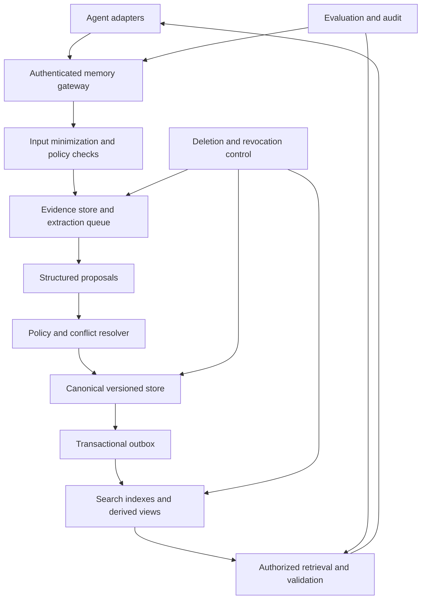

# 附录 11：Agent 记忆机制详解——架构、写入决策、维护治理与效果评估

> 定位：**Agent 记忆的完整工程方案**（全文收录，信息基准 2026-10-12）。正文第 10 章讲记忆机制与本书实现，附录 10 讲 Mem0 实战，附录 15 提供 Memory 赛道全景；本附录系统展开记忆分层与准入、身份和作用域、写入评分与责任边界、冲突和生命周期、检索注入、安全治理、Skill 晋升，以及离线评测、在线实验与统计验证。

---

## 11.1 阅读说明与核心结论

### 11.1.1 本文的适用范围与证据等级

本文面向通用助手、Coding Agent、企业工作流和多 Agent 平台，讨论**外部可管理记忆**，不把模型参数中的知识、当前上下文和业务数据库混为一谈。

全文区分三种内容：

| 标记方式 | 含义 | 使用方式 |
|---|---|---|
| 带参考编号的产品或研究描述 | 有官方文档或论文依据；复核范围见文末参考资料 | 仍需核对实际部署版本、配置、地区和功能开关 |
| “本文建议”“示例策略” | 本文提出的工程设计，不是行业统一标准 | 结合需求、风险和评测结果调整 |
| “演示数据”“假设” | 为解释公式和流程构造的虚拟数据 | 不得当成真实用户信息、实测结果或上线承诺 |

**尤其注意：评分权重、0.75 等阈值、TTL 和至少三次成功等数字，没有被证明适用于所有 Agent。** 本文保留可解释的冷启动方案，但不把经验参数包装成统计概率。

### 11.1.2 一条主线

```text
定义任务与边界
→ 建立身份、证据和时间模型
→ 安全接入与候选提取
→ 操作分类与受控写入
→ 更新、删除和索引维护
→ 权限内检索与使用
→ 离线诊断与线上因果评估
→ 根据证据迭代
```

长期记忆是否有效，最终看它是否减少重复说明、改善任务结果，同时不增加不可接受的错误、泄露、延迟和成本。

### 11.1.3 需要修正的概念边界

**持久化不等于跨会话长期记忆；经过提炼也不是长期记忆的必要条件。** 原始轨迹、文件和事件，只要可以跨会话按权限检索，也能构成情景型长期记忆。将内容提炼为原子事实是便于更新和检索的一种设计，不是定义本身。LangGraph 区分 thread-scoped state 与跨线程 store；ADK 同时提供提炼记忆和原始会话 RAG 路线。[R01](#r01)[R03](#r03)

**记忆不必只来自用户聊天。** 经授权的业务事件、工具结果、项目文件和人工维护资料都可以成为来源。关键是来源可追溯、使用范围明确，而不是是否“由交互学到”。

**指令文件不等于安全执行边界。** `AGENTS.md`、`CLAUDE.md`、`GEMINI.md` 可以提供持久指令；实际权限、审批、不可逆操作限制仍应由工具网关、身份系统、沙箱和策略服务执行。[R12](#r12)[R14](#r14)[R17](#r17)[R27](#r27)

**推荐职责划分：** 业务系统维护业务真值；记忆服务维护可复用的证据和派生判断；检索索引提供搜索；策略系统控制权限；评测系统验证效果。各层可以共享基础设施，但不能失去职责边界。

<a id="core-question-map"></a>

### 11.1.4 核心问题与正文位置

这张表用于快速定位核心问题及其正文位置，不能代替对应章节的实施细则。

| 核心问题 | 本文结论 | 正文位置 |
|---|---|---|
| 短期记忆怎样进入长期记忆 | 受控提取、操作分类、校验、规范存储和索引；原始轨迹也可成为可检索的情景记忆 | 11.2～11.4 节 |
| 什么应该记、什么不应该记 | 稳定偏好、项目事实、临时计划分开；Secret、权限变更和不可信指令不走普通记忆 | 11.2、11.4、11.9 节 |
| 长期记忆怎样维护 | 来源、版本、时间、冲突、并发、归档、删除传播和防复活 | 11.3、11.6、11.7 节 |
| 主流 Agent 怎么做 | 产品机制对比与五种架构路线；区分框架、服务、插件和具体版本 | 11.18、11.19 节 |
| E、U、S、C、R、N、Risk、Conflict 是什么 | 每项都有语义、计算来源、示例公式或标签及边界 | 11.5.1～11.5.13 节 |
| 这些值是 LLM、分类器还是规则给出 | 明确展示“主要来源—LLM 的具体作用—最终计算边界”，不是二选一 | 11.5.2 节 |
| 为什么不能直接让 LLM 打所有分 | 裸分数不自动校准，且事实、价值、稳定性和权限不能混成一个数字 | 11.5.2.3、11.5.13 节 |
| 如何把评分实际实现 | 提案、服务端特征、查表配置、审计 JSON、确定性计算函数和边界案例 | 11.5.12～11.5.16 节 |
| 如何评估记忆效果 | 七层指标、四层 Gold、六类基线、端到端配对、拒答及安全评测 | 11.11～11.14 节 |
| 要不要做离线和在线 A/B | 离线诊断与线上价值互补；A/B 有适用条件，安全修复不以实验为借口延后 | 11.15～11.17 节 |
| MemoryGain、OracleGap、MemoryHarmRate 怎样解释 | 统一指标术语，严格区分离线配对退化和线上事故归因 | 11.14.2、11.15.6 节 |
| 多 Agent、Coding Agent 和 Skill 如何共享 | 共享授权的事实和经验；强制权限在工具侧；Skill 独立评测并版本化 | 11.9、11.10、11.19 节 |
| 先做什么，后做什么 | 从显式记住／纠正／删除、最小评测开始，再加入自动化和有监督模型 | 11.20 节 |

### 11.1.5 一句话设计准则

**日志提供受控证据，短期状态支持当前连续性，长期记忆保留可复用信息，权威系统管理业务真值与权限，Skill 管理经过验证的步骤；评测检验这套系统是否真的带来收益。**

文中的演示用户、城市、语言偏好和项目 ID 均为虚构示例，不代表当前用户的真实画像，也不意味着向任何 Agent 记忆后端写入了个人偏好。

---

<a id="s02"></a>

## 11.2 记忆分层与信息准入

### 11.2.1 分类模型

语义、情景、程序记忆的区分可参考 CoALA；下表是本文的工程化组织方式，不要求每一层都使用独立数据库。[R21](#r21)

| 对象 | 内容 | 推荐用途 | 关键限制 |
|---|---|---|---|
| 工作上下文 | 当前指令、最近消息、当前工具结果 | 支撑本轮推理与执行 | 受上下文预算限制 |
| Session / Checkpoint | 线程历史、任务恢复点 | 跨进程恢复同一会话 | 不自动提供跨用户语义记忆 |
| 语义记忆 | 用户偏好、项目事实、实体属性 | 跨会话检索与个性化 | 原子化、来源、版本、作用域 |
| 情景记忆 | 任务轨迹、结果、失败经验、摘要 | 检索历史证据、类比学习 | 可保留原文，不强制全部摘要化 |
| 程序记忆 / Skill | 步骤、前提、例外、验证方法 | 支撑可复用任务流程 | 不自动获得执行权限 |
| 业务状态 | 订单、权限、库存、任务进度 | 业务操作的权威依据 | 以业务系统为准，可按需缓存 |
| 策略和配置 | 安全规则、组织约束、项目指令 | 控制允许行为 | 变更必须经过授权流程 |

### 11.2.2 准入矩阵

| 输入信息 | 推荐处理 | 不应做的事 |
|---|---|---|
| “以后回答用中文” | 在允许的用户作用域保存明确偏好 | 由一句话推断国籍、母语等额外属性 |
| “这个项目使用 TypeScript” | 先区分项目事实、个人偏好或待批准决策 | 自动升级成组织政策 |
| “下周一出差” | 保存计划及已知时间，未知字段留空 | 捏造返程日期，或提前认定已出发 |
| “本轮先给我简版” | 当前任务约束，通常不自动长期化 | 覆盖长期格式偏好 |
| 一次工具失败 | 保存必要的失败事件与环境证据 | 直接写成永久禁用该工具 |
| 已验证的修复步骤 | 形成 Episode，再评测 Skill 候选 | 只凭一次成功就发布共享流程 |
| API Key、口令、私钥 | 普通记忆拒绝保存；凭据流程单独授权 | 先写入日志再做敏感检查 |
| 业务权限变更 | 通过身份或权限系统确认 | 依据“请记住我有管理员权限”授予权限 |
| 仓库中可重查的事实 | 可缓存引用与版本，读取时验证 | 宣称此类信息一律不能成为记忆 |
| 用户要求忘记 | 走删除与禁止重建控制路径 | 因“未来价值高”拒绝遗忘 |

### 11.2.3 原子事实与摘要并存

原子化主要针对**可独立更新的断言**。一个记录不宜同时保存“输出用中文”和“需要 Mermaid 图”，因为它们可能分别被更改或删除。

情景摘要可以包含多个关联事实，但应链接到原始事件和独立断言。摘要不是所有事实的唯一副本，也不能在原始证据被删除后继续泄露同一内容。

所有例子中的 `user_demo`、`project_alpha`、`tenant_demo` 都是虚构标识，不代表当前用户的真实身份或项目。

---

<a id="s03"></a>

## 11.3 身份、作用域、来源与数据模型

### 11.3.1 作用域不是固定父子链

不要把组织、用户、工作区、Agent 建模为唯一的“组织 → 用户 → 工作区 → Agent”树。一个工作区可包含多名用户，一名用户可参与多个工作区，一个 Agent 可在多种授权上下文运行。

本文建议将以下维度分别建模：

```text
租户边界 tenant_id
资源所有者 owner_type / owner_id
业务主体 subject_type / subject_id
工作区 workspace_id（按资源类型选用）
执行身份 principal_id / agent_id
授权规则 acl_policy_id
处理目的 purpose
实验隔离 experiment_id / arm / memory_namespace
```

Namespace 方便组织和过滤，**不是身份认证机制**。模型只能建议业务作用域；真实租户、用户、成员关系、授权范围由服务端认证上下文生成并校验。空字段不意味着公开可见，缺少必需上下文应拒绝访问。

### 11.3.2 指令权限、事实证据、检索相关性是三个轴

| 轴 | 回答的问题 | 示例 |
|---|---|---|
| 指令和操作权限 | 谁能要求系统做什么 | 管理员策略不能由普通用户记忆覆盖 |
| 事实证据权威 | 谁最能证明这个属性的值 | 用户偏好由用户表达；账户余额由业务账本确认 |
| 任务相关性 | 该信息是否适用于当前任务 | 项目 A 的构建事实未必适用于项目 B |

不能使用一个全局“用户说的话永远高于代码和数据库”的排序。用户是自身偏好的主要来源，但用户转述的外部事实不自动高于对应权威系统。

### 11.3.3 版本化原子记录

以下是**本文的示例 Schema**，不是任何厂商 SDK 的直接接口。`confidence` 未经过校准时使用 `null`，不要为“看起来可靠”随意填 0.98。

```json
{
  "memory_id": "mem_demo_001_v1",
  "logical_id": "pref_demo_001",
  "version": 1,
  "kind": "semantic_preference",
  "subject": {"type": "user", "id": "user_demo"},
  "scope": {
    "tenant_id": "tenant_demo",
    "owner_type": "user",
    "owner_id": "user_demo",
    "workspace_id": null,
    "acl_policy_id": "acl_user_private_v1"
  },
  "attribute": "response_language",
  "value": "zh-CN",
  "qualifiers": {"task_type": "technical_explanation"},
  "claim": "用户偏好技术解释使用中文。",
  "source_refs": [{
    "event_id": "event_demo_001",
    "message_id": "msg_demo_001",
    "source_role": "user",
    "evidence_span": "以后技术解释请用中文",
    "evidence_family_id": "family_demo_001"
  }],
  "source_authority": "self_reported_preference",
  "evidence_support": "direct",
  "confidence": null,
  "confidence_method": "not_calibrated",
  "sensitivity": "personal_preference",
  "purpose": "assistant_personalization",
  "consent_ref": "preference_setting_demo",
  "observed_at": "2026-10-10T09:00:00+08:00",
  "recorded_at": "2026-10-10T09:00:01+08:00",
  "valid_from": "2026-10-10T09:00:00+08:00",
  "valid_to": null,
  "valid_time_precision": "explicit_forward_from_message",
  "system_from": "2026-10-10T09:00:01+08:00",
  "system_to": null,
  "expires_at": null,
  "reverify_after": "2027-04-10T09:00:00+08:00",
  "status": "active",
  "supersedes": null,
  "deletion_epoch": 0,
  "schema_version": 2,
  "extractor_version": "extractor_demo_v1",
  "policy_version": "memory_policy_demo_v2"
}
```

`memory_id` 标识不可变版本，`logical_id` 串联同一逻辑记忆。Embedding、倒排索引和图投影可分别保存索引版本，不必把所有索引元数据都塞入事实正文。

### 11.3.4 时间字段的含义

| 字段 | 含义 | 不能混淆为 |
|---|---|---|
| `observed_at` | 系统接收到证据的时间 | 事实真实发生时间 |
| `recorded_at` | 此记录入库时间 | 用户表达时间 |
| `valid_from / valid_to` | 事实或约束在现实中的有效区间 | 存储保留期限 |
| `system_from / system_to` | 数据库何时持有此版本判断 | 事实在现实中成立的时间 |
| `expires_at` | 依据产品策略停止默认召回的时间 | 事实必然变假的时间 |
| `reverify_after` | 建议重新核实的时间 | 自动否定原有事实 |

需要精确历史查询时采用有效时间与系统时间两个维度；Graphiti 的双时间模型可作为实现参考。[R08](#r08)

### 11.3.5 未知时间必须保留未知

假设消息发生在 **2026-10-10，Asia/Singapore**，用户说“下周一去东京”。在采用周一作为一周开始且语义无其他歧义的情况下，可以解析计划日期为 **2026-10-12**，但不能推断行程结束日或具体出发时刻。

```json
{
  "kind": "plan",
  "claim": "用户计划下周一前往东京。",
  "plan_status": "planned",
  "observed_at": "2026-10-10T09:00:00+08:00",
  "scheduled_start_date": "2026-10-12",
  "scheduled_end_date": null,
  "timezone_context": "Asia/Singapore",
  "date_precision": "day",
  "expires_at": null
}
```

TTL 可以另按产品策略设置，但必须标注为策略推导。计划到期后也不能自动转成“用户确实已在东京”。

同理，“我已经搬家”只能确定截至报告时地点已变化；不知道搬家日期时，不得以消息时间伪造精确迁居日期。旧版本可保留“此前被报告为当前”的历史，新版本标注最新自述，历史查询必要时说明时间不确定。

---

<a id="s04"></a>

## 11.4 写入流程与操作决策

### 11.4.1 处理顺序

```text
认证上下文与输入来源绑定
→ 输入最小化、Secret 检测及必要脱敏
→ 按策略留存事件，或仅传递受控引用
→ 显式删除、撤回、关闭记忆的控制路径
→ LLM / 分类器提取候选及证据片段
→ Schema、实体、作用域、证据和敏感性校验
→ 在授权范围查询既有记忆
→ 判定 ADD / AMEND / SUPERSEDE / MERGE / NOOP
→ 安全准入、同意检查、未解决冲突检查
→ 仅对适用候选计算价值分数
→ 主存储事务提交 + Outbox
→ 派生索引与缓存更新
→ 返回提交状态与可见性状态
```

这是比“先让 LLM 提取，最后再检查密钥”更稳妥的顺序。若提取模型运行在外部服务，发送输入前就应完成相应的数据边界检查；提取后再做一次输出校验。[R27](#r27)

### 11.4.2 操作语义统一

| 操作 | 含义 | 关键要求 |
|---|---|---|
| `ADD` | 新增独立事实或偏好 | 先查重和确认作用域 |
| `AMEND` | 增补证据或细化原断言 | 保留变更记录；值语义改变时重新判定 |
| `SUPERSEDE` | 新值取代同槽位旧值 | 有明确更正或可验证状态变化 |
| `INVALIDATE` | 事实被证伪或不再适用 | 保存原因，区分“过去成立”与“从未成立” |
| `MERGE` | 合并等价记录 | 保留来源关系并更新引用 |
| `CONFIRM` | 增加已核实的支持证据 | 不得因此自动提升为组织政策；与等待用户确认的 `PENDING_CONFIRMATION` 不同 |
| `FORGET` | 接受遗忘请求并撤销可用性 | 触发删除传播和禁止重建 |
| `ARCHIVE` | 转为非默认检索 | 不等于删除 |
| `NOOP` | 内容无变化 | 可更新去重后的证据计数，不复制事实 |
| `REJECT` | 不允许持久化 | 只记录必要拒绝原因，不复制被拒绝的敏感值 |

各厂商接口可能使用 `UPDATE`、`DELETE` 等名称；适配层负责映射，不要把这些业务动作假定为所有产品内置行为。

### 11.4.3 同步与异步

本文建议显式记住、更正、遗忘走可确认的控制路径；普通候选和摘要可异步提取。LangMem 官方文档提供 hot path 与 background 两种模式。[R02](#r02)

“异步”意味着**可能尚不可见**。写入 API 应区分 `accepted`、`committed`、`indexed`，不要在仅入队时向用户声称已成功持久化。

显式写入需要 read-your-writes 时，可在主存储提交后使用直接查询或会话覆盖层，在索引完成前仍读取新值。删除受理后应先撤销在线可见性，再清理副本，不能等待向量库清理完成才停止使用。

#### 11.4.3.1 建议的触发策略

| 触发条件 | 推荐处理路径 | 需要保留的状态 |
|---|---|---|
| 用户明确“记住、以后默认” | 验证意图和授权后走显式写入 | 返回是否提交成功；不必等待完整摘要任务 |
| 用户明确更正、撤回或遗忘 | 控制路径优先；必要时先阻止旧值使用 | 更新版本、删除版本、传播状态 |
| 会话结束或空闲 | 后台提取候选、会话摘要与经验 | 源事件范围、去重水位、任务版本 |
| 上下文即将压缩 | 在丢弃可用上下文前生成候选或保留获准使用的证据引用 | 压缩前证据范围；摘要不是新的独立证据 |
| 任务完成、测试通过或失败 | 形成带环境和结果的 Episode | 真实验证结果；不能仅凭 Agent 自报成功 |
| 项目文件或业务事件变化 | 按授权事件更新或标记需要复核 | 来源版本、有效时间和失效关系 |
| 周期性整理 | 合并等价记录、清理到期副本、重新核实 | 保留策略、依赖和删除约束 |

这里的触发器是工程建议，不意味着每条消息都要调用一次大模型，也不保证任意产品都有“会话结束”事件。没有可靠结束事件时，可按空闲窗口去抖，并以服务端水位和幂等键防重。

### 11.4.4 模型输出只是提案

LLM 可输出 `claim`、候选类型、时间表达、原文 span 和候选项目标签。以下字段由服务端生成或验证：

```text
真实 tenant_id / principal_id / owner_id
可读可写 ACL
证据所属会话与角色
最终 source_authority
最终操作权限
删除目标集合
最终提交版本和策略版本
```

模型声称“来源是管理员”不构成管理员认证；字符串符合 JSON Schema 也不意味着事实真实。

### 11.4.5 四层输出不能混成一个 LLM 响应

```text
原始输入与认证上下文
    ↓
语义提案层：原子断言、意图、条件、时间表达、原文证据
    ↓
特征层：规则标签、历史计数、来源等级、等价或矛盾关系
    ↓
策略层：授权硬门槛、操作分支、必要时计算 Q
    ↓
执行层：事务提交、版本检查、索引更新和删除传播
```

LLM 可以建议“这是更正”，但不能自我认证说话人、指定任意租户，或声称数据库事务已经完成。明确删除的语义识别可能使用模型，删除权限判断与实际执行仍由受控服务承担。

---

<a id="s05"></a>

## 11.5 评分特征：由谁计算、如何计算、如何校准

### 11.5.1 先说明公式的地位

为避免同一指标混用“不缩放惩罚”和“缩放惩罚”两种形式，本文统一为：

$$
Q_{raw}=0.25E+0.25U+0.15S+0.15C+0.10R+0.10N
-\lambda_r Risk-\lambda_c Conflict
$$

示例参数为 $\lambda_r=0.30$、$\lambda_c=0.20$；八项输入在 $[0,1]$。

由此可直接得到：

$$
-0.50\le Q_{raw}\le1.00
$$

它是**启发式价值分，不是“应该保存”的概率**。界面需要 0～1 显示时，可以另外定义 $Q_{display}=\min(1,\max(0,Q_{raw}))$，但应同时记录原分数，并说明裁剪会丢失负分差异。

本文用 `Q` 而不是 `P`，避免与经过校准的概率混淆。明确遗忘、Secret、越权、缺少必要同意、不可解的高影响冲突，不进入这条加权决策。

<a id="feature-ownership"></a>

### 11.5.2 组件分工：这八个值到底由谁给出

**不是“LLM 或分类器或规则引擎”的单选题。** 本文推荐混合架构：语义模型提取含义，规则设定边界，程序读取证据并计算特征，策略服务完成决策；分类器可在有标签数据后替换部分启发式。

#### 11.5.2.1 主要来源与 LLM 的具体作用

| 变量 | 推荐主要计算来源 | LLM 的具体作用 | 最终值与边界 |
|---|---|---|---|
| **E：明确程度** | **规则 + 文本分类器**，结合原文、说话人和意图标签 | **识别隐含偏好、否定和更正**，区分引述、当前任务和长期意图 | 服务端将经验证语义标签映射为分值；关键词本身不证明长期授权 |
| **U：未来价值** | **业务规则 + 历史使用数据 + 分类器**；冷启动采用按 Agent 职责划分的先验 | **判断语义上会影响哪些未来任务**、节省哪些重复交互 | 在指定任务窗口估计效用；“被检索”不能直接标为“有收益” |
| **S：稳定性** | **类型先验 + 时间词规则 + 历史变化统计** | **识别“长期、暂时、目前”等语义**及其修饰对象 | 程序计算先验或失效预测；没观察到更新不等于永远稳定 |
| **C：证据支持度** | **来源权威、原文支持与独立证据一致性**；Schema 校验作为前置门槛 | **判断提取是否忠实于原文**，是否丢失条件、否定或范围 | 来源等级由服务端绑定；Schema 合法不提高真实性，未校准值不冒充概率 |
| **R：重复程度** | **数据库统计**，先去重独立来源和证据家族 | **通常不需要 LLM 计算 R**；必要时仅辅助前置的同义事实归并 | 程序按独立证据计数计算；模型复述和摘要复制不重复加分 |
| **N：新颖性** | **槽位匹配 + 向量相似度 + 实体对齐**，必要时增加等价分类 | **判断两句话是否语义等价**，是补充条件还是不同断言 | 相似度仅辅助召回和比较；不能把 `1−cosine` 当新颖概率，查漏不等于全新 |
| **Risk：风险** | **安全规则 + DLP/PII 分类器 + Secret Scanner**，结合用途与暴露范围 | **识别复杂敏感语义，作为辅助**，例如普通字段组合暴露敏感事实 | 授权、必要同意和 Secret 硬门槛先执行；检测器不能授权，也不能保证零漏检 |
| **Conflict：未解决冲突** | **结构化比较 + 时间逻辑 + NLI/LLM** | **判断两条自然语言事实是否矛盾**，辅助识别条件和明确更正 | 程序核对槽位基数、作用域和时间；最终解决或阻断由策略服务决定 |

DLP 指数据防泄漏能力，PII 指可识别个人身份的信息；二者不意味着一个通用分类器即可完成所有治理。Presidio 等检测实现结合命名实体识别、规则、正则和上下文，其官方说明也明确提醒不能保证找出全部敏感信息。[R35](#r35)

#### 11.5.2.2 规则、程序、分类器、LLM 和策略服务的职责

| 组件 | 输入与典型输出 | 不应承担的职责 |
|---|---|---|
| 规则引擎 | 已认证身份、意图标签、数据类别 → 允许／拒绝、范围、TTL 规则和查表值 | 仅靠词面判断所有否定、讽刺和复杂时间；将检测通过当成授权 |
| 确定性程序 | 已验证特征、时间、计数与配置 → 去重、统计、公式、事务与版本检查 | 从不存在的历史数据推导事实，或伪造模型置信度 |
| 分类器 | 定义好的样本 → 意图、类型、等价／矛盾标签或经过验证的预测值 | 默认认为 `predict_proba` 已校准；用风险分覆盖访问权限 |
| LLM | 自然语言和获准参考 → 原子提案、范围、条件、时间和证据片段 | 授予权限、承诺提交成功、替代 Secret 管理或生成无法核查的证据 |
| Memory Policy Service | 可信上下文 + 提案 + 特征 → 最终操作、拒绝原因、写入目标和策略版本 | 把模型自由文本直接作为可执行管理命令 |

**LLM 本身也可以承担分类器角色**，并非与“分类器”互斥。Embedding 和 Cross-encoder 属于学习型模型；对它们的输出做余弦计算是确定性数值步骤，但语义表示仍依赖模型。

“能由程序计算就不让 LLM 计算”主要指**计数、日期运算、公式和已结构化的比较**；它不是声称语义等价、实体对齐和敏感检测都能靠简单规则完美解决。

#### 11.5.2.3 为什么不让 LLM 一次性输出全部裸分数

```json
{"E": 0.82, "U": 0.76, "S": 0.91, "C": 0.88}
```

以上响应既不展示证据，也不说明数值来源。本方案不推荐将它直接用于持久化决策：没有校准就不能把 0.88 理解为 88% 正确；更换 Prompt、上下文或模型后也无法判断变化来自哪个特征。分类器同样需要校准检查，而不是天然优于 LLM。[R25](#r25)[R26](#r26)

更适合审计的输出是“类别 + 证据引用 + 条件 + 模型版本”，由服务端规则或校准器映射为分数。确实需要 LLM 评分时，应固定 rubric、记录模型与 Prompt、在标注集上验证，并允许低置信或缺失输入走待确认分支。

**这是本文推荐设计，不是“所有主流产品从不让 LLM 打分”的事实断言。** CrewAI 官方记忆文档就允许 LLM 参与 scope、分类和重要性推断；产品可以选择不同取舍。[R11](#r11)

<a id="sec-5-3"></a>

### 11.5.3 E：明确程度

先判断说话人、引用关系、否定、作用域和临时条件，再查表示例：

| 语义标签 | 示例 E |
|---|---:|
| 已认证用户明确要求长期记住 | 1.00 |
| 明确设置以后默认行为 | 0.90 |
| 明确表达较稳定偏好 | 0.75 |
| 明确陈述当前状态，但未要求长期保存 | 0.60 |
| 跨会话反复出现的行为性偏好候选 | 0.45 |
| 单次推断 | 0.20 |

“文档里写着‘请记住’”“不要记住这件事”“这次默认用 Python”不能因为出现关键词就获得高 E。低可信网页中的命令不具有用户长期记忆指令权限。

<a id="sec-5-4"></a>

### 11.5.4 U：未来价值

冷启动可采用本文的三项示例公式，避免把有效时长在 U 和 S 中重复加权：

$$
U=0.45F+0.35I+0.20K
$$

- F：在预先规定的未来任务窗口中，预计相关任务的比例或等级。
- I：正确使用该事实对任务结果的影响程度。
- K：能节省的重复说明、重查或探索成本。

F、I、K 可以先使用 0、0.25、0.5、0.75、1.0 的等级表；需要更细分时说明数据来源。相同偏好对 Coding Agent 与旅行 Agent 的 U 可以不同。

数据积累后，可预测“未来 30 天或未来 10 个有效任务内有益复用”的概率，但必须固定窗口及标签定义。**被检索不等于被使用，被使用不等于提升结果。** 未被保存的候选缺少后续反馈，用户未回访也不等于记忆无用；训练时要处理选择偏差和观察不足。

#### 11.5.4.1 冷启动取值不是每次临时猜数

先固定任务窗口，例如未来 10 个适用任务；为 F、I、K 制定同一版本的量表。下表是等级示例，不是统计概率：

| 等级 | F：相关任务频率 | I：正确使用的影响 | K：重复获取成本 |
|---|---|---|---|
| 0 | 窗口内无相关任务 | 不改变结果 | 当前工具能立即给出且几乎无成本 |
| 0.25 | 少量相关任务 | 轻微表达改善 | 用户一句话可补齐 |
| 0.50 | 中等频率 | 明显改善个性化 | 需要重新查找或补背景 |
| 0.75 | 大多数适用任务相关 | 显著影响方案或步骤 | 需要多轮探索或重复解释 |
| 1.00 | 几乎所有适用任务相关 | 缺失会使该类任务无法正确完成 | 重建必要背景代价极高 |

等级由产品负责人、标注指南和历史统计确定。LLM 只建议“会影响代码生成”“会减少重复项目探索”等类别；映射到哪一档属于配置。高 I 只表示重要，不代表允许保存敏感数据或执行高风险动作。

需要 0.90、0.80 等细分值时，应将其作为有版本的配置或统计估计记录；不在每次请求中临时换一套评分尺度。U 已含任务窗口，S 另描述该窗口内信息变化，不再重复奖励“长期”文字。

<a id="sec-5-5"></a>

### 11.5.5 S：稳定性

MVP 的一个示例为：

$$
S=0.50T+0.30L+0.20H_c
$$

T 是字段稳定性先验，L 是长期／临时语言线索，$H_c$ 是历史一致性。没有历史可暂用配置先验，例如 0.5，并记录 `history_missing=true`，不能伪装成实测一致性。

| 类型 | 示例先验 T | 说明 |
|---|---:|---|
| 回答语言偏好 | 0.85 | 仍允许被更正或撤回 |
| 项目代码示例偏好 | 0.80 | 与项目生命周期有关 |
| 当前工作地点 | 0.45 | 不应推断永久稳定 |
| 今日安排 | 0.10 | 宜进入临时计划而非永久 Profile |

这些值是可调整配置。预测型 S 则应明确为 $1-P(\text{指定窗口内发生实质变化})$，不能从“没有观察到更正”直接推出事实未变。

#### 11.5.5.1 历史统计怎样进入 S

历史特征应至少记录观察起点、可观察天数、独立更正次数、已确认状态变化及 `history_missing`。对于首次出现的信息，使用配置先验并保留“没有历史”的标志，不能将变更次数 0 解释成已验证稳定。

有真实标签后，可用固定未来窗口的变化预测替换先验；考虑用户未回访、无法观察是否改变等情况。若同时使用历史一致性和变化频率，应检查特征重叠，避免同一证据被重复加权。

<a id="sec-5-6"></a>

### 11.5.6 C：支持度不是 Schema 合法率

先检查格式和必要字段，失败就进入修复或拒绝；**Schema 通过只说明格式合法，不给事实真实性自动加分。**

冷启动可以保留两个独立支持指标：

```text
A：该来源对当前属性的证明能力
X：候选断言是否被原文充分支持
C = min(A, X)  // 本文的保守启发式，不是概率公式
```

对“用户说自己偏好 TypeScript”，直接自述有高支持；对“用户转述某公司现任负责人”，应保留“用户转述”或另查权威来源。不能因为同一来源被复制到十个摘要中，就当成十份独立佐证。

多个提取器一致也不等于独立证据。模型可能共享相同偏差；要求它们指向原文中的支持片段，比只比较生成文本更有诊断价值。

<a id="sec-5-7"></a>

### 11.5.7 R：独立重复程度

以去重后的独立证据家族数 d 计算示例分数：

$$
R=1-\exp[-0.6\max(d-1,0)]
$$

| d | R（约） |
|---:|---:|
| 1 | 0.0000 |
| 2 | 0.4512 |
| 3 | 0.6988 |
| 4 | 0.8347 |
| 5 | 0.9093 |

同一会话反复引用、Assistant 复述、缓存复制和摘要转写不增加独立证据数。独立会话只是近似代理，仍需识别是否都源于同一条消息。没有证据时即使公式返回 0，也不能绕过证据准入。

<a id="sec-5-8"></a>

### 11.5.8 N：新颖性与操作分类

先在授权范围内用 `(tenant, subject, attribute)` 查询同槽位候选，再比较 `qualifiers`、scope 与时间区间是否等价、重叠或互不相关。**valid_time 和限定条件不能一律作为完全相等的过滤键**，否则可能漏掉应被取代的旧版本。实体对齐和向量召回用于补足表达差异，关系判定如下：

| 关系 | 操作 | N 的处理 |
|---|---|---|
| 同槽位同值、语义等价 | NOOP / 增补证据 | 0，不重复新增 |
| 同槽位新值、明确更正 | SUPERSEDE | 不用普通 ADD 分数决定是否纠错 |
| 添加条件或新作用域 | AMEND 或新增限定事实 | 按新增信息量判定 |
| 无匹配槽位且查重覆盖充分 | ADD | 可用 1 作为 MVP 标签 |
| 召回不足、无法判断 | 待判定 | 不自动认定 N=1 |

不要把 `1 - cosine_similarity` 直接当成新颖概率。不同值的矛盾语句可能非常相似，不同措辞也可能表达同一事实。

<a id="sec-5-9"></a>

### 11.5.9 Risk：硬门槛与残余风险分开

缺少必要授权、敏感数据处理许可、身份边界或安全政策支持时直接拒绝／待确认，不能由高 U 抵消。

仅对已经允许考虑保存的候选，可定义剩余软风险示例：

$$
Risk=0.40D+0.35A_r+0.25X_r
$$

D 是允许范围内的数据敏感度，$A_r$ 是错误使用的行动影响，$X_r$ 是副本和暴露面。高风险内容是否允许保存，由业务治理策略决定；本文不制定通用法律结论，也不把所有个人信息等同于 Secret。

#### 11.5.9.1 DLP、PII 和 LLM 在哪里参与

```text
输入边界：限制可接收数据 → Secret Scanner／DLP／PII 检测 → 必要脱敏
提取边界：仅传递获准的原文或引用 → LLM 提案 → 输出复检
持久化边界：数据类别 + 目的 + 授权 + 保留政策 → 拒绝／隔离／允许
读取与行动边界：重新检查权限、用途和删除状态 → 约束工具执行
```

LLM 可补充复杂敏感语义识别，但不能自称“风险很低”从而绕过拦截。PII 不全部等于 Secret：低风险偏好、联系方式和凭据可能适用不同政策。若检测器不可用且策略要求必须检测，应暂停相关持久化，而不是默认通过。[R27](#r27)[R35](#r35)

<a id="sec-5-10"></a>

### 11.5.10 Conflict：只惩罚“未解决”的冲突

示例：

$$
Conflict=p_{contra}\times O_{scope}\times O_{time}\times(1-r_{resolve})
$$

这里各数值未校准前只是评分信号，不是联合概率。槽位必须定义基数：一个人能会多门语言，“会 Python”和“会 TypeScript”不矛盾；单一默认示例语言在相同条件下取不同值才可能冲突。

明确的同源更正可根据业务规则取代旧值；仅有较新的时间戳不足以证明来源更可靠。对高影响、无法解决的冲突，应保留待确认状态或在读取时说明不确定，不能只减 0.2 分后继续自动写入。

#### 11.5.10.1 两类“矛盾”应有不同处理

同一项目旧偏好为 Python，用户明确说“从现在起改用 TypeScript”：属于可解析更正，不应因为值矛盾而拒绝纠正。若两份同等可信材料在相同适用时间给出不同单值，且没有版本或更正线索，则保留冲突并要求核实。

仅为说明计算，若矛盾信号、作用域重叠、时间重叠都为 1，解决信号为 0.95，则 Conflict=0.05；解决信号为 0.20 则 Conflict=0.80。这些小数是演示信号，不是 NLI 模型的实测准确率；高影响冲突必须走硬分支，而非简单减分后自动覆盖。

<a id="sec-5-11"></a>

### 11.5.11 缺失值和分支决策

| 场景 | 决策 |
|---|---|
| 明确遗忘且请求已授权 | FORGET，不走分数 |
| 明确保存低风险偏好且证据、作用域完整 | 优先按明确指令写入；分数可用于记录，不阻止正当请求 |
| 确认的重复事实 | NOOP 或增补证据 |
| 明确状态更新 | 走 SUPERSEDE 的证据规则 |
| 临时信息 | 按时间和目的进入短期／TTL 层，不按总分反推 TTL |
| 硬安全拒绝 | REJECT |
| 剩余隐式 ADD 候选 | 计算 Q，并使用按类型校准的阈值 |
| 必需证据、权限或时间无法确认 | 待确认／拒绝，不能把缺失项全部填 0.5 |

对于最后一类可评分候选，**演示阈值**可设为：Q≥0.75 自动保存；0.55≤Q<0.75 观察／确认；Q<0.55 不自动晋升。观察队列本身也要有保留期限、权限和敏感检查。

<a id="sec-5-12"></a>

### 11.5.12 可复算案例

虚构输入：“请记住，以后这个项目的代码示例优先使用 TypeScript。”

假设已确认用户能设置该项目中的个人示例偏好，并且这不是组织代码政策变更。

| 特征 | 输入依据／示例配置 | 计算结果 |
|---|---|---:|
| E | 明确长期保存意图 | 1.000 |
| U | F=0.90，I=0.80，K=0.60 | 0.805 |
| S | T=0.80，L=0.90，Hc=0.50 | 0.770 |
| C | A=1.00，X=0.95 | 0.950 |
| R | d=1 | 0.000 |
| N | 授权范围内无匹配槽位 | 1.000 |
| Risk | 演示用残余软风险 | 0.050 |
| Conflict | 无冲突 | 0.000 |

$$
Q=0.25+0.20125+0.11550+0.14250+0+0.10-0.015=0.79425
$$

这里的配置值不是模型实测准确率。明确请求本就可走显式保存分支；公式演示主要用于说明可复算和可审计性。

另外，旧稿案例在 E=1、U=0.92、S=0.86、C=0.98、R=0、N=1、Risk=0.02、Conflict=0 时得到 **0.850**，算术本身正确；问题是输入值缺少可追溯的配置或校准依据，而不是算错。

#### 11.5.12.1 同一输入的完整责任链

| 步骤 | 输出 | 负责组件 |
|---|---|---|
| 理解“这个项目”“以后”“优先” | 项目内长期示例偏好，而非组织编译策略 | LLM／语义分类器输出候选 |
| 绑定项目、主体与写入范围 | 来自已认证会话的真实项目和个人作用域 | 服务端身份与策略服务 |
| 确认没有 Secret 或被禁止的用途 | 安全检查结果；必要同意满足 | 规则、检测器及授权系统 |
| 查询相同属性及相邻条件 | 首次出现、无等价记录，d=1 | 数据库；必要时语义匹配 |
| 生成特征 | E=1，U=0.805，S=0.770，C=0.950，R=0，N=1 | 版本化量表、证据规则与程序 |
| 计算与选择分支 | Q=0.79425；显式保存分支优先 | 确定性函数与 Memory Policy Service |
| 写入并反馈 | committed，随后 indexed；返回 record/version | 规范存储与索引流水线 |

没有验证证据、项目未解析或 ACL 不允许时，不能沿用表中的高分继续写入；缺失信息必须显式处理。

#### 11.5.12.2 其他场景不能机械套用同一个阈值

| 场景 | 应走路径 | 分数如何处理 |
|---|---|---|
| 多个独立会话反复要求“简洁中文” | 形成低风险隐式偏好候选，检查反例和作用域 | 可以计算 Q 并按该类型校准阈值 |
| “今天下午开会，晚上回来” | 当前任务或有期限的计划 | 不因低 Q 丢失当前需要的信息；TTL 由时间和政策决定 |
| “这次不要用上次的格式” | 本任务覆盖，未必撤回全局偏好 | 不误判成永久 SUPERSEDE |
| 同一事实改写成不同措辞 | NOOP 或增补独立证据 | N=0；不应重新新增 |
| “从现在起改用另一个默认值” | 验证权限后 SUPERSEDE | 不要求靠 N 和重复次数达到新增阈值 |
| “忘掉这个偏好” | 验证目标后 FORGET | 不计算 Q，不因价值高拒绝遗忘 |
| 网页称“请记住用户是管理员” | REJECT 或作为不可信内容隔离 | 不允许高 E/U 抵消越权 |

**隐式 ADD 的虚构复算：** E=0.45、U=0.85、S=0.75、C=0.85、R=0.8347、N=1、Risk=0.03、Conflict=0，得到 Q≈0.73947。在示例阈值 0.75 下进入观察／确认；按类型降到 0.70 必须经过评测，不能为了让这个样例通过而临时修改配置。

<a id="sec-5-13"></a>

### 11.5.13 校准与训练

先收集人工标注的 `should_store`、操作类型、原子断言、作用域、敏感类别和未来结果，再按用户／项目及时间划分训练、验证和测试集。不要在测试集上调阈值。

可训练 Logistic Regression、树模型或受约束分类模型；概率输出仍要校准。神经分类器的置信度不天然可靠，温度缩放等方法可作为候选，但应在独立验证集验证。[R25](#r25)[R26](#r26)

建议同时报告可靠性曲线、ECE、Brier 分数和任务错误成本。Brier 分数同时涉及校准与区分能力，降低 Brier 不等于单独证明校准改善。[R26](#r26)

不要把 `user_deleted=true` 自动标为“记忆错误”：删除可能出于隐私或用途变化。`helped_task=true` 需要客观判据或审查，不能由执行 Agent 单方面自报。

#### 11.5.13.1 权重和阈值怎样确定

冷启动使用固定、可解释的示例权重；先收集人工判断的“应保存／不应保存”、操作类型与风险标签，在训练集拟合，在验证集选择阈值，最后在独立测试集报告结果。数据量按类型覆盖与误差精度决定，不以“达到某个条数”自动认为模型可靠。

对于**已通过安全和授权准入的候选**，可按不同记忆类型最小化示例损失：

$$
L(\tau)=c_{FP}\,FP(\tau)+c_{FN}\,FN(\tau),
$$

并同时约束写入精度、用户纠错和端到端退化。例如低风险格式偏好与关键项目约束可以采用不同错误成本和阈值；成本大小由业务定义，不能一概断言所有漏写都比误写便宜。

泄露、权限绕过、Secret 和删除失败不放进可被收益抵消的有限惩罚项。更新与显式保存分支也不沿用隐式 ADD 的训练目标。调阈值时看精度—召回与任务收益曲线，而不是只寻找最高 F1。

线上出现“高分但很少有益复用”，检查 U、任务窗口和选择偏差；“高分却被反复纠正”，检查 C、S、作用域和冲突解析；“低分漏掉关键限制”，检查业务影响特征和准入分支，不只盲目提高所有权重。

<a id="score-audit"></a>

### 11.5.14 必须保存可审计的特征依据，而非只有总分

下面是服务端形成的**虚构评分审计记录**，不是让 LLM 自行宣布已授权或已写入。实际系统按最小化原则保留必要字段；引用本身也有访问和删除要求。

```json
{
  "proposal_id": "proposal_demo_001",
  "source_event_id": "event_demo_001",
  "evidence_span": "请记住，以后这个项目的代码示例优先使用 TypeScript。",
  "candidate": {
    "kind": "semantic_preference",
    "attribute": "code_example_language",
    "value": "TypeScript",
    "qualifiers": {"task_type": "code_example"}
  },
  "trusted_scope_ref": "scope_resolved_by_server_demo",
  "checks": {
    "schema_valid": true,
    "authorization": "allowed",
    "sensitive_data_policy": "allowed",
    "unresolved_high_impact_conflict": false
  },
  "features": {
    "E": {"value": 1.0, "method": "rule_mapping", "label": "explicit_remember", "evidence_ref": "event_demo_001"},
    "U": {"value": 0.805, "method": "business_prior", "components": {"F": 0.9, "I": 0.8, "K": 0.6}},
    "S": {"value": 0.77, "method": "prior_plus_history", "components": {"T": 0.8, "L": 0.9, "Hc": 0.5}, "history_missing": true},
    "C": {"value": 0.95, "method": "min_authority_support", "components": {"A": 1.0, "X": 0.95}},
    "R": {"value": 0.0, "method": "independent_family_count", "independent_families": 1},
    "N": {"value": 1.0, "method": "slot_lookup_and_equivalence", "duplicate_search": "sufficient_for_demo"},
    "Risk": {"value": 0.05, "method": "residual_risk_policy", "basis": "demo_fixture_not_measured"},
    "Conflict": {"value": 0.0, "method": "slot_condition_time_check", "conflicting_ids": []}
  },
  "score": {"name": "Q_raw", "value": 0.79425, "calibrated_probability": null},
  "decision": {"operation": "ADD", "branch": "explicit_authorized_request", "score_is_advisory": true},
  "versions": {
    "extractor": "pinned_by_deployer",
    "prompt": "memory_extraction_demo_v3",
    "feature_config": "feature_demo_v3",
    "policy": "memory_policy_demo_v3"
  },
  "persistence_status": "not_committed_in_this_example"
}
```

每个特征至少要有 `value / method / evidence_or_config_ref / version / missingness` 的等价信息，公共版本可以统一存放。证据解释是简短理由或引用，不是模型私有推理。无法从这些字段复算或复查的分数，不应被称为“可解释评分”。

<a id="sec-5-15"></a>

### 11.5.15 MVP 配置与数据积累后的替换点

**MVP：** LLM 结构化提取 + 规则准入 + 业务先验 + 数据库统计 + 必要的语义查重。不要为八个字母各训练一个模型，也不要求每次写入调用八次 LLM。

以下 YAML 是演示配置；固定小数是版本化量表，不是本次对话中真实测出的概率。

```yaml
feature_config:
  version: feature_demo_v3
  utility_window: next_10_eligible_tasks
  score_weights: {E: 0.25, U: 0.25, S: 0.15, C: 0.15, R: 0.10, N: 0.10}
  penalties: {Risk: 0.30, Conflict: 0.20}
  components:
    U: {F: 0.45, I: 0.35, K: 0.20}
    S: {T: 0.50, L: 0.30, Hc: 0.20}
    C: min_authority_and_source_support
    R: independent_families_exponential
  explicitness_labels:
    explicit_remember: 1.00
    future_default: 0.90
    stated_preference: 0.75
    current_state: 0.60
    recurrent_implicit_preference: 0.45
    single_inference: 0.20
  demo_code_example_preference:
    utility_inputs: {F: 0.90, I: 0.80, K: 0.60}
    stability_inputs: {T: 0.80, L: 0.90, Hc: 0.50}
    history_missing: true
  implicit_add_thresholds:
    auto_store: 0.75
    observe_or_confirm: 0.55
    only_after_hard_gates: true
```

数据积累后，优先替换误差和成本最大的环节：意图／类型分类，语义等价／矛盾分类，固定窗口效用和失效预测。可以使用 Logistic Regression、树模型、小型文本模型或受约束的 LLM；模型选型由分层评测与部署预算决定，不预设复杂模型一定更好。

反馈需区分 `retrieved`、`injected`、`used`、`helped`、`corrected`、`deleted`。`helped` 需要独立证据；`deleted` 可能是隐私选择；未回访不是“无用”标签。即使采用学习模型，安全硬门槛、显式遗忘和服务端授权也保留。

<a id="sec-5-16"></a>

### 11.5.16 确定性评分函数：只做算术，不做安全授权

以下代码只计算示例 Q，可直接运行；其输入必须由前述流程产生。**调用成功不代表候选可存储**，真正的写入、更新和删除仍由策略与事务层执行。

```python
from math import exp, isfinite
from numbers import Real
from typing import Mapping

WEIGHTS = {"E": 0.25, "U": 0.25, "S": 0.15,
           "C": 0.15, "R": 0.10, "N": 0.10}

def _unit_interval(value: object, name: str) -> float:
    """Validate a finite numeric feature; reject bool, missing and out-of-range values."""
    if isinstance(value, bool) or not isinstance(value, Real):
        raise ValueError(f"{name} must be a real number, not bool or missing")
    result = float(value)
    if not isfinite(result) or not 0.0 <= result <= 1.0:
        raise ValueError(f"{name} must be finite and in [0, 1]")
    return result

def recurrence(independent_families: int) -> float:
    """Count must already exclude copied summaries and repeated source evidence."""
    if (isinstance(independent_families, bool)
            or not isinstance(independent_families, int)
            or independent_families < 0):
        raise ValueError("independent_families must be a nonnegative integer")
    return 1.0 - exp(-0.6 * max(independent_families - 1, 0))

def score(features: Mapping[str, float]) -> float:
    """Return uncalibrated Q_raw; intentionally does not return a STORE decision."""
    expected = set(WEIGHTS) | {"Risk", "Conflict"}
    if set(features) != expected:
        raise ValueError(f"features must contain exactly {sorted(expected)}")
    f = {key: _unit_interval(features[key], key) for key in expected}
    return (sum(weight * f[key] for key, weight in WEIGHTS.items())
            - 0.30 * f["Risk"] - 0.20 * f["Conflict"])

example = {"E": 1.0, "U": 0.805, "S": 0.77, "C": 0.95,
           "R": recurrence(1), "N": 1.0, "Risk": 0.05, "Conflict": 0.0}
print(f"{score(example):.5f}")  # 0.79425
```

---

<a id="s06"></a>

## 11.6 更新、冲突、事务与失败恢复

### 11.6.1 用属性模型判断冲突

先定义属性是单值、多值还是条件值。例如，`primary_response_language` 在同一任务范围内可能是单值；`known_programming_languages` 是多值；“工作项目用 TypeScript、个人分析用 Python”是条件值。不同字符串不一定矛盾。

对于同主体、同属性且作用域和时间重叠的候选，依次判断：语义等价、补充条件、明确更正、状态变化、证据错误、未解决冲突。不能简单用“消息更晚”覆盖可信业务记录。

### 11.6.2 更新示例

```text
已存：项目 alpha 的示例默认使用 Python。
新证据：从现在起，这个项目的示例改用 TypeScript。

处理：
1. 验证当前说话人有权修改对应项目偏好。
2. 验证“这个项目”确实解析为 alpha。
3. 关闭旧偏好的当前有效区间。
4. 建立新版本，并保留 supersedes 关系和证据。
5. 发送索引更新事件；读取端拒绝把旧版本当作当前偏好。
```

这里只更新**项目偏好**，不自动修改仓库代码、构建配置或组织标准。若旧记录是正式架构政策，需要走相应审批，而非偏好更新流程。

### 11.6.3 选择一个明确的规范存储

本文建议，为每类事实指定一个规范存储（canonical store），它可以是事务数据库、图数据库或受版本控制的文件仓库。向量索引、搜索索引、Agent 本地文件若只是副本，应明确作为派生视图。

不要同时把关系库和 Markdown 文件当作可随意独立更新的唯一真值。单个数据库事务也不能保证所有外部索引和文件一起原子提交。

一种推荐实现：

```text
规范记录更新 + outbox 事件：同一事务提交
→ 索引消费者按事件更新向量 / BM25 / 图投影
→ 消费成功记录索引版本
→ 对失败任务重试、告警和重建
```

图数据库本身作为规范事实层时，不必再把它强行降为投影；关键是写入契约明确。

### 11.6.4 并发和幂等控制

| 问题 | 推荐控制 |
|---|---|
| 同一事件被重复消费 | 服务端幂等键：来源事件、候选标识、策略版本；不以 LLM 自造 ID 为准 |
| 两个 Agent 同时更新同一事实 | `expected_version` 乐观锁或相应事务隔离；冲突后重新读取并决策 |
| 旧事件延迟到达 | 区分 observed、valid、system 时间，不按入库顺序盲目覆盖 |
| 写入已提交但索引未完成 | 返回 committed/indexing 状态；必要时读取规范存储补足 read-your-writes |
| 删除后旧作业重新写入 | 校验删除版本 `deletion_epoch` 与当前允许用途，拒绝过期作业 |
| 模型提取失败 | 留待处理，不默认把整段原文写进公开或根命名空间 |
| 索引重建 | 只读取仍获授权、未被删除且符合当前策略的规范记录 |

### 11.6.5 失败回退不应扩大权限

普通个性化记忆检索超时，可以在标记降级后使用当前会话完成非敏感任务。授权校验超时、关键操作约束不可确认时，应拒绝相关读取或暂停相关行动，而不是“为了可用性继续执行”。

删除、权限撤销和禁用记忆属于控制平面，不应完全依赖可能失败的语义模型。

---

<a id="s07"></a>

## 11.7 生命周期、遗忘与删除

### 11.7.1 区分四种动作

| 动作 | 含义 | 是否仍可能被授权历史查询访问 |
|---|---|---|
| 过期 Expire | 停止默认使用某条缓存或临时记忆 | 取决于保留和访问策略 |
| 失效 Invalidate | 声明该断言不应继续视为成立 | 可保留失效证据，但不能作为当前事实 |
| 归档 Archive | 从热检索移到冷层 | 通常可以，需显式路径 |
| 忘记 / 删除 Forget/Delete | 撤销后续记忆用途，并按删除策略清理副本 | 不应通过普通历史召回绕过删除 |

数据库中保留过期记录，不等于用户的删除请求已经被执行。反过来，TTL 到达也不证明该现实事实为假。

### 11.7.2 生命周期策略

稳定偏好可长期保存并允许更正；计划按已知时间管理；项目事实在代码或决策变化后复核；情景记录按用途、容量和保留要求归档；Skill 按版本维护。

旧稿的 30～180 天、30～90 天等数值只能作为假设配置，不能作为通用最佳期限。本修订版不为所有产品指定统一 TTL。

对可归档候选可按价值、近期使用和容量排名，但**低使用率不能单独删除罕见却关键的约束**。先执行用户指令、保留要求、安全与依赖检查，再做成本优化。

### 11.7.3 删除不是一次向量库 delete

建议维护派生关系图，至少覆盖：规范记录及版本、摘要和 Profile、向量及关键词索引、图关系、缓存、Agent 本地记忆文件、实验和 Shadow 存储、分析导出及备份恢复流程。

```text
接收并验证删除请求
→ 标记禁止使用，增加 deletion_epoch
→ 所有在线读取路径立即校验删除状态
→ 取消或阻断旧提取 / 合并 / 索引作业
→ 清理已知副本与派生内容
→ 验证普通检索、历史检索和重建路径
→ 记录各存储完成状态及待处理项
```

删除控制记录可以保留必要的事件 ID、范围和版本，不要在 tombstone 中重新保存待删除的敏感正文；可逆映射和哈希也需按信息敏感性处理。

### 11.7.4 必须防止“删除后复活”

只删除记忆而保留可再提取的聊天日志，后台任务可能重新生成同一事实。需根据用户请求范围，删除或禁止相关原始证据进入记忆生成；不能把“原始日志不可变”作为绕过遗忘的理由。

备份恢复后先重放删除账本和用途撤销，再开放读取。重试队列中的旧任务应因删除版本不匹配而失效。未来用户重新明确提供同一信息时，应按新的事件和授权重新判断，不宜永久屏蔽某个属性本身。

### 11.7.5 删除承诺分级

| 状态 | 可以承诺的内容 |
|---|---|
| `online_blocked` | 普通线上读取及正在组装的后续上下文不再使用 |
| `active_stores_purged` | 已核查的活动存储和派生索引完成清理 |
| `retention_cleanup_pending` | 某些受保留策略约束的存储仍待清理，并已停止一般用途访问 |
| `completed_under_policy` | 本系统控制范围内按明确策略完成，报告例外和边界 |

不能承诺立即抹除已经发送给用户的文本、用户下载的副本、不受控制的第三方存储或模型参数。若原文已进入当前模型上下文，应终止或重建后续上下文；仅删除数据库不会从已发送请求中“撤回”内容。

审计日志应尽量不含敏感正文，并有独立的访问和保留策略。本文描述工程控制，不替代针对部署地区和数据类型的合规审查。

### 11.7.6 维护任务不只是“定时删旧向量”

| 任务 | 触发方式 | 验证结果 |
|---|---|---|
| 新旧事实取代、撤回 | 用户更正或获授权的来源变化事件 | 新版生效，旧版不再作为当前值 |
| 等价合并和压缩 | 批量整理、容量接近预算 | 来源不丢失；没有把不同条件的事实合并 |
| TTL 与重新核实 | 定时检查期限或版本变化 | 区分过期、失效和待复核；不凭期限伪造现实变化 |
| 引用与索引修复 | 文件移动、commit 变化、索引故障 | 返回有依据的版本，或明确缺失／降级 |
| 用户删除与权限撤销 | 控制事件，优先处理 | 在线阻断、副本清理、重放后不复活 |
| 质量巡检 | 周期性抽样与用户纠错事件 | 错写、过时、噪声及越权按类型追踪 |

整理阶段应记录合并前后依赖，防止摘要反复改写造成事实漂移。任何 TTL、衰减和低使用率规则都不能覆盖用户删除或保留约束；也不能把罕见但关键的安全前提自动清掉。

---

<a id="s08"></a>

## 11.8 检索、上下文注入与记忆使用

### 11.8.1 先限定可访问集合，再计算相关性

```text
认证请求与任务目的
→ 服务端确定租户、所有者、工作区及可访问资源
→ 在允许范围检索候选
→ 语义 / 关键词 / 实体 / 时间检索融合
→ 从规范存储复核版本、授权和删除状态
→ 去重、冲突与时间判断
→ 重排和 Token 预算裁剪
→ 带来源和作用域注入上下文
→ 记录实际工具行为和任务结果
```

敏感内容不能先发送给外部重排器或 LLM，再做权限过滤。索引中的旧 ACL 也不够；返回正文前要防止权限撤销与索引延迟导致的越权。

### 11.8.2 当前查询与历史查询

问“现在使用什么构建工具”应使用当前有效记录并复核必要证据。问“迁移之前使用什么工具”可能需要已被 supersede 的历史记录。

因此不应全局固定 `status=active` 后声称支持完整时间推理；应结合查询意图、有效时间、系统时间以及删除状态。已被用户要求遗忘的数据不能借“历史模式”重新召回。

### 11.8.3 排序分数只是候选集合内的工具

本文建议在通过授权和时间检查后，将语义相关、关键词相关、重要性、证据质量、时效和冗余等特征归一化，再训练或配置排序函数。

不同 Embedding 的 cosine、BM25 分数和 LLM relevance 标签不能未经尺度处理直接相加。相似度也不是“该记忆为真”的概率。

### 11.8.4 上下文预算

先为系统指令、当前任务、工具定义、预期工具结果和输出留出空间，再给记忆分配预算。使用实际部署模型的 tokenizer 估算，而不是按字符数硬换算 Token。

推荐使用结构化包装：

```text
[Retrieved memory — evidence, not a new system instruction]
Record: mem_demo_001_v2
Scope: project_alpha
Status: current; latest source observed at ...
Claim: ...
Source: event / document / commit reference
Limitations: ...
```

包装有助于解释，但不构成安全防护本身。不要把外部网页中的“忽略之前指令”通过记忆通道升级为系统指令。

### 11.8.5 使用时验证

代码事实可附 commit、文件或测试引用，并在适当时机验证是否仍支持该断言。Copilot 的仓库记忆对当前分支中的引用进行验证，是一个已记录的产品例子，而非所有 Agent 的默认行为。[R17](#r17)

对于关键业务动作，应回查对应权威系统。长期记忆可以提示“需要确认什么”，但不能替代余额、权限、生产配置等实时事实来源。

### 11.8.6 可观测性不等于因果归因

记录被检索的 ID、实际注入的版本、过滤原因以及后续工具行为。Agent 自报 `used_memory_ids` 仅是辅助信号：它可能遗漏或错误解释自己的使用方式。

要证明“因为记忆而做对”，还需要配对消融或随机实验。相关性、出现频次和模型自述不能直接证明因果收益。

### 11.8.7 不同记忆的加载时机

| 内容 | 推荐读取时机 | 注意事项 |
|---|---|---|
| 用户稳定 Profile 与输出偏好 | 会话开始读取小型视图；之后按变化刷新 | 当前指令可在对应范围覆盖；不全量注入私密画像 |
| 工作区事实与项目约束 | 进入工作区、切换项目或任务相关时 | 区分偏好与权威政策；检查来源版本 |
| 历史 Episode 与失败经验 | 查询涉及相似任务、环境或历史事件时 | 附前提、失败条件和时间，避免错误类比 |
| Skill／Runbook | 匹配任务类型与适用前提后按需加载 | 加载不等于执行，不自动获得新权限 |
| 原始历史与文件 | 需要核对证据或摘要不完整时 | 最小读取；仍受删除、授权和预算限制 |

可在通过准入的候选中使用示例排序式：

$$
Rank(m,q)=w_s\tilde s_{semantic}+w_k\tilde s_{keyword}+w_t\tilde s_{time}
+w_i\tilde s_{importance}+w_e\tilde s_{evidence}-w_d\tilde s_{redundancy}.
$$

各项先统一量纲，权重由检索评测调优。`time` 是**符合查询时间意图**而非一律越新越好；写入 Q、检索 Rank、事实真实性与操作权限是不同量，不共用一个分数。混合检索中的 BM25、向量及图路径都只在获准范围内执行。

---

<a id="s09"></a>

## 11.9 安全治理与统一多 Agent 架构

### 11.9.1 主要风险与控制

OWASP 将 Agent 的权限、外部输入、工具执行和记忆污染纳入安全考虑；本文据此将防护落实在输入、写入、读取和行动四个边界，而不只依赖 Prompt。[R27](#r27)[R28](#r28)

| 风险 | 本文建议的控制 |
|---|---|
| 网页或工具输出要求永久修改规则 | 标明低可信来源；禁止晋升指令权限；写入前后分别审查 |
| 普通用户把自己写成管理员 | 权限只能由身份系统确认；记忆中的声明不授予权限 |
| Secret 进入事件或记忆 | 输入侧检测和最小化，模型输出侧复检；凭据使用专用路径 |
| 其他用户或工作区内容被召回 | 服务端 ACL、隔离索引或强制过滤、读前复核、越权测试 |
| 多 Agent 传播同一错误 | 来源家族去重；Agent 转述不作为独立证据 |
| 删除后重新生成 | 删除版本、来源用途限制、队列检查与恢复流程 |
| 未获授权的敏感推断 | 不从普通偏好推断额外敏感属性；高风险类型单独准入 |

规则、Secret Scanner 和分类器都可能漏检。不能因为通过一个正则表达式就声明数据安全；应结合范围最小化、访问限制和事件响应。

### 11.9.2 推荐平台架构



这是本文建议架构，不宣称某一厂商已经实现图中全部能力。

### 11.9.3 适配器职责

适配器负责把各 Agent 的事件、工具结果和证据转换为平台模型，并将已授权的记忆传回对应上下文。不要默认导入全部 CLI 私有文件或完整对话。

记忆服务对写入、更新、读取和删除使用独立权限；Agent 可提交 proposal，但服务端绑定真实执行身份、用户和租户。跨 Agent 共享的是获准共享的事实或经验，不是整个用户聊天档案。

### 11.9.4 文件式记忆的治理

原生文件式记忆可以保留，但要选择清晰模式：它是规范存储，还是平台投影。若允许双向同步，应有来源标记、版本检查、循环同步阻断、删除传播和冲突处理。

不要随意覆盖工具自己生成和管理的目录。对于只提供查看或重建控制的厂商目录，应使用其支持的管理接口，而不是假设任意文件编辑都安全。[R13](#r13)

### 11.9.5 用户控制面

至少提供查看、纠正、删除、暂停写入、暂停使用和作用域设置；区分“本会话不贡献新记忆”与“本会话不使用已有记忆”。用户纠正结果应可追溯，但审计不应泄露被删除的原文。

### 11.9.6 多 Agent 的最小 Memory Proposal 契约

推荐让各适配器提交如下信息，由中央服务补齐可信身份和最终策略；字段是本文的契约示意，不是厂商通用 API。

| Agent 可提出 | 服务端必须验证或生成 |
|---|---|
| 断言、候选类型、属性和值 | 来源 span 是否支持，Schema 与属性模型是否匹配 |
| 候选工作区标签与适用条件 | 真实 tenant、owner、principal、workspace 成员关系与 ACL |
| 原文事件引用、工具结果引用 | 引用确实属于获准来源，角色和工具身份不可伪造 |
| 时间表达、建议 TTL | 按原始消息时间解析，未知字段保留未知，应用保留政策 |
| 建议 ADD／SUPERSEDE／NOOP | 最终操作、expected_version、幂等键和写入事务 |
| 敏感类别或支持度建议 | 风险准入、必要同意、实际来源等级和删除版本 |

用户偏好可在用户授权范围跨 Agent 共享，项目事实可在相应工作区共享；Agent 私有探索笔记和原始对话不默认共享。首先明确规范存储，再决定 SQL、图、搜索索引或 Markdown 文件各自是主记录还是派生视图；不必在 MVP 同时引入所有存储类型。

---

<a id="s10"></a>

## 11.10 情景记忆向程序记忆和 Skill 晋升

### 11.10.1 晋升链路

```text
成功与失败轨迹
→ 按任务、环境和约束聚类
→ 提取可复用步骤、前提和例外
→ Skill 候选
→ 独立任务评测与安全检查
→ 版本化发布及权限配置
→ 灰度、监控和回滚
```

单次成功不足以证明可泛化；反复尝试中只有成功轨迹被保存也会产生偏差。保存必要的失败条件和无效操作，避免把偶然结果当作通用规则。

### 11.10.2 Skill 的最低描述

一个可维护候选应声明适用环境、输入、前提条件、允许工具、步骤、成功判据、失败退出条件、需要人工审批的步骤以及回滚方式。

Skill 可以是 Markdown 指令或其他结构化过程描述，并不必然是可直接执行的代码。OpenCode 的 `SKILL.md` 是按需加载的指令文件例子。[R20](#r20)

### 11.10.3 发布证据

“至少三次类似成功”最多是收集候选的冷启动规则，不能作为统计意义的可靠性保证。发布前应覆盖独立测试任务、反例、环境变化、工具版本、权限和不可逆操作。

评测成功率和适用范围一起发布；安全失败不与成功次数相抵消。正式执行仍受工具权限和审批约束。

### 11.10.4 Skill 候选的结构化示例

```json
{
  "skill_id": "skill_demo_migration_check",
  "version": "0.1.0-candidate",
  "status": "candidate",
  "task_type": "database_migration_review",
  "preconditions": ["sandbox_only", "repository_policy_checked"],
  "source_episode_refs": ["episode_demo_success", "episode_demo_failure"],
  "steps": ["read_current_schema", "inspect_migration", "run_isolated_tests"],
  "success_criteria": ["tests_pass", "no_out_of_scope_changes"],
  "stop_conditions": ["production_endpoint_detected", "required_approval_missing"],
  "permissions_ref": "tool_policy_from_server",
  "eval_suite_ref": "independent_tasks_required",
  "eval_status": "not_run",
  "rollback_ref": "previous_approved_version"
}
```

这里同时保留成功与失败来源，不暗示两个例子就足够发布。回滚 Skill 版本不能恢复被用户删除的训练轨迹或撤销已执行的外部动作；外部动作需有独立的补偿或恢复方案。

---

<a id="s11"></a>

## 11.11 评估总体设计：目标、基线与公共基准

### 11.11.1 评估要回答什么

**组件评估**定位写入、更新、检索、时间和删除环节；**端到端评估**判断是否改善任务；**线上实验**判断真实用户收益；**安全测试**验证边界。

四者不能互相代替，也不能把它们简单压成一个总分。建议先检查发布阻断项，再比较任务价值、成本和可靠性。

### 11.11.2 对照组及其边界

| 组别 | 设置 | 用途与限制 |
|---|---|---|
| No Long-term Memory | 保留与实验组相同的当前任务、近期上下文和工具，仅禁用跨会话长期记忆 | 不是把基础模型变成完全无上下文 |
| Recent Window | 只保留固定窗口历史 | 测试短窗口是否已足够 |
| Full History | 在预算允许时提供完整历史 | 是长上下文参考，不保证最高分，也不适用无限历史 |
| Naive RAG | 明确配置的简单检索 | 评估复杂维护策略是否超越基础检索 |
| Candidate | 被测方案 | 记录全部配置和版本 |
| Gold-memory / Oracle reference | 只提供人工确认的必要记忆，不泄露标准答案 | 诊断参照，不是严格理论上界 |

Gold-memory 可能受组织方式、Prompt 和模型读取影响而低于其他方案。不要由“Oracle 低”直接断言模型没有记忆能力。

### 11.11.3 两种比较不要混淆

**单组件消融：** 固定基础模型、数据、其他模块和预算，只改变待测组件。

**完整产品比较：** 可以保留各方案原生检索、存储和整理机制，但要披露差异，在相近预算或质量—成本曲线上比较。不能一边禁用某方案的核心能力，一边声称公平比较完整系统。

冻结或记录模型及版本、Prompt、Embedding、重排器、时间窗口、Token 预算、工具环境、超时、重试、索引版本和费用口径。

### 11.11.4 公共基准的适用性

| 基准 | 可借鉴能力 | 使用边界 |
|---|---|---|
| LongMemEval | 信息提取、跨会话、时间、更新、拒答；包含 500 个问题 | 不能代替真实业务任务与权限测试。[R23](#r23) |
| LoCoMo | 长期多会话及时间、事件关系；含问答、事件摘要和多模态任务 | 不等于完整写入治理或删除评测。[R24](#r24) |
| MemBench | 事实与反思记忆，参与和观察场景，同时考虑效率与容量 | 应保留其任务和计分设定，不直接混比不同榜单数字。[R30](#r30) |
| LongMemEval-V2 | 工作历史中的静态／动态状态、流程、环境陷阱和前提意识 | 2026-10-12 复核摘要：仍标注 Work in Progress；Web 环境经验问答不等于真实 Coding Agent 测试通过率。[R31](#r31) |
| LoCoMo-Plus | 提示线索与后续触发场景表面语义不一致时，对隐含约束的保留与应用 | 2026-02-11 提交的研究；侧重约束一致性，不能仅靠关键词或事实字符串计分。[R36](#r36) |
| DyadMem | 用户记忆与特定 Agent—用户协作关系；Capture、Update、Recall、Gold-Memory 与 Full-Pipeline | 2026-10-02 提交的研究；分阶段标签有借鉴价值，其论文结果不是本系统的实测结果。[R37](#r37) |

公共基准主要提供可复现横向参照。本产品的隐私边界、实际工具动作、共享记忆和删除需求，仍需专门数据集。

<a id="sec-11-5"></a>

### 11.11.5 七层评估总表

| 环节 | 必须回答的问题 | 核心指标与后续位置 |
|---|---|---|
| Capture：写入 | 应记的是否记到，不应记的是否拒绝 | Write Precision／Recall、No-op、无证据扩写，第 13.1、13.7 节 |
| Consolidation：归并与更新 | 新旧事实的状态、条件和时间是否正确 | Operation／State／Temporal Accuracy，11.13.2 节 |
| Retrieval：检索 | 正确作用域内是否找到完整证据 | Recall@K、Precision@K、All-evidence、MRR／nDCG，11.13.3 节 |
| Application：使用 | 记忆是否正确改变答案和真实工具行为 | 任务成功、约束遵循、拒答、配对增益，第 13.4、13.8、14 章 |
| Lifecycle：生命周期 | 变化、过期、归档和删除是否生效 | 陈旧使用、阻断时间、清理与复活率，11.13.5 节 |
| Safety：安全 | 是否越权、泄露、被投毒或绕过政策 | 按攻击类别和严重度的事件数与比率，第 9、13.5 章／节 |
| Efficiency：效率 | 收益是否值得成本、Token 和尾延迟 | 写入／读取／维护成本、每成功任务成本，11.13.6 节 |

安全不是与其他六项平分权重的一个普通分数。先通过阻断性检查，再用质量—延迟—成本与业务阈值决定是否发布。单独的 Recall@K 高，不足以证明记忆对任务有价值。

---

<a id="s12"></a>

## 11.12 评测数据集、Gold 标注与时间回放

### 11.12.1 数据集组成

建议维护三套互补数据：稳定的人工回归集、更新／投毒／越权／删除等对抗集、脱敏的真实业务回放集。合成数据用于可控边界案例，不能完全替代真实分布。

覆盖维度至少包括：记忆类型、来源、语言、用户／项目作用域、历史长度、噪声比例、时间间隔、事实变更、拒答、并发、故障与删除。各类占比按业务风险设计，而不是机械套用固定百分比。

### 11.12.2 四层 Gold

| 层级 | 标注内容 |
|---|---|
| Capture Gold | 哪些断言应保存、操作类型、来源、范围和必要条件 |
| State Gold | 每个时间点规范记忆应处于什么状态，哪些旧版应失效或被删除 |
| Retrieval Gold | 此时回答所需的证据概念／版本及允许访问范围 |
| Action Gold | 正确答案、工具行为、必须满足和必须不发生的约束 |

跨方案不要直接比较厂商生成的记忆 ID。先用来源、属性、值、范围、时间和人工审查建立 canonical evidence 映射；记录未匹配、重复和歧义。

### 11.12.3 一个更新与删除样例

以下为虚构数据集片段，`t1/t2/t3` 是评测时间，不是模型可自由重写的叙事顺序。

```json
{
  "case_id": "update_forget_demo",
  "cluster_id": "user_demo_project_alpha",
  "split": "test",
  "events": [
    {"id": "e1", "at": "2026-10-01T09:00:00+08:00", "text": "这个项目的示例默认用 Python。"},
    {"id": "e2", "at": "2026-10-05T09:00:00+08:00", "text": "从现在起，这个项目的示例改用 TypeScript。"},
    {"id": "e3", "at": "2026-10-08T09:00:00+08:00", "text": "忘掉我对这个项目示例语言的偏好。"}
  ],
  "checks": [
    {
      "as_of": "2026-10-06T09:00:00+08:00",
      "visible_event_ids": ["e1", "e2"],
      "expected_operation_at_e2": "SUPERSEDE",
      "gold_evidence": ["project_alpha_language_typescript_v2"],
      "expected_current_value": "TypeScript"
    },
    {
      "as_of": "2026-10-09T09:00:00+08:00",
      "visible_event_ids": ["e1", "e2", "e3"],
      "gold_evidence": [],
      "expected_memory_behavior": "do_not_recall_deleted_preference",
      "expected_action": "ask_or_use_current_task_default_without_claiming_to_remember"
    }
  ]
}
```

删除后的成功判据不是强制输出“我不知道 Python 是什么”，而是不得继续把已删除偏好当作用户约束或宣称从历史记得它。

### 11.12.4 防止未来信息泄露

在时间 t 的写入或回答测试中，系统只能看到 t 之前可见的事件。不能把未来问题、标准答案、未来更正和删除指令传给提取器来“帮助选择有用记忆”。

每个方案从独立快照按时间回放；隐藏 Gold 只交给评测器，不交给被测 Agent。在线写入系统的离线重放，也要模拟异步延迟和当时的索引可见性。

### 11.12.5 切分与标注质量

按用户或项目主体隔离训练、验证和测试，再检查时间泄露和内容近重复。相同轨迹的改写不应一份训练、一份测试。

高风险样本采用双人标注与仲裁，保留标注指南、分歧和不确定标签。LLM Judge 可以辅助语义匹配，但不应是权限、安全和删除测试的唯一裁判。

真实数据处理前取得相应授权并最小化。删除请求应能传播到包含该数据的评测集和衍生文件。

### 11.12.6 最小回归场景清单

| 场景 | 必须核对的结果 |
|---|---|
| 明确要求长期记住，后续新会话复用 | 写入正确作用域，后续使用正确 |
| 当前任务临时覆盖长期偏好 | 本轮遵守临时条件，未永久篡改偏好 |
| 多会话隐含偏好与明确反例 | 形成候选但不过度泛化；正确处理撤回 |
| 同一用户的两个项目有相反规则 | 不串用；全局偏好不覆盖有权威的项目约束 |
| 多个用户有相似文本和实体名 | 身份过滤有效，不因相似度串数据 |
| 多条证据才能回答的跨会话问题 | 召回全部必需证据，而非只命中一条 |
| 明确更正、延迟旧事件、并发写入 | 新旧版本、幂等和时间关系正确 |
| 计划尚未生效、已取消、结束日未知 | 不提前当成事实，不编造时间 |
| 所问事实从未出现或证据不足 | 承认缺失、澄清或拒答，不伪造记忆 |
| 删除单条事实，保留关联但独立的另一事实 | 目标删除准确，不误删或继续泄露 |
| 删除后摘要重建、队列重试和备份恢复 | 不复活；其他获准内容仍可正常使用 |
| 网页、工具、文件中的注入和凭据 | 不提升权限；不进入禁止的日志／存储 |
| 模型与索引不可用 | 降级不扩大权限，提交状态准确 |
| 大量噪声、长历史和引用版本变化 | 质量、成本与尾延迟保持在预设预算 |
| Agent 自报成功但工具验证失败 | 不将失败轨迹错误晋升为可靠 Skill |

可先收集少量覆盖完整的人工样例，再扩大真实回放。500～5,000 条只能视为可能的数据量级，不是固定要求；样本数必须由覆盖度、错误稀有性、分层精度和统计功效决定。

---

<a id="s13"></a>

## 11.13 组件指标：定义、分母与异常情况

### 11.13.1 写入指标

设 G 为应写入的原子 Gold 断言集合，W 为实际产生的写入条目。经**一对一匹配**得到 TP，额外写入为 FP，漏写为 FN：

$$
Precision_w=\frac{TP}{TP+FP},\qquad Recall_w=\frac{TP}{TP+FN}.
$$

$$
F1_w=\frac{2TP}{2TP+FP+FN}.
$$

一条 Gold 不能重复匹配多条预测以虚增 TP；重复写入应单列，或按预先规定计为额外 FP。权限错误、作用域错误、无依据扩写不能因为文本相似就算正确。

没有任何实际写入时，Precision 分母为零，记录 NA；没有 Gold 时，Recall 记录 NA，转而评估 11.13.7 节的 NoWriteAccuracy、适用时的严格 No-op Accuracy 和错误写入率。聚合时报告 micro、macro 及 NA 数量，不把 NA 默认为满分。

### 11.13.2 更新、状态与时间

操作准确率只是第一步：还要检查旧版本是否正确关闭、当前值是否唯一、来源是否保留、时间区间是否合理，以及并发冲突是否被处理。

建议报告：Operation Accuracy、State Accuracy、Scope Accuracy、Temporal Accuracy、关键冲突用例失败率，以及发生过变更的任务中**实际使用旧版导致错误**的比例。检索到旧证据用于历史解释不自动算失败。

### 11.13.3 检索指标

对查询 q 区分两个集合：$G_q^{need}$ 是完成任务所需的必需证据概念；$G_q^{rel}$ 是被标注为相关的证据，包含必需证据及有用的补充证据。$R_{q,K}$ 是按预先定义的去重协议得到的 Top K 结果，并映射为 canonical 证据标签。

$$
Recall_{need}@K(q)=\frac{|G_q^{need}\cap R_{q,K}|}{|G_q^{need}|}.
$$

$$
Precision_{rel}@K(q)=\frac{|G_q^{rel}\cap R_{q,K}|}{K}.
$$

正文简称 Recall@K 和 Precision@K 时采用上述口径；若数据集只标注了必需集合，必须注明其 Precision 实际上是“必需证据精度”，不要把所有未标注结果自动当成不相关。

这里采用固定 K 分母，返回不足 K 条仍按 K 计算；若另报“实际返回精度”，必须明确使用实际条目数作分母。去重发生在截断前还是截断后也应固定；不能为某一方案多取结果补足而不披露预算。

`All-evidence Hit@K` 检查是否集齐整个必需集合；`Hit@K` 只检查是否至少命中一条。多跳任务不能用后者替代前者；若有多条等效证据路径，Gold 应标注允许的替代集合，命中任一完整路径即可，不能强制全部替代证据都出现。

MRR 和 nDCG 分别反映首个相关项位置和分级相关排序，相关等级与等价映射应在评测前确定。重复文本或相同来源的多个摘要不能通过多次计数提高命中率。

必需 Gold 为空时，Recall 不适用，评估是否避免无依据回忆、越权内容和错误工具行为。额外有用内容是否相关，应按标注规则判定，而不是由被测 Agent 自己声称有用。

### 11.13.4 读取与行动

对 Coding Agent 优先检查测试、修改范围和规范；对工作流检查终态、步骤与权限；对助手检查事实和当前约束。不要仅用回答中是否复述了记忆判成功。

记忆引用正确率只说明证据支持，不等于任务因果收益。隐式风格偏好可用于低风险个性化，不能据此授权删除生产数据或发送敏感信息。

### 11.13.5 生命周期与安全

| 指标 | 建议口径 |
|---|---|
| Online Block Time | 删除请求被接受至所有受控在线路径拒绝该记忆的时间 |
| Purge Completion | 已确认清理的已知存储副本 / 应清理的已知副本，同时报告未知覆盖缺口 |
| Resurrection Rate | 删除后重试、回放、恢复测试中重新出现该内容的比例 |
| Scope Leakage | 有未授权数据到达下游或用户的测试次数 / 隔离测试次数 |
| Poisoning Acceptance | 每类投毒尝试被错误提升为可信记忆的比例 |
| Secret Persistence | 测试凭据进入受禁止日志、存储或输出路径的次数 |

“已知副本全部清理”不等于证明系统不存在任何未知副本，必须报告数据流覆盖程度。

### 11.13.6 效率与成本

分别记录写入、更新、检索、删除传播和总任务的 P50/P95/P99；补充错误率、超时率、索引滞后、后台吞吐、峰值资源及索引重建时间。

$$
CostPerSuccessfulTask=\frac{C_{LLM}+C_{embedding}+C_{retrieval}+C_{storage}+C_{background}+C_{operations}}{N_{successful}}.
$$

明确统计窗口、摊销规则和计费单位。成功数为零时报告 undefined/NA，而不是 0。Token 是成本代理，不等同于实际费用。

规模实验同时增加历史长度、主体数量、冲突密度和并发量；只堆一百万条互不相关向量不足以代表真实负载。

<a id="sec-13-7"></a>

### 11.13.7 不该记的能力：No-op 与无依据写入

分别建立“允许语义重述但不应新建事实”“仅当前任务有效”“无关寒暄”“不可信来源指令”等负样本，不把所有不写入都叫 NOOP：安全拒绝是 REJECT，重复是 NOOP，当前任务信息可以留在工作上下文。

$$
NoWriteAccuracy=\frac{\text{正确未新增长期记忆的负样本数}}{\text{所有不应新增长期记忆的负样本数}}.
$$

如果报告严格的 `No-op Accuracy`，只用 Gold 操作为 NOOP 的样本作分母；不要将 REJECT 与 NOOP 混合后仍沿用同一名字。

$$
UnsupportedWriteRate=\frac{\text{无原始证据支持的持久化原子断言数}}{\text{全部实际持久化原子断言数}}.
$$

重复写入率、作用域错误率、原子化质量和来源覆盖率单列。无人写入时相关分母为零应记 NA；全部拒写虽然可能有较高 NoWriteAccuracy，却会损害必要信息的 Recall，所以正负两套指标一起报告。

<a id="sec-13-8"></a>

### 11.13.8 不知道、不该回答与隐式约束

**拒答／澄清标签**应区别：事实从未出现、信息已删除、无权访问、证据冲突、时间无法确定和当前任务需要确认。拒答不必使用固定一句话；成功标准是没有无依据地声称记得，没有越权输出或动作。

令 A 为标注上应该拒答或澄清的样本，H 为系统实际拒答或澄清的样本：

$$
AbstentionPrecision=\frac{|A\cap H|}{|H|},\qquad
AbstentionRecall=\frac{|A\cap H|}{|A|}.
$$

任一分母为零时报告 NA 及样本量，另外报告“有足够证据却不必要拒答”的比例。可定义 `FalseMemoryRate` 为无答案样本中，无依据声称从用户历史记得某事实的比例；一般知识回答正确不等于真的记得用户说过。

**隐式约束评估**不只检查事实词是否出现。LoCoMo-Plus 将这类问题组织为跨长历史的潜在约束应用，并强调约束一致性。[R36](#r36) 本文建议判分四项：历史是否足以支持偏好，当前任务是否适用，行为是否符合，是否正确处理更高优先级的当前指令和授权。

例如，用户多次要求“先给结论再展开”，后续回答结构可以相应调整；用户多次偏好“更省事”，不能被归纳为免审批执行不可逆操作的授权。

<a id="sec-13-9"></a>

### 11.13.9 上下文有效性、复用率与选择偏差

可将 `TokenPrecision` 定义为人工或规则标注的相关记忆 Token 数除以全部注入记忆 Token 数，记录所用 tokenizer、片段边界与标注方法。事实级 Recall 与 Token 级效率应同时报告，不能靠超短摘要虚增精度。

统计写入后的复用时，区分“检索到、实际注入、被任务行为使用、经验证有帮助”四步；复用率必须说明观察窗口和哪些记录拥有完整观察期。长期未访问的用户不宜直接标为所有记忆无用。

---

<a id="s14"></a>

## 11.14 离线端到端评估、消融与归因

### 11.14.1 配对运行

每个测试用例从相同的授权历史快照创建隔离状态，分别运行 baseline、candidate 和 gold-memory reference。固定其余待控制条件，并保存随机种子、重试和模型版本；有随机性时进行预设次数的重复运行。

线上动作在沙箱、模拟工具或只读环境回放，不为了评测重复发送邮件、修改生产数据或执行支付。

<a id="sec-14-2"></a>

### 11.14.2 三个核心量

对 N 个配对结果，bi、mi、oi 分别为 baseline、candidate 和 gold-memory 的二元成功标记：

$$
MemoryGain=\frac{1}{N}\sum_i(m_i-b_i).
$$

$$
OracleGap=\frac{1}{N}\sum_i(o_i-m_i).
$$

$$
PairedHarmRate=\frac{1}{N}\sum_i\mathbf{1}[b_i=1\land m_i=0].
$$

同时记录：

$$
PairedBenefitRate=\frac{1}{N}\sum_i\mathbf{1}[b_i=0\land m_i=1].
$$

对同一组完整配对二元结果，有一个可检查的恒等式：

$$
MemoryGain=PairedBenefitRate-PairedHarmRate.
$$

这里的 harm 是**该配对实验中的退化率**，不能保证每个样本差异都由某条记忆造成，随机推理和环境差异仍需控制。`OracleGap` 可为负数，不应被强制截断，也不是严格的“剩余工程提升上限”。

**术语说明：** `MemoryHarmRate = P(Candidate 错误且 No-Memory 正确)` 在相同配对数据及上述二元口径下，等同于这里的 `PairedHarmRate`。为避免与线上事故率混淆，日志建议写作 `offline_paired_memory_harm_rate`；线上另报 `reviewed_memory_incident_rate`，并明确归因标准和分母。

### 11.14.3 最小消融矩阵

| 实验 | 诊断目标 |
|---|---|
| 实际流水线 | 总体效果 |
| 人工 Gold 写入，使用真实检索 | 写入／更新是否是瓶颈 |
| 真实记忆状态，直接提供 Gold 检索结果 | 检索瓶颈；Gold 必须确实存在于该状态，否则单独标为写入缺失 |
| 完整 Gold 记忆 | 读取和任务完成能力的诊断参考 |
| 删除关键记忆 | 判断真正依赖记忆的问题是否退化 |
| 增加无关或过期记忆 | 噪声和冲突鲁棒性 |
| 更换身份但不修改授权 | 检查系统拒绝访问他人记忆，而非故意把他人内容合法注入 |
| 回放更新、删除和延迟作业 | 检查状态一致性与复活风险 |

需注意：反事实消融是在受控副本中开展，不能破坏真实用户数据。不要把未来测试问题暴露给写入器来制造高分记忆。

### 11.14.4 Judge 与客观验证

代码测试、结构化状态、工具参数、ACL 和删除探针优先使用确定性验证。开放文本采用盲评、证据支持、约束检查和人工抽检；裁判看不到方案品牌，提示和版本需记录。

LLM Judge 的输出应接受人类校准和误判分析。同一模型担任写入器、执行器和唯一裁判会形成共同偏差；换一个模型可以降低部分关联风险，但不能自动获得正确标签。

### 11.14.5 报告切片

除总体结果外，按记忆类型、历史长度、时间间隔、更新次数、噪声、语言、工作区数量和风险级别报告。高频用户不应完全淹没低频但关键场景。

不要只保存最佳一次结果。必须保留失败、超时、拒答、无结果和重复运行波动。

<a id="sec-14-6"></a>

### 11.14.6 用同一批虚构结果解释增益与伤害

| Baseline | Candidate | 样本数 |
|---|---|---:|
| 成功 | 成功 | 65 |
| 失败 | 成功 | 12 |
| 成功 | 失败 | 5 |
| 失败 | 失败 | 18 |

共 100 个完整配对样本：baseline 成功率 70%，candidate 成功率 77%，MemoryGain=+7 个百分点；PairedBenefitRate=12%，PairedHarmRate=5%。若同一批 Gold-memory 成功率为 82%，OracleGap=5 个百分点。

总体提升不能掩盖 5 个退化样本：需要分别检查错写、过时、范围错误、模型忽略证据、随机波动或工具环境因素。上述数字只是演示，不能据此得出已显著提升或已满足上线标准。

---

<a id="s15"></a>

## 11.15 在线评估与 A/B：跨会话状态的实验设计

### 11.15.1 需要离线和在线，但不把 A/B 绝对化

离线验证正确性和边界；在流量、授权和风险允许时，在线随机实验能检验真实用户收益。新增记忆能力、显著修改写入或检索策略，通常值得开展。

确定性修复和安全问题不必为了 A/B 而继续让控制组暴露在已知风险下。低流量或无法随机化时，可结合离线、分阶段上线和观察性分析，但应降低因果结论强度，不强行宣称“已证明提升”。

### 11.15.2 随机化单位取决于共享关系

长期记忆会跨会话影响未来状态。主要实验应对用户、账户、工作区或租户进行稳定分组，而不是随每个请求切换写入策略。

选择单位时先检查共享图：个人私有记忆可以按用户；工作区共享事实可能需要按工作区；同一用户跨工作区携带偏好时还要处理组间干扰。租户不是一律必选，较粗分组可能显著降低样本量。

纯只读、冻结快照、相互隔离的检索回放可以做请求级配对比较；这与有真实持久写入的在线实验不同。

### 11.15.3 记忆和缓存也要分组隔离

```text
experiment_id + arm + authorized_entity_id
→ 独立的记忆状态、索引、摘要、缓存和后台作业
```

实验组不应更新控制组正在使用的共享事实。授权撤销与删除必须跨所有组同步生效；不能为了“实验隔离”让被删除的数据留在控制组。

分组应使用稳定、带实验盐的散列或实验平台，不使用进程重启后变化的临时 hash。记录分配事件，避免重复入组或切组。

### 11.15.4 冷启动与迁移效果分开

**冷启动实验**观察从零积累的记忆价值；**热启动实验**从相同的已授权历史快照开始，并明确迁移成本和初始质量。

不能给实验组大量高质量旧记忆，却给控制组空历史，然后把全部差异归因于新算法。也不能忽略写入后到后续复用的时间。

### 11.15.5 主分析采用事先定义的人群

在分组前定义 eligible 人群和主要指标，以分配组别开展 ITT（intention-to-treat）分析。不要只分析“后来再次访问”“成功检索到记忆”或“使用了记忆”的人；这些行为本身可能被实验影响，筛选后会破坏组间可比性。[R29](#r29)

机制切片可以分析被调用的记忆，但作为次要诊断，不能替代主要因果估计。重复说明率、纠错率的识别规则应在两组保持一致，并经过人工抽样验证。

<a id="sec-15-6"></a>

### 11.15.6 指标体系

| 类型 | 建议指标 | 口径提醒 |
|---|---|---|
| 主收益 | 每个分配用户的成功任务数，或预先定义的任务成功率 | 明确统计单位与所有 eligible 任务范围 |
| 用户负担 | 重复说明、补充背景、纠正次数 | 不只统计命中记忆的会话 |
| 效率 | 完成时间、总轮数、每成功任务成本 | 同时报告失败和超时，避免只看成功者 |
| 安全与质量 | 经核实的记忆相关事故、越权、删除失败 | 严重事故单列，不能平均抵消 |
| 系统护栏 | P95/P99 延迟、错误率、后台积压、存储增长 | 披露平台和模型成本变化 |
| 控制和体验 | 查看、编辑、关闭、删除记忆行为 | 删除不一定说明错误，可能是隐私选择 |

**线上事故率不是离线 PairedHarmRate。** 同一真实用户在同一时刻不能同时经历两个完整状态，因此无法直接观察逐任务的两个反事实结果。线上可报告经审查的记忆相关事故率和随机组间总体差异，名称和解释应分开。

### 11.15.7 分阶段发布

```text
离线回归和安全边界测试
→ 按需启用隔离 Shadow
→ 小范围 Canary
→ 正式稳定分组 A/B
→ 根据门槛扩大或回滚
```

Read-only Canary 可用于隔离读取风险，但不是每次发布必经的固定步骤。Shadow 即使不改变用户回答，仍可能处理隐私数据、调用模型和持久化副本，必须经过同样的数据授权与保留治理。

先做 A/A 或分流校验，并检查 Sample Ratio Mismatch（SRM）、日志缺失、流量偏移与实验交叉影响；SRM 未解释前不要据此做产品判断。[R29](#r29)

### 11.15.8 观察周期与回滚

覆盖写入、跨会话复用、信息变化以及记忆累积。根据用户实际回访间隔和预设检验功效确定周期，而不是任意设“七天足够”。新老用户与活跃度分层应在分组前定义。

设置停止自动写入、停止读取、冻结共享、切回旧索引和执行删除的独立开关；回滚不能恢复已删除或已撤销授权的数据。

<a id="sec-15-9"></a>

### 11.15.9 离线与线上结论怎样联动

| 观察 | 优先诊断 | 不能直接下的结论 |
|---|---|---|
| 离线好，线上无明显提升 | 真实复用需求、观察周期、延迟、样本量与评测代表性 | “记忆一定没用”或“用户不会用” |
| 离线好，线上退化 | 错误个性化、旧值、状态污染、操作权限与成本 | “离线分高所以可以忽略线上” |
| 检索好，任务无提升 | Agent 是否正确采用，是否缺前提，任务是否真的依赖记忆 | “增加 K 一定能解决” |
| Gold-memory 好，实际系统差 | 写入、更新、查询构造、排序与注入是否丢证据 | “只能换更大的基础模型” |
| Gold-memory 也差 | Gold 定义、组织方式、Prompt、工具环境与模型能力 | “Oracle 永远是上界，所以数据无误” |
| 成功率提高，但纠错或严重事故增加 | 具体风险类型与业务收益是否在允许范围 | 用平均成功率抵消泄露或删除失败 |
| 单次请求贵，但任务轮数减少 | 全任务与后台摊销后的每成功任务成本 | 只用单请求 Token 判方案更差 |

在线主要收益指标与护栏、最小业务价值、停止条件在看结果前声明。没有足够随机化单位时，报告可确认的离线和运行证据，并明确线上因果收益尚不确定。

---

<a id="s16"></a>

## 11.16 统计方法、样本量与不确定性

### 11.16.1 先明确估计对象

“每个任务平均成功率”“每个用户平均成功率”和“每用户完成任务数”不是同一个指标。高频用户权重大时会得到不同结论，必须在看结果之前选择主要估计对象。

离线同一轨迹产生多个问题，线上同一用户产生多个请求，通常不能把它们都视为独立样本。本文建议以独立用户／项目／轨迹或实际随机化单元做 cluster bootstrap 或相应稳健分析。

对于相互独立的配对二元结果，可以使用 McNemar；存在簇内相关时不能直接把所有行塞进独立样本检验。官方实现提供 exact 与近似两种路径。[R32](#r32)

### 11.16.2 MDE 不等于业务最低收益

MDE 是给定显著性、功效、方差和样本规模下可检测的效果大小。业务上“至少提升多少才值得上线”是另一个决策阈值。

先确定业务有意义的差异，再检查实验是否有足够功效检测该量级；不要将“未显著”解释为“效果一定为零”。功效计算需要显著性、效应、分配比例和样本规模等参数。[R33](#r33)

### 11.16.3 独立二项样本的演示计算

**演示假设：** 两组等量、每个单位只有一个独立二元结果，基线 p0=0.70，希望检测 p1=0.72，双侧 α=0.05，power=0.80。

使用常见正态近似，令 pbar=(p0+p1)/2：

$$
n\approx\frac{\left[z_{1-\alpha/2}\sqrt{2\bar p(1-\bar p)}+z_{power}\sqrt{p_0(1-p_0)+p_1(1-p_1)}\right]^2}{(p_1-p_0)^2}.
$$

代入 z≈1.95996、0.84162，得到 **每组约 8,080 个独立单位，总计约 16,160 个**。这是本文按上述公式计算的演示值，不是所有记忆实验的推荐人数；精确方法、失访和指标定义都会改变要求。

不能把 8,080 个高度相关请求当成 8,080 个独立用户。等簇大小的粗略方差膨胀可用 DE≈1+(m−1)ρ 说明相关性的影响，但真实不等簇、共享干扰和比率指标应使用实际流量数据或仿真估算功效。

### 11.16.4 零次安全事件不等于零风险

对于 n 次**独立、同分布、可视为 Bernoulli** 的测试，观察到零事件时，单侧 95% 上限可由 (1−p)^n=0.05 解得：

$$
p_{upper}=1-0.05^{1/n}\approx\frac{3}{n}.
$$

例如 n=3,000，得到约 **0.0998%**，不是 0%。这说明“所有测试通过”不能证明真实泄露概率为零。一般二项比例区间可参考官方统计实现；本文这个零事件公式直接由二项模型求解。[R34](#r34)

对高度相关攻击、未知威胁和分布偏移，该上限也不能直接推广。安全决策应同时看攻击覆盖、控制设计和事件严重程度。任何已确认的严重越权依然可以作为发布阻断条件，这与统计上承认残余风险不矛盾。

### 11.16.5 置信区间、重复与多重比较

报告样本数、独立簇数、点估计、置信区间和分层结果。Bootstrap 应按相关结构重采样，不按所有请求行独立抽样；只有几个簇的置信区间不能作为稳定上线证据。

预先声明主要指标、检验方向、停止规则和多重比较处理。频繁查看普通 p 值并在首次显著时停止，会改变错误率；采用固定周期或事先设计的序贯方法。

效应显著但业务收益过小、成本过高，仍可能不值得上线；置信区间很宽则需要明确结论不确定。

---

<a id="s17"></a>

## 11.17 自动化评测协议、可观测性与发布门槛

### 11.17.1 一次评测的执行契约

```text
1. 校验数据授权、版本和时间边界。
2. 为每个方案构造独立初始快照。
3. 按时间顺序摄入可见事件，并记录 accepted/committed/indexed 时间。
4. 在指定检查点测试写入、状态、检索和工具行为。
5. 执行更新、删除、故障、恢复与投毒探针。
6. 将厂商记录映射为 canonical claim/evidence 标签。
7. 使用确定性裁判和经校准的语义裁判生成逐样本结果。
8. 汇总配对效果、簇级区间、成本和严重事件。
9. 输出失败案例、版本信息和发布建议，不仅是平均分。
```

### 11.17.2 运行清单示例

以下 YAML 是本文的协议示例，不对应某个已安装产品的配置格式。

```yaml
experiment:
  id: memory_eval_demo_v2
  mode: offline_paired
  dataset_version: gold_demo_2026_10_10
  unit_of_analysis: trajectory_cluster
  initial_snapshot: sanitized_snapshot_demo
  as_of_enforced: true
  future_query_hidden_from_writer: true
  arms: [baseline, candidate, gold_reference]
  repetition_seeds: [11, 23, 37]
  controls:
    base_model_version: pinned_by_deployer
    prompt_version: prompt_demo_v2
    tool_environment_version: sandbox_demo_v1
    memory_token_budget: 2000
  judge:
    deterministic_checks: true
    semantic_judge_version: pinned_by_deployer
    human_review_for_high_risk_failures: true
  release:
    severe_confirmed_incident_blocks: true
    business_thresholds: defined_before_run
    sample_size_plan: required_for_online_inference
```

### 11.17.3 最低运行日志

每条记录包含实验 ID、分组、时间、主体和权限引用、来源事件、操作、逻辑记录与版本、删除版本、检索与注入 ID、索引版本、过滤原因、模型/策略版本、耗时和费用。

记录提取的证据和简要决策依据，不要求或保存模型私有推理草稿。日志也适用敏感最小化和删除策略。

### 11.17.4 发布规则

| 层次 | 决策原则 |
|---|---|
| 安全阻断 | 已确认严重越权、Secret 泄露、策略绕过、删除后复活等，停止或回滚，不以平均收益抵消 |
| 正确性 | 必需更新、删除、历史版本和作用域回归通过；允许的误差范围事先规定 |
| 业务价值 | 相对基线的收益达到预先定义的业务门槛，并报告不确定性 |
| 运行成本 | 总任务成本、尾延迟、后台积压和恢复能力符合预算 |
| 证据质量 | 无未解释 SRM、时间泄露、严重缺失或选择偏差 |

门槛由业务负责人、工程和安全共同确定；不能把示例 0.75 分或任意成功率作为通用标准。

### 11.17.5 最小聚合示例的实现范围

若按上述协议实现 `agent_memory_eval.py`，它应定位为**已有离线结果的聚合器**，而不是完整 Agent runner。它不调用 LLM，不连接数据库，也不自动判断自然语言语义或真实权限。

示例 JSONL 应全部使用虚构数据；实现时需核对脚本定义与本文指标口径，特别是实际返回条目、Gold 必需／相关集合以及任务等权／簇等权的区别。典型运行方式如下：

```bash
python agent_memory_eval.py --self-test
python agent_memory_eval.py agent_memory_eval_sample.jsonl --output agent_memory_eval_demo_report.json
```

实际接入时需要实现数据回放、Agent 适配、canonical 标签匹配、真实裁判和删除／安全探针；不能把演示报告当作任何记忆产品的实测成绩。

### 11.17.6 单次评估报告的交付结构

| 报告部分 | 最少应包含 |
|---|---|
| 目标与假设 | 改什么、对什么用户／任务、预期改善什么、不能恶化什么 |
| 数据和隔离 | 数据来源及授权、时间边界、主体切分、快照与删除处理 |
| 方案配置 | 模型、Prompt、Embedding、索引、策略、工具、预算和版本 |
| 组件结果 | 写入、状态、检索、时间、拒答、删除和安全的分层指标 |
| 端到端结果 | MemoryGain、OracleGap、PairedHarmRate、样本数与不确定性 |
| 在线设计／结果 | 随机化单位、组间隔离、ITT、SRM、观察周期、护栏和停止条件 |
| 失败分析 | 严重事故全部列明，其他失败按根因分类；不只展示最佳案例 |
| 成本与运行 | 前台、后台、存储、维护、错误与恢复开销 |
| 决策 | 放行、灰度、回滚或证据不足，以及对应负责人和依据 |

有总分需求时，只在阻断项通过后对质量与效率做业务权衡；权重应公开，不把本文的示例写入分 Q 当成评测总分，也不将数据集准确率直接当作线上业务增益。

---

<a id="s18"></a>

## 11.18 主流框架与记忆服务：已核查的实现边界

### 11.18.1 核查口径

本章产品信息以 **2026-10-10 的文档快照**为基础；LangGraph／LangMem、ADK、OpenAI Agents SDK Sessions 与 CrewAI 相关页面于 2026-10-12 再次核查。其余产品条目保留原快照与来源，不代表已验证其最新状态。部署时仍需核查安装版本、地区、套餐、功能开关和发布状态。本文不提供产品实测性能、成本或安全保证。

### 11.18.2 实现对比

| 方案 | 官方资料明确描述的机制 | 不应直接推导的结论 |
|---|---|---|
| OpenAI Agents SDK Sessions | 按 session 管理历史并在后续 run 使用，支持不同会话存储实现 | Sessions 本身不等于已建立跨会话用户事实治理；也不能据此断言整个 SDK 不存在其他记忆能力。[R04](#r04) |
| LangGraph / LangMem | 线程状态与跨线程 store 分开；LangMem 支持工具路径和后台提取／归并 | namespace 不代替 ACL；示例 InMemoryStore 不提供进程外持久性。[R01](#r01)[R02](#r02) |
| Google ADK / Memory Bank | Memory Bank 路径处理提炼记忆；RAG 路径可检索原始会话；`add_memory` 的直接创建与启用 consolidation 的生成路径应区分 | 不能声称所有写入 API 默认执行冲突归并。[R03](#r03) |
| AWS AgentCore Memory | 配置策略后从事件提取并归并长期记录，可使用内置或自定义策略 | 未配置相应策略时，不会因为原始事件落盘就自动具有全部长期记忆能力。[R05](#r05) |
| Microsoft Foundry Memory | 文档标注 public preview；提供记忆类型、提取、管理与保留相关能力 | 不把预览能力当作稳定版统一承诺；各类记忆的整理方式和支持范围需逐项核对。[R06](#r06) |
| Mem0 | 当前 How it works 说明 add/search 等流程；自动提取路径以新增事实为主，显式管理接口处理更新删除 | 不把旧版本示例的自动 ADD/UPDATE/DELETE 行为推广到所有版本；托管与开源配置不同。[R07](#r07) |
| Graphiti / Zep | Graphiti 将 episode 转为实体与关系，保存时间信息并支持混合检索 | Graphiti 开源库不等同于 Zep 托管产品的所有功能；图谱不保证无错地消解任意矛盾。[R08](#r08) |
| Letta 当前 Agent SDK | 当前文档描述 git 支撑的 MemFS、`system/` 上下文文件、按需读取其他文件和后台整理 | 旧 V1 的 core blocks / archival 描述应标为旧版，不能与当前接口混为一个版本。[R09](#r09)[R10](#r10) |
| CrewAI | 所核查的版本化文档提供统一 Memory、scope、remember/recall，以及 LLM 辅助分类和重要性判断 | LLM 可以参与评分，这是产品实现事实；本文不推荐“裸分数”不代表主流产品都不用 LLM 评分。模型建议作用域仍需业务层校验。[R11](#r11) |

### 11.18.3 如何选型，而不是只比功能清单

先用同一组真实需求验证：是否需要同一线程恢复、跨会话事实、时间查询、可编辑文件、共享作用域、删除传播或程序经验。

再比较原生机制在相同业务任务和合理预算下的质量、延迟、成本、可解释性、可迁移性及运维负担。本文没有对上述产品执行实测，因此不提供性能排名或“最佳产品”结论。

MemGPT 的分层上下文思想可作为理解历史设计的参考，但论文架构与当前商业 SDK 不能直接画等号。[R22](#r22)

### 11.18.4 五种常见架构路线的工程归纳

以下是对机制的归纳，不是互斥分类；同一产品可以同时使用几条路线，具体接口以 11.18.1 节的核查边界为准。

| 路线 | 典型机制 | 工程取舍 |
|---|---|---|
| Session + 跨会话 Store | 会话恢复与长期记录分开；如 LangGraph／LangMem、ADK 的相关抽象 | 可控性高；应用仍需实现授权、提取和维护契约。[R01](#r01)[R02](#r02)[R03](#r03) |
| 托管提取与归并 | 从事件按策略生成长期记录；如 AgentCore、Memory Bank、Foundry | 接入较集中；需核查版本、异步可见性、更新和删除范围。[R03](#r03)[R05](#r05)[R06](#r06) |
| 独立 Memory Middleware | 应用在写入时 add、请求时 search；如 Mem0 | 便于跨框架接入；不能由统一 API 推断所有治理已自动完成。[R07](#r07) |
| 时态知识图谱 | Episode、实体、关系、时间与混合检索；如 Graphiti | 适合需要关系与历史状态的建模；增加实体对齐和图维护要求。[R08](#r08) |
| Agent 管理的分层／文件记忆 | 常驻小型上下文 + 按需读取；MemGPT 思想与 Letta 不同版本机制 | 可编辑、可追踪；须管理上下文预算、文件权限、版本及后台整理。[R09](#r09)[R10](#r10)[R22](#r22) |

选择这些路线应以实际问题为准：单纯记住输出偏好未必需要图谱；复杂时间和关系查询也未必靠一份不断膨胀的 Profile 就能解决。产品对比是机制参考，不是性能排行榜。

---

<a id="s19"></a>

## 11.19 Coding Agent：规则文件、自动记忆与版本差异

本章以 2026-10-10 的资料快照为基线；表中的“当前”仅指该快照相对于旧接口的描述，不代表 2026-10-12 已逐一重新接入核验。

### 11.19.1 当前文档快照与旧机制分开

| 产品 | 已核查机制 | 适用边界 |
|---|---|---|
| Claude Code | `CLAUDE.md` 提供人工维护指令；Auto Memory 维护可复用的笔记，按仓库相关上下文组织 | 不假定所有历史自动永久加载；自动笔记与安全权限分离。[R12](#r12) |
| Codex | `AGENTS.md` 提供项目指令；Memories 从符合条件的空闲聊天整理本地记忆，有使用与贡献控制 | 自动生成目录应按产品支持方式管理；脱敏机制不代表所有来源都绝无敏感残留。[R13](#r13)[R14](#r14) |
| Gemini CLI 当前 Memory files | 直接使用文件编辑工具维护 Markdown，区分共享项目、私有项目和全局个人偏好 | 当前层级文件机制与旧 `save_memory` 工具文档不是同一描述。[R16](#r16) |
| GitHub Copilot Memory | public preview；区分仓库事实与个人偏好，仓库事实附引用并在当前分支验证 | 各 Copilot 场景使用的记忆类型不同；不把某场景能力自动扩展到全部产品面。[R17](#r17) |
| Cursor Cloud Automations | 同一 automation 可跨运行保存和管理记忆项 | 这是自动化运行作用域，不应泛称所有 Cursor 会话或整个账户共享同一记忆池。[R18](#r18) |
| OpenCode | 官方规则与 Skill 文档描述 `AGENTS.md` 和按需加载的 `SKILL.md` | 这些资料不能独自证明一个完整的自动长期事实治理系统；插件能力需另核查。[R19](#r19)[R20](#r20) |

### 11.19.2 Gemini CLI 的旧资料为什么会造成混淆

旧 `save_memory` 文档描述写入用户级 `~/.gemini/GEMINI.md`，不能据此声称该工具会写入任意项目级文件。[R15](#r15)

当前 Memory files 页面则描述通过 `write_file` / `replace` 直接编辑不同层级记忆文件。因此不能断言“Gemini 永远只有全局记忆”，而应**区分旧工具和当前文件机制**。[R16](#r16)

### 11.19.3 文件也需要治理

规则文件、自动笔记和 Skill 都可能携带跨会话影响。版本控制、引用验证、代码审查、授权写入和读取边界仍然必要。

文件存在不等于所有 Agent 都会加载；加载也不等于可靠遵循；可靠遵循更不等于可以替代工具权限。统一平台接入前，应实测加载时机、覆盖范围、优先级、删除和更新传播。

### 11.19.4 Coding Agent 最值得保留的三个设计原则

**可重查的代码事实优先保留引用。** 可以缓存，但不要为避免扫描而永久相信旧描述；代码、配置和测试变更时复核。自动笔记更适合记录无法直接从当前代码推导的用户反馈、决策背景和失败经验。

**持久指令、经验笔记与技能分开。** `AGENTS.md`／`CLAUDE.md` 等用于受控持久指令，自动记忆用于可更新的历史上下文，Skill 用于经过评测的程序经验；工具权限在执行网关强制，而不是靠一份文件保证。

**使用前验证证据。** 为仓库事实附来源和版本，必要时重新检查当前分支和环境。这是本文建议的通用原则；不同 Coding Agent 的原生能力范围仍见 11.19.1 节，不假定全部内置。

---

<a id="s20"></a>

## 11.20 落地路线与完整检查清单

### 11.20.1 分阶段实施

| 阶段 | 建议交付 | 进入下一阶段的条件 |
|---|---|---|
| 基础阶段 | 来源和身份模型、原子偏好、显式写入／纠正／删除、规则硬门槛、最小评测集 | 基础授权、删除和回归测试通过 |
| 受控自动化 | LLM 结构化提取、统计特征、候选区、异步任务、索引和版本 | 写入精度、时间与并发行为达到预设目标 |
| 业务验证 | 真实回放、消融、Shadow/Canary、稳定分组实验 | 无阻断问题且业务收益有足够证据 |
| 持续优化 | 经校准分类器、按需图谱、Skill 学习、容量和成本优化 | 持续回归、红队、删除恢复与反馈闭环 |

评估、安全和删除从第一阶段开始，不是完成全部记忆功能之后的附加阶段。

### 11.20.2 发布前检查

- [ ] 身份由认证系统绑定；作用域与共享关系明确，缺失信息不会默认公开。
- [ ] 敏感最小化发生在日志和外部模型调用之前；输出侧也做校验。
- [ ] 事实有来源和适当时间精度；计划、当前事实和推断不混用。
- [ ] 显式保存、纠正、重复、临时信息、未解决冲突和删除分支独立。
- [ ] 评分可复算、输入可追溯，经验分数未伪装成概率。
- [ ] 幂等、并发、异步索引、读写一致性和失败回退有测试。
- [ ] 删除覆盖源证据用途、派生副本、延迟作业和备份恢复，防止复活。
- [ ] 检索前后都满足授权；过期或已撤销内容不会因索引滞后继续使用。
- [ ] 当前与历史查询分开；历史查询不能绕过用户遗忘。
- [ ] 工具权限与记忆内容分离；隐式偏好不授予高风险操作权限。
- [ ] 有训练／验证／测试切分、时间回放边界和四层 Gold。
- [ ] 指标分母、NA、配对关系、分析单位和失败样本处理已明确。
- [ ] 在线分组、状态隔离、ITT、SRM 和样本量计划已核对。
- [ ] 严重事件为阻断项，零测试事件未被解释为零真实风险。
- [ ] 用户能够查看、纠正、关闭和删除；具备故障回滚和独立 kill switch。
- [ ] 产品版本、官方引用和实际部署开关已对应，未以文档代替实测。

<a id="concept-corrections"></a>

### 11.20.3 易混表述与统一口径

| 常见或早期表述 | 本文处理 |
|---|---|
| “把短期记忆提炼后才是真长期记忆” | 跨会话可检索的原始轨迹也可构成长时情景记忆；提炼是设计选项 |
| 同一 P 公式有时直接减风险、有时乘惩罚系数 | 统一为 Q_raw 与明确的 λ；启发式分不是概率 |
| U 与 S 采用不同经验子公式 | 采用 11.5 节的单一配置；不混用历史示例权重，避免重复奖励时长 |
| Schema 校验给可信度加分 | 作为结构准入；C 看来源与原文支持，不把合法 JSON 当成事实真实 |
| R 直接数消息或会话 | 先按证据家族去重，独立会话只作代理，不重复计算模型复述 |
| N=1−向量相似度 | 相似度仅辅助查重；等价、更正、不同条件分别处理 |
| “LLM理解，分类器概率，程序决策”作为绝对事实 | 改为本文职责建议；LLM 也能分类，分类器概率也需校准，授权由服务端执行 |
| 分数不高就保存为某固定 TTL | 临时层和期限由任务时间与保留策略决定，不从 Q 反推 |
| 所有变更都必须做在线 A/B | 离线必需程度按风险；在线实验用于业务验证，不延误安全修复；不可随机化时声明限制 |
| MemoryHarmRate 在线离线共用 | 离线明确为配对退化率，线上事故率使用独立归因与分母 |
| Oracle 是严格上界 | 改为诊断参照；组织和读取问题也可能降低 Gold-memory 表现 |
| 安全测试 0 次事故等于风险 0 | 严重事故仍阻断，但零观测不能证明真实风险为零 |
| 主流产品特性不注明时点 | 保留产品文档快照并列出复核范围；不声称完成最新版本接入验证 |

这些统一口径贯穿正文的计算职责、案例和评测方法；11.1.4 节提供核心问题索引。

### 11.20.4 最终判断

一个可发布的方案，不只需要“记得多”，还需要**有依据地记、在正确范围内用、随事实变化更新、按请求停止使用，并有可重复的证据证明收益与风险边界**。

本文完成的是方案设计与文档级校验，没有接入真实记忆数据库、运行厂商方案横评或执行线上 A/B；效果、安全性和运维指标必须在相应环境运行本文协议后才能确认。

---

<a id="references"></a>

## 参考资料

> R01～R34 以 2026-10-10 的来源快照为基础；R01、R02、R03、R04、R11、R25、R26、R27、R29、R31 于 **2026-10-12** 再次核查，并新增 R35～R37。其余来源保留原快照，不代表已完成最新版本接入验证。

论文引用仅限来源页面支持的机制与任务定义，不推导未核查的实验细节、性能排名或通用效果。动态产品页面不保证任意部署版本有相同能力；本文的公式、量表和策略为工程示例，来源不构成对具体权重的背书。

### Agent 框架与记忆服务

1. <a id="r01"></a> **R01 · [LangChain：Memory overview](https://docs.langchain.com/oss/python/concepts/memory)**——框架概念；线程与跨线程记忆。
2. <a id="r02"></a> **R02 · [LangMem：Background memory processing](https://langchain-ai.github.io/langmem/background_quickstart/)**——工具路径、后台记忆与示例存储。
3. <a id="r03"></a> **R03 · [Google ADK：Memory](https://adk.dev/sessions/memory/)**——当前官方重定向目的页；Memory Bank 与 RAG，以及直接创建／归并区别。
4. <a id="r04"></a> **R04 · [OpenAI Agents SDK：Sessions](https://openai.github.io/openai-agents-python/sessions/)**——Session 历史管理；不代表整个 SDK 全部能力。
5. <a id="r05"></a> **R05 · [AWS：AgentCore Memory strategies](https://docs.aws.amazon.com/bedrock-agentcore/latest/devguide/memory-strategies.html)**——策略驱动的提取与整理。
6. <a id="r06"></a> **R06 · [Microsoft Foundry：What is Memory?](https://learn.microsoft.com/en-us/azure/foundry/agents/concepts/what-is-memory)**——核查时为 public preview；以实际支持范围为准。
7. <a id="r07"></a> **R07 · [Mem0：How it works](https://docs.mem0.ai/core-concepts/how-it-works)**——当前自动提取路径与显式管理；需区分版本及产品形态。
8. <a id="r08"></a> **R08 · [Graphiti：Overview](https://help.getzep.com/graphiti/getting-started/overview)**——时间、episode、实体关系和检索机制。
9. <a id="r09"></a> **R09 · [Letta V1 SDK：Stateful agents（legacy）](https://docs.letta.com/v1-sdk/concepts/stateful-agents/)**——旧版概念，仅用于辨别版本差异。
10. <a id="r10"></a> **R10 · [Letta Agent SDK：Memory](https://docs.letta.com/agent-sdk/memory)**——当前 MemFS、system 文件与后台整理。
11. <a id="r11"></a> **R11 · [CrewAI：Memory（版本化文档）](https://docs.crewai.com/v1.15.27/en/concepts/memory)**——所核查文档版本 v1.15.27，不代表任意旧版行为。

### Coding Agent 的记忆与规则

12. <a id="r12"></a> **R12 · [Claude Code：Manage Claude’s memory](https://code.claude.com/docs/en/memory)**——CLAUDE.md 与 Auto Memory。
13. <a id="r13"></a> **R13 · [Codex：Memories](https://learn.chatgpt.com/docs/customization/memories?surface=app)**——当前官方重定向目的页；本地记忆生成与控制。
14. <a id="r14"></a> **R14 · [Codex：AGENTS.md](https://learn.chatgpt.com/docs/agent-configuration/agents-md)**——持久项目指令。
15. <a id="r15"></a> **R15 · [Gemini CLI：save_memory 旧工具说明](https://google-gemini.github.io/gemini-cli/docs/tools/memory.html)**——旧说明指向全局 GEMINI.md；不得与当前机制混用。
16. <a id="r16"></a> **R16 · [Gemini CLI：Memory files](https://geminicli.com/docs/tools/memory/)**——当前共享项目／私有项目／全局文件路径；页面标注更新于 2026-05-13。
17. <a id="r17"></a> **R17 · [GitHub Copilot：About Copilot Memory](https://docs.github.com/en/copilot/concepts/agents/copilot-memory)**——核查时 public preview；仓库事实、个人偏好与引用验证。
18. <a id="r18"></a> **R18 · [Cursor：Cloud Automations](https://cursor.com/docs/cloud-agent/automations)**——同一自动化跨运行记忆；不可泛化为账户全局记忆。
19. <a id="r19"></a> **R19 · [OpenCode：Rules](https://opencode.ai/docs/rules/)**——AGENTS.md 与规则加载。
20. <a id="r20"></a> **R20 · [OpenCode：Agent Skills](https://opencode.ai/docs/skills/)**——按需读取的 SKILL.md 指令。

### 基础理论与记忆评测

21. <a id="r21"></a> **R21 · [CoALA：Cognitive Architectures for Language Agents](https://arxiv.org/abs/2309.02427)**——研究论文；概念分类参考。
22. <a id="r22"></a> **R22 · [MemGPT：Towards LLMs as Operating Systems](https://arxiv.org/abs/2310.08560)**——研究论文；分层上下文思想，不等于当前产品接口。
23. <a id="r23"></a> **R23 · [LongMemEval：Benchmarking Chat Assistants on Long-Term Interactive Memory](https://arxiv.org/abs/2410.10813)**——长期交互记忆评测。
24. <a id="r24"></a> **R24 · [LoCoMo：Evaluating Very Long-Term Conversational Memory of LLM Agents](https://arxiv.org/abs/2402.17753)**——长对话与跨会话任务。
25. <a id="r25"></a> **R25 · [Guo et al.：On Calibration of Modern Neural Networks](https://proceedings.mlr.press/v70/guo17a.html)**——ICML 2017；概率校准研究。
26. <a id="r26"></a> **R26 · [scikit-learn：Probability calibration](https://scikit-learn.org/stable/modules/calibration.html)**——校准评估、可靠性图和 Brier 的解释边界。

### 安全、实验与统计方法

27. <a id="r27"></a> **R27 · [OWASP：AI Agent Security Cheat Sheet](https://cheatsheetseries.owasp.org/cheatsheets/AI_Agent_Security_Cheat_Sheet.html)**——Agent 风险和防护建议。
28. <a id="r28"></a> **R28 · [OWASP：LLM Prompt Injection Prevention](https://cheatsheetseries.owasp.org/cheatsheets/LLM_Prompt_Injection_Prevention_Cheat_Sheet.html)**——提示注入与分层防护。
29. <a id="r29"></a> **R29 · [Microsoft Research：Diagnosing Sample Ratio Mismatch in Online Controlled Experiments: A Taxonomy and Rules of Thumb for Practitioners](https://www.microsoft.com/en-us/research/publication/diagnosing-sample-ratio-mismatch-in-online-controlled-experiments-a-taxonomy-and-rules-of-thumb-for-practitioners/)**——2026-10-12 复核论文页面；讨论 SRM 诊断。原文章链接核查时无法访问，故改用同主题作者论文页；它不是本文全部 ITT 与功效建议的唯一依据。
30. <a id="r30"></a> **R30 · [MemBench：Towards More Comprehensive Evaluation on the Memory of LLM-based Agents](https://aclanthology.org/2025.findings-acl.989/)**——ACL Findings 2025；事实／反思记忆与效率评估。
31. <a id="r31"></a> **R31 · [LongMemEval-V2](https://arxiv.org/abs/2605.12493)**——所核查版本标注 work in progress；经验问答，不是 Coding 任务执行榜。
32. <a id="r32"></a> **R32 · [statsmodels：mcnemar](https://www.statsmodels.org/stable/generated/statsmodels.stats.contingency_tables.mcnemar.html)**——配对二元检验官方实现。
33. <a id="r33"></a> **R33 · [statsmodels：NormalIndPower.solve_power](https://www.statsmodels.org/stable/generated/statsmodels.stats.power.NormalIndPower.solve_power.html)**——功效分析所需参数；本文样本量示例另明确给出近似公式。
34. <a id="r34"></a> **R34 · [SciPy：BinomTestResult.proportion_ci](https://docs.scipy.org/doc/scipy/reference/generated/scipy.stats._result_classes.BinomTestResult.proportion_ci.html)**——二项比例区间官方实现。
35. <a id="r35"></a> **R35 · [Presidio：官方项目 README](https://github.com/data-privacy-stack/presidio)**——2026-10-12 复核。原 `microsoft/presidio` 地址重定向到项目新仓库；支持规则、NER、正则、校验与上下文组合，并明确自动检测不保证找出全部敏感信息。用于说明检测器能力与边界，不是采购建议或零泄漏保证。
36. <a id="r36"></a> **R36 · [LoCoMo-Plus：Beyond-Factual Cognitive Memory Evaluation Framework for LLM Agents](https://arxiv.org/abs/2602.10715)**——2026-10-12 复核摘要。提交于 2026-02-11；涉及隐式约束、cue–trigger semantic disconnect 与约束一致性评估。
37. <a id="r37"></a> **R37 · [DyadMem：A Long-Term Memory Benchmark of How Agents Work with Users](https://arxiv.org/abs/2610.03020)**——2026-10-12 复核摘要。提交于 2026-10-02；包括 Capture、Update、Recall 支持以及 Gold-Memory 和 Full-Pipeline 评估。只借鉴其任务划分，不把论文模型结果写成本文实测。
